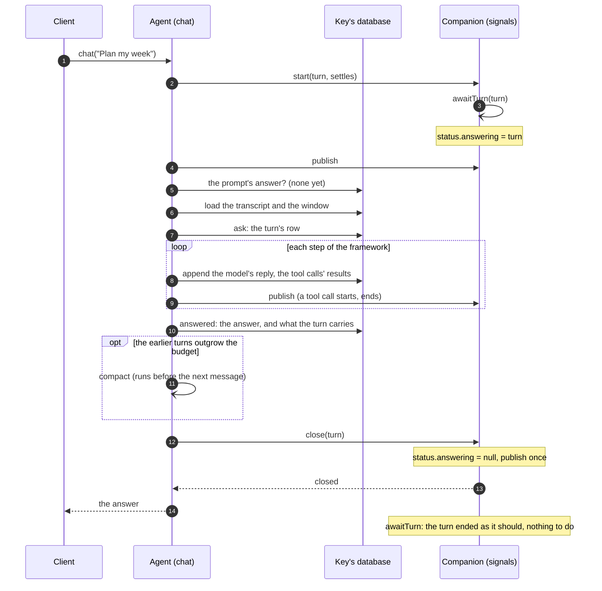
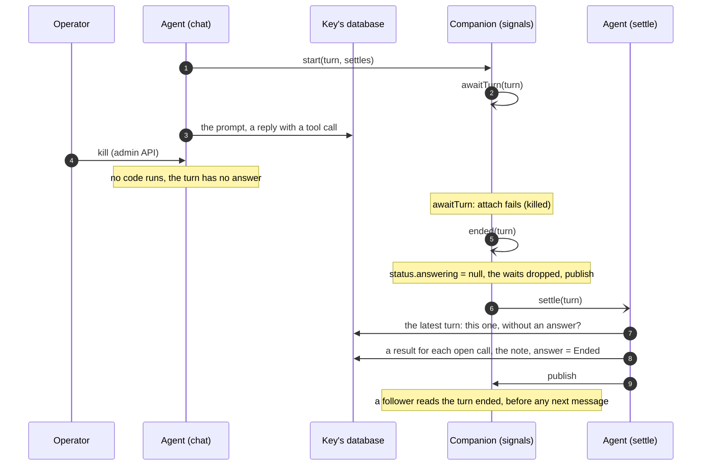
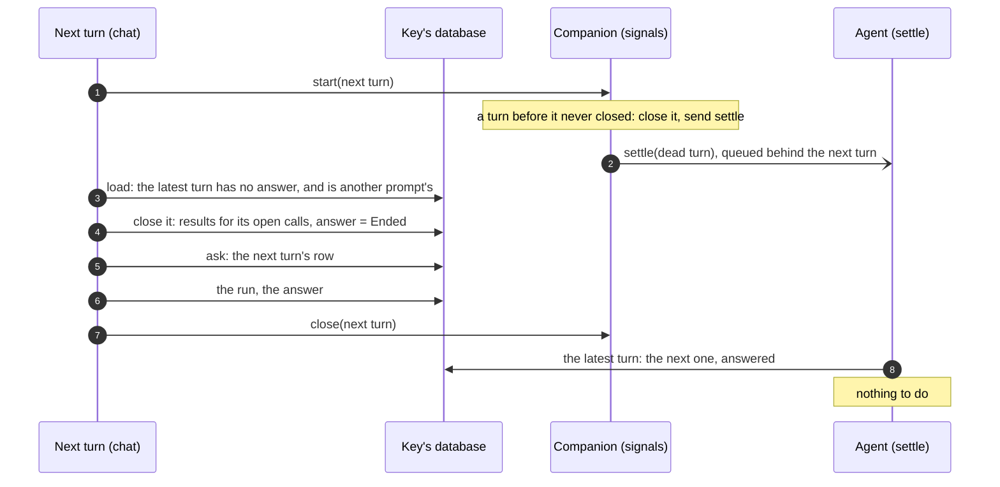
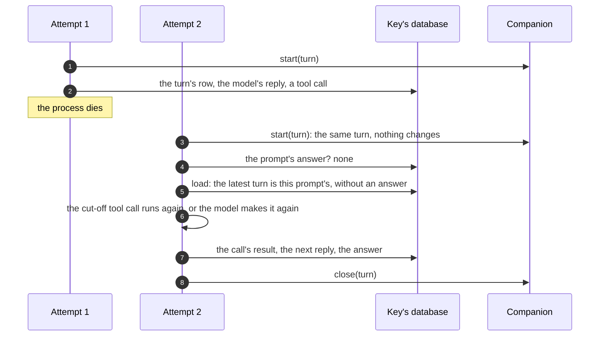
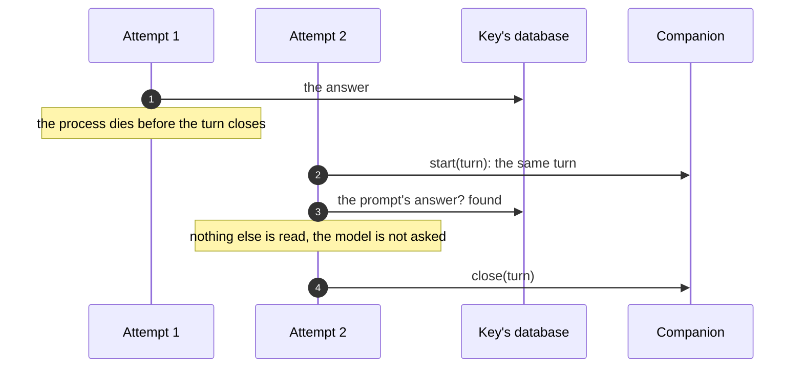
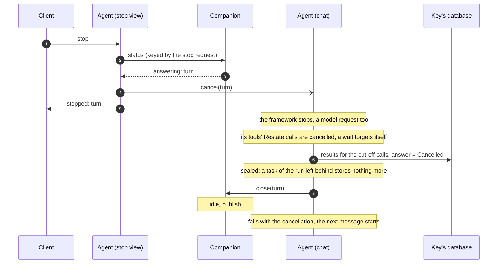
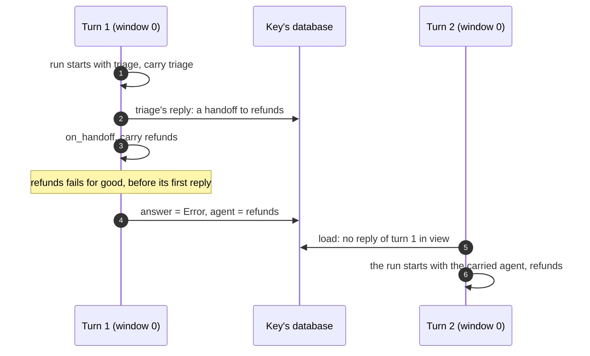
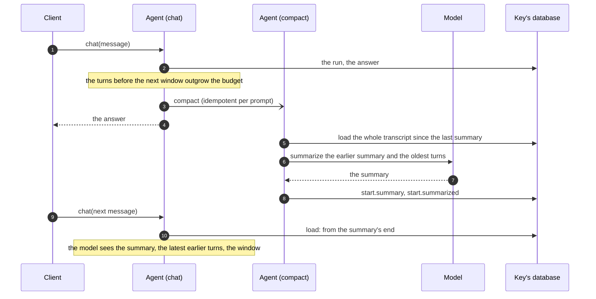

# Turn semantics

How an agent of `restate.agents` answers its messages: what a turn is, how it
starts and ends, what it stores and reads, what happens when it is retried,
stopped or killed, and what `status`, `messages` and a follower see along the
way.

The code lives in:

- [`_turn.py`](python/restate/agents/_turn.py): `chat_turn`, the turn;
- [`_conversation.py`](python/restate/agents/_conversation.py): the
  conversation, and `answer_once`, which answers a prompt;
- [`_signals.py`](python/restate/agents/_signals.py): the companion;
- [`_object.py`](python/restate/agents/_object.py): the views (`status`,
  `stop`, `clear`, `sync`, `watch`) and the private handlers (`settle`,
  `compact`, `erase`);
- [`_messages.py`](python/restate/agents/_messages.py): the conversation as
  clients read it;
- [`_calls.py`](python/restate/agents/_calls.py): the Restate calls of a
  turn's tools.

The TypeScript SDK's agents follow the same turn and companion
(`sdk-sessions/packages/agents/TURN-SEMANTICS.md`). How the conversation is
stored and loaded, and the `settle` and `compact` handlers, are this SDK's
(see [Agents of the TypeScript SDK](#agents-of-the-typescript-sdk)).

## Words

- **Agent, key.** A session object of `restate.agents`, such as `assistant`,
  and one of its keys, such as `alice`: one conversation, in its own SQL
  database.
- **Message.** One call of the agent's `chat` handler: one Restate
  invocation, whose id (`inv_1f…`) is also the message's id.
- **Turn.** The agent answering one message: its `chat` invocation, from its
  start to its end. A turn is the invocation, not one run of it.
- **Prompt.** What a turn asks its framework (OpenAI Agents, Pydantic AI,
  ADK, LangGraph): the message. Its id is the invocation's id, or
  `<id>:2`, `<id>:3` for later prompts of a handler that prompts more than
  once. A prompt is a turn of the conversation.
- **Attempt.** One run of a turn's invocation. A crash, a lost connection or
  a suspension ends an attempt; Restate starts another, which runs the
  handler again from its first line and resumes from what the database has.
- **Companion.** The agent's `signals` object, keyed `<agent>:<key>` (such
  as `assistant:alice`). It is a journaled virtual object, so it can wait
  (awakeables, timers) and be written while the turn runs. It keeps the
  running turn, the waits of its tools, and the conversation's revision.
  Nothing in it is needed to complete a turn: it is the control plane.
- **Revision.** A number the companion increases at every change a client
  could see (`publish`). `watch` and `sync` wait for a newer one.
- **Transcript.** Per turn: the prompt and the turn's answer.
- **Trajectory.** Per turn: everything else it stored, the model's replies,
  the tool calls and their results, compaction items.
- **Carried state.** What a turn hands to the turns after it that is no
  message: the agent the conversation is with (after a handoff), and the
  framework's own state (ADK's session state).
- **Window.** The turns the model sees whole, with their trajectories
  ([Which turns a turn loads](#which-turns-a-turn-loads)).

## One message at a time

A key answers one message at a time, in the order they came. `chat` is an
exclusive handler, and it keeps the key while it waits (suspended on a
signal, say): a message sent while the agent answers another waits in
Restate's queue for the key, and its turn starts when the one before it
ended. There is no steering: a message never joins the turn being answered.

So **turns never overlap.** At most one turn of a conversation has no
answer, and it is the latest. A turn that finds an earlier one without an
answer knows that turn's invocation is gone (killed, say): a live one would
still hold the key.

- **Answer now, or later.** `chat` answers with the answer. `chat/send`
  answers with the invocation's id at once, and
  `/restate/invocation/<id>/attach` waits for the answer, as often as you
  like.
- **Once.** A message sent with an idempotency key is one invocation,
  answered once, however often it is sent. A webhook's delivery (`deliver`)
  is a message of this kind, keyed by the delivery.
- **To change course,** stop the turn (`stop`) and send the message that
  replaces it: it is answered once the stopped turn ended, after any
  messages already waiting.

## A turn's life



1. **Start.** The turn calls the companion's `start(turn)`: from here,
   `status` says the agent answers it (`answering: {invocationId, since}`).
   It also says the agent has `settle` (see [Dead turns](#dead-turns)). A
   retried attempt calls `start` again with the same invocation, which
   changes nothing (it keeps when the turn started). `start` sends
   `awaitTurn(turn)`, the turn's watch.
2. **The prompt.** `answer_once` reads the prompt's answer by its id, one
   indexed read: a retried attempt of an answered turn returns it, and reads
   nothing more. Otherwise it loads the conversation
   ([Which turns a turn loads](#which-turns-a-turn-loads)), closes a turn
   left without an answer, and stores the prompt as the turn's row.
3. **Steps.** The framework answers: model calls and tool calls. Each step
   is stored as it comes (a reply in one transaction, each result as it
   comes back), and each tool call publishes as it starts and as it ends,
   so a follower sees the call start and its result.
4. **Answer.** The answer is stored on the turn's row, with what the turn
   carries. If the turns before the next turn's window outgrow the agent's
   budget, the agent sends itself `compact`
   ([Summaries](#summaries)).
5. **End.** The turn calls the companion's `close(turn)` and waits for it.
   `close` clears the turn and publishes: one revision for the turn's end,
   after its last write. Then the handler returns the answer, or raises the
   turn's error.

A **background** agent (`background=True`, a subagent say) publishes its
turn's end only: no step, nor its start, wakes a follower.

## How a turn ends

| How | The handler | In the conversation, the turn's answer | Who closes the turn in the companion | Then |
| --- | --- | --- | --- | --- |
| **Answered** | returns the answer | the answer | the turn | idle; the next message starts |
| **Refused** (a wrong API key, an unknown model) | fails with HTTP 424, for good | `Unanswered: …` | the turn | idle; the next message is answered on its own |
| **Failed for good** (a terminal error) | fails with it | `Error: <message>` | the turn | idle |
| **Stopped** (`stop`, `clear`, or Restate's cancel) | fails with the cancellation (409) | `Cancelled: …` | the turn | idle; its tools' calls are cancelled, their waits forgotten |
| **Crashed** (a process died, a retryable error) | none yet: Restate runs it again | none yet: the turn goes on | nobody: the turn is not over | still answering; the next attempt goes on with it |
| **Killed** (Restate's admin API) | runs no code | `Ended: …`, by `settle` or the next message | its watch (`awaitTurn`), at once | idle; its tools' waits dropped |
| **Out of retries** (100 000 attempts, about 11 days) | runs no code | `Ended: …`, as killed | its watch, if Restate fails it | idle; a turn Restate pauses instead stays answered until an operator acts |

A turn that closes itself (answered, refused, failed, stopped) closes its
run in the conversation first: each tool call without a result gets one (the
error its Restate call returned, a note that it did happen if it returned,
or else the note that ends the turn), then the note is the turn's last
reply, and its answer. So the next turn's model never sees a tool call
without a result, and knows how the turn ended.

Whoever closes a turn in the companion, a close does the same: it clears the
turn (if the agent still answers it), drops the waits of the turn's tools
(rejecting their awakeables, so a `wait` still parked ends), and publishes
once if either changed something. A second close of the same turn changes
nothing, and publishes nothing.

## Dead turns

A turn closes itself only if its code runs to the end. A killed turn runs
none, so its turn has no answer, and must not be finished: it is over. Two
things close it, whichever comes first.

### The companion notices: `settle`

The companion watches each turn it starts: `awaitTurn(turn)`, a shared
handler, waits on the turn's invocation (`attach`), holding no process. If
the invocation failed without closing its turn, the companion closes it,
and sends the agent `settle(turn)`, a private handler that closes the turn
in the conversation.



- **The calls' outcomes.** A tool call whose Restate call returned before
  the kill gets "done, but its result was not recorded" rather than the
  note: the model would take it for undone, and do it again. `settle` reads
  the outcomes the dead invocation stored, while they are still there (the
  next invocation of the key replaces them).
- **Idempotent.** `settle` closes the latest turn only if it is the dead
  invocation's and has no answer. A turn the next message closed first is
  left as it is.
- **An hour at most.** The watch races `attach` against an hour's sleep. A
  turn still answered then gets a new watch, and this one ends: no watch
  waits for weeks (a turn waiting for an approval, say) on the deployment it
  started on.
- **A cancelled watch** (an operator's) closes nothing: the turn may still
  run.

### The next message comes first

A message queued behind the killed turn may start before the watch closed
it. Its `start` closes the turn before it in the companion (and sends
`settle`, which waits behind it for the key), and its `answer_once` finds
the turn without an answer, and closes it the same way, before its own
prompt.



### Which closes it, a table

| The dead turn is closed by | When | Its calls' outcomes |
| --- | --- | --- |
| `settle`, from the companion's `awaitTurn` | as soon as Restate fails the invocation | read, if still stored |
| `settle`, from the next turn's `start` | after the next turn, which closed it first | (the next turn did) |
| the next turn's `answer_once` | before its prompt | read, if still stored (the next turn stored none yet) |

## Attempts: crashes and retries

A crash (a process that dies, a lost connection, a retryable error) ends an
attempt, not the turn. Restate runs the handler again from its first line,
and the turn goes on from what the database has:



And a crash after the answer was stored:



- **The prompt, once.** Every attempt asks for the same prompt id, which
  finds the turn stored, answered or unfinished, rather than asking the
  model again. A run that stored its final reply but not its answer answers
  with that reply.
- **Tool calls, once.** A tool call has an idempotency key of the
  invocation and its call id, `<invocation>:<call id>`. Restate's own tools
  (`call`, `send`, `workflow`, `subagent`, `wait_for_signal`) make their call
  once however often the tool call runs: a framework that gives a cut-off
  call a new id gets the earlier call's id back
  ([`_calls.py`](python/restate/agents/_calls.py)).
- **Waits survive.** A tool waiting for a signal waits in the companion
  (`wait`), by that key: the next attempt rejoins the same wait, and the
  turn is still answered meanwhile.
- **A dead attempt stops.** An attempt that ends while its process lives on
  (Restate suspended it, gave up on it, or lost its connection) stops its
  work, a model's request included: it can store nothing more, and the next
  attempt goes on. This is not a cancellation: the turn goes on.

## Stopping a turn

`stop` cancels the invocation of the message being answered: Restate's
cancellation, as its admin API's `PATCH /invocations/<id>/cancel`.



- The view asks `status` with an idempotency key of its request: a `stop`
  that Restate runs again gets the same turn, and cancels it again (which
  does nothing), never the message that started after it.
- The turn ends cancelled whenever the cancellation comes, and the next
  message starts afresh: the cancelled prompt is over.
- A cancellation that comes once the turn answered changes nothing: the
  answer stands.
- `clear` stops the turn the same way, then forgets the conversation (the
  key's database, the companion's waits and kept signals). A message sent
  before `clear` is answered first, then forgotten too. Message ids and
  cursors carry on.

## The conversation

### What a turn stores

The conversation is two tables in the key's database, and a row of where it
starts:

```sql
restate_agent_turns  (n, seq, prompt, item, answer, agent, carried)  -- the transcript: one row per turn
restate_agent_items  (n, turn, seq, item, reply, agent)              -- the trajectories
restate_agent_conversation_start (n, seq, summary, summarized)       -- the first position, the last seq, the summary
```

- **Positions.** The two tables share one sequence of positions (`n`), the
  ids of the messages that `messages` shows. A turn's prompt has the turn's
  position; its items come after it, before the next turn's.
- **`seq`** increases with every row written, so that a client can ask what
  changed since a cursor. Storing an answer, an agent or a state does not
  increase it: they are for the model, and the view shows the reply rows.
- **Appends only.** Rows are appended, in one transaction per step. A
  reply at the end can be dropped (to ask the model again: an output
  guardrail tripped, say), which is one range delete; its `seq` is kept in
  the start row, so cursors never go back.
- **Each item is the framework's own** (a message, an event), stored and
  loaded by the framework (`Items.dump`, `Items.load`).

### Which turns a turn loads

A turn reads what it needs, not the whole conversation:

1. The start row, and the last position and `seq` given.
2. The transcript, from the latest turn back, 64 turns at a time, until it
   holds the window and the earlier turns that the budget holds (the model
   sees no more of them), or the summary's end.
3. The trajectories of the window's turns: one range read, from the first
   window turn's position on.

The **window** is, from the latest turn back:

- every turn its framework did not answer: the one being answered (only the
  latest can be one), and any that another invocation ended (`Ended: …`).
  Their framework never finished them, so what they carried is a guess, and
  the next turn reads what happened from their rows;
- then the latest `window` turns their framework answered.

| Turns, oldest first | `window` | Loaded whole |
| --- | --- | --- |
| a, b, *being answered* | 1 | b, *being answered* |
| a, b, *being answered* | 0 | *being answered* |
| a, *ended*, *being answered* | 0 | *ended*, *being answered* |
| a, *ended*, c, *being answered* | 1 | c, *being answered* (c carried on from the ended turn) |

`window` is an agent option (default 1: the previous turn's tool calls stay
in view, for a follow-up), or `"all"`. A LangGraph graph agent loads at least
the previous turn whole, to give its graph what closed it.

### What the model sees

`Conversation.history()`, in order:

1. The summary of the earliest turns, if they have one: a user's message
   with it, and the assistant's acknowledgement.
2. The turns before the window, as their prompt and answer: the latest of
   them that the agent's `budget` holds (32 000 tokens by default, counted
   as 4 characters each).
3. The window's turns, whole.

The model sees the earlier turns' messages, not their tool calls: those of
the window only. The `messages` view shows every turn whole, as stored.

### What a turn carries

The agent and the framework's state are stored with the turn's answer, one
update of its row, by `answered`, also when the turn is closed:

- **The agent**: the agent the conversation is with. For OpenAI, the agent
  a run starts with, then the agent of each handoff, as it happens, even if
  the turn ends before that agent replies; else the agent of the turn's
  latest reply; else the previous turn's.
- **The state**: ADK's session state, as of the turn's end; else the
  previous turn's.

The next turn resumes with them when its window holds none of their source:
an OpenAI run with no reply in view starts with the carried agent; ADK's
session starts from the state the latest turn ADK answered carried, with the
changes of the loaded turns after it.



Had turn 1 been killed instead, `settle` would close it (`Ended: …`), and
turn 2 would load it whole, whatever its window, and find the handoff in it.

## Summaries

Once a turn is answered, if the turns before the next turn's window outgrow
the agent's budget, the agent sends itself `compact`, a private exclusive
handler. It runs before the key's next message.



- **What is summarized:** the turns before the next window, but the latest
  that half the budget holds, which stay as they are, with the summary
  before. Turns stay stored, and `messages` shows them as before.
- **Who summarizes:** the built-in agents of each framework, with their own
  model. An agent you configure yourself only trims the earliest turns.
- **A summary that fails** is logged, and tried again after the next turn.
  The turn's answer is already returned.
- Within a turn, the frameworks' own compaction still applies: OpenAI's
  server-side compaction, Pydantic AI's provider compaction, LangGraph's
  `trim_messages`.

## Several prompts in one handler

A handler of your own may prompt more than once (`openai.prompt(ctx, …)`
twice, say): each prompt is a turn of the conversation, `<id>`, then
`<id>:2`. A retried attempt makes them in the same order, so each finds its
own answer, and the companion's turn is the invocation, all of them.

## What a client sees

| View | What it gives |
| --- | --- |
| `status` | `answering`: the turn from its `start` to its close, or null; `waiting`: its tools' waits |
| `pending` | the waits, oldest first, each with its id (`<turn>:<call>`) for `signal` |
| `messages` | the conversation as stored: every turn, with its tool calls and their outputs, and how a closed turn ended |
| `notifications`, `watch` | the revision; `watch` waits (up to a minute) for a newer one |
| `sync` | the revision, `status`, and the messages since a cursor, at once: what a follower reads |

The revision increases at:

- a turn's start, and each of its tool calls' start and end (not in the
  background);
- a turn's close: its own, its watch's, or the next turn's `start` closing
  it;
- `settle`, once it closed a dead turn in the conversation;
- a wait that starts, is resolved by a `signal`, or is forgotten (a
  cancelled turn's);
- `clear`.

So a follower that reads each new revision sees every turn begin, its tool
calls, its end, and a killed turn end.

## Agents of the TypeScript SDK

The companion's handler names are shared with the TypeScript SDK, so one
deployment's `signals` may hold the turns of the other's agents. An agent
says it has `settle` as it starts a turn (`Started.settles`, which `status`
does not show), and only such a turn is sent it:

- a TypeScript agent's turn that this SDK's companion holds is closed in the
  companion, and its agent is sent nothing;
- this SDK's agent whose turn the TypeScript companion holds has a dead turn
  closed by its next message.

## Guarantees and limits

- **One turn at a time per key**, in the order messages came. A turn is
  never joined by another message.
- **A turn is completed from its own rows**, and reads a bounded part of the
  conversation: the transcript the budget holds, and the window.
- **`status` says the turn being answered** from its start to its close,
  however it ends: answered, refused, stopped, killed, or out of retries
  (if Restate fails it). A crashed turn is still being answered: it is.
- **A dead turn is closed, never finished**, by `settle` or the next
  message, with a result for each of its open calls.
- **A turn's waits end with it**: a cancelled turn's forget themselves; a
  killed turn's are dropped when it closes.
- **A turn's work is done once** across attempts: its prompt by its id,
  Restate's calls by their idempotency keys. A tool of your own does
  something once if it uses the idempotency key it is given.
- **Limits:**
  - A LangGraph graph that trims its run's prompt away has the messages it
    keeps copied by id: those of the loaded turns are not copied again.
  - An agent without a summary trims its earliest turns one at a time, so
    the start of the model's input changes at each turn, and a provider's
    prompt cache misses.
  - A crash right after an answer is stored leaves the turn's finished
    Restate calls recorded until the key's next invocation replaces them.
  - A summary that keeps failing is tried again after each turn.
  - Waits started by a handler other than `chat` (your own handler that
    prompts a framework with a `wait_for_signal` tool) are not turns: if
    that handler is killed, its waits stay in `pending` until a `signal`
    resolves them or `clear` forgets them.
