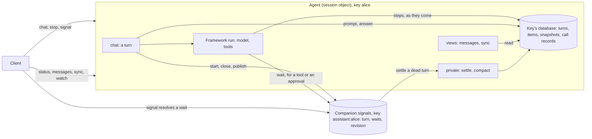

# `restate.agents`

`restate.agents` runs an AI agent as a Restate session object. Each key of the
agent (a user, a thread) is one conversation, kept in that key's own SQL
database, answered one message at a time, and completed exactly once through
crashes, retries, suspensions and stops. A framework (the OpenAI Agents SDK,
Pydantic AI, Google ADK, LangGraph) runs the model and the tools;
`restate.agents` owns the conversation, the turn, and the durability around
them.

These pages are the reference for how it works and why: the semantics, the
data, what the model gets, each framework's integration, what we learned
building it, and how to port it.

## In brief

- **A conversation is a sequence of turns.** A turn is one prompt and what
  answers it: its steps (the model's replies, tool calls and results) and its
  answer. Turns never overlap, so at most one turn has no answer: the latest.
- **The turn is the unit of storage.** One row per turn (the transcript),
  and every other item tagged with its turn (the trajectories), in one
  sequence of positions that are the message ids clients see.
- **The model's input is composed in one place,** `history()`: the turn
  projection (a summary, the earlier turns' messages and answers within a
  budget, the latest turns whole), or, for a framework that compacts its own
  history, the latest snapshot of it and everything after.
- **Every write is the turn's own, made once:** the prompt by its id, a
  tool's Restate calls by idempotency keys. A retried attempt resumes from
  what is stored; it doesn't replay.
- **A turn whose invocation dies is closed, never finished:** `settle`, or
  the next message, gives each open call a result and ends the turn as
  `ended`.
- **The companion** (the `signals` object) is the control plane: the turn
  being answered, the tools' waits, and a revision clients follow. Nothing in
  it is needed to complete a turn.

## The pages

| Page | What it holds |
| --- | --- |
| [Turn semantics](turns.md) | what a turn is; its life, its end, attempts, stops, dead turns and `settle`; the turn model; what clients see; the guarantees |
| [The conversation](conversation.md) | the data layout (every table), a worked example, which turns a turn reads, what the model gets (the turn projection, summaries, snapshots), what a turn carries, the call records, the schemas |
| [The frameworks](frameworks.md) | per framework: what it expects, how we map onto it, and what we learned |
| [What we learned](learnings.md) | the research (coding agents, frameworks), the decisions and why, the lessons, the bugs a review found, the open questions |
| [Porting to sdk-sessions](porting.md) | where the TypeScript agents stand, what to port in which order, what must hold, and the tests that define it |
| [Access patterns](access-patterns.md) | what a turn and a view read and write in Restate state, warm and cold, before and after the turns; the statements that cost most, and what to change |
| [Testing](testing.md) | what the tests cover, the gaps, the mutants that bring past bugs back, and the strategy |
| [Steps retention](steps-retention.md) | future work: deleting the steps no model reads any more |

To understand it, read them in this order: this page, turns, the
conversation, the frameworks. To port it, read [Porting](porting.md) first,
then the same.

## The code

| Module | What it is |
| --- | --- |
| [`_turn.py`](../../python/restate/agents/_turn.py) | the turn's wrapper: start and close in the companion, cancellation, attempts |
| [`_conversation.py`](../../python/restate/agents/_conversation.py) | the conversation: its tables, `Conversation`, `Turn`, `answer_once`, `compact`, `settle` |
| [`_messages.py`](../../python/restate/agents/_messages.py) | the conversation as clients read it (`messages`, `sync`) |
| [`_signals.py`](../../python/restate/agents/_signals.py) | the companion |
| [`_object.py`](../../python/restate/agents/_object.py) | the agent object: `chat`, the views, the private handlers |
| [`_calls.py`](../../python/restate/agents/_calls.py) | the call records: a tool's Restate calls, made once |
| [`_tools.py`](../../python/restate/agents/_tools.py) | the tools built on Restate (`call`, `send`, `workflow`, `subagent`, `wait_for_signal`), and `wait_for` |
| [`internal.py`](../../python/restate/agents/internal.py) | what a framework integration uses from the core |
| `openai/`, `pydantic_ai/`, `adk/`, `langgraph/` | the integrations: each `_agent.py` starts with what it does |
| [`scripts/resurrect.py`](../../scripts/resurrect.py) | brings past bugs back, one at a time, to see which tests notice |
