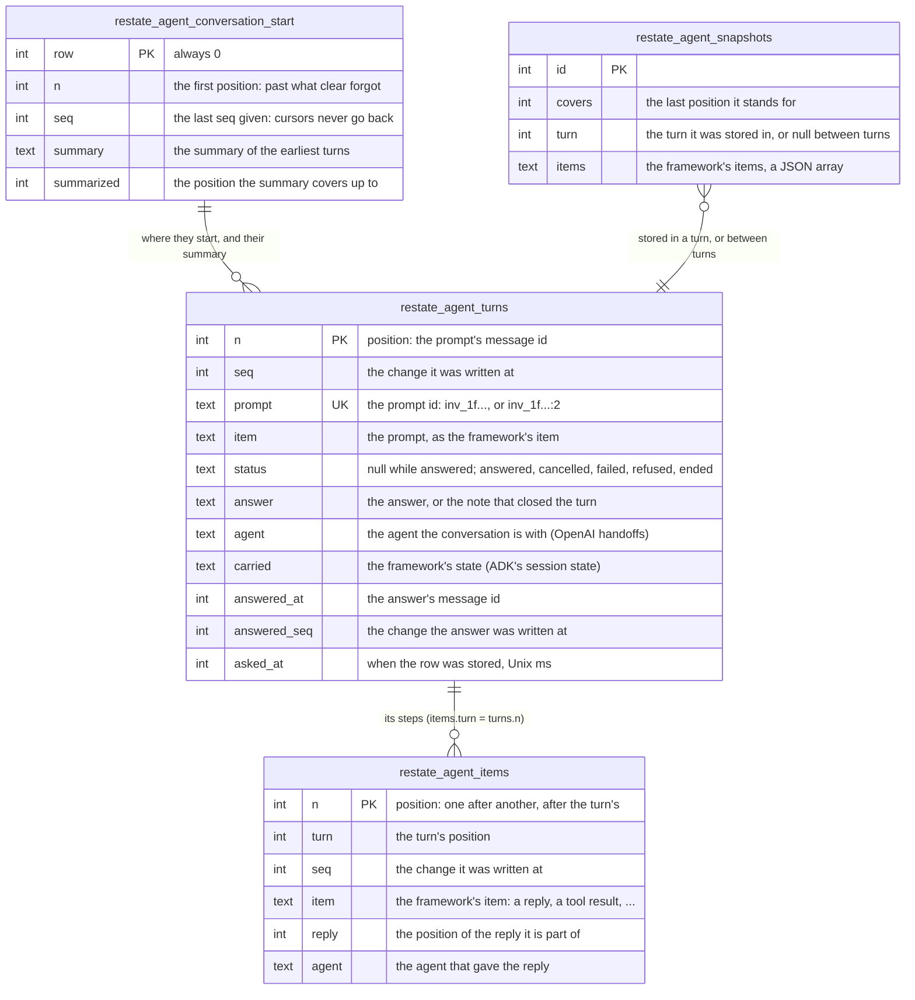
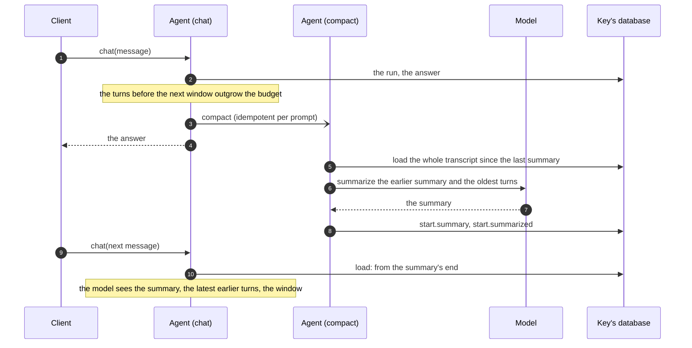
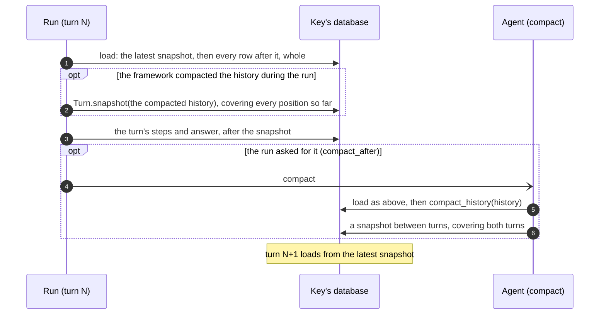
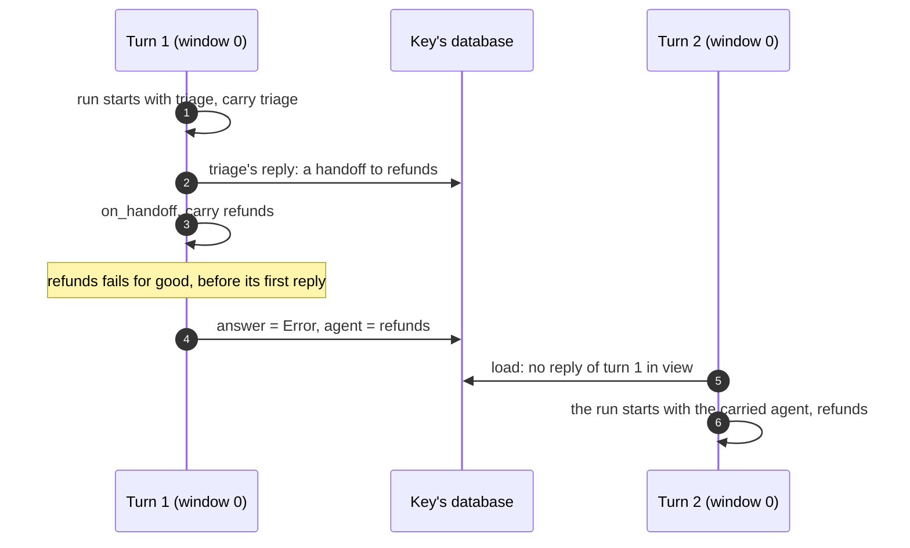

# The conversation

What an agent's conversation is made of, how it is stored, which part of it a
turn reads, and what the model gets. The turn itself (its life, its end,
attempts, stops, dead turns) is in [Turn semantics](turns.md).

The code is [`_conversation.py`](../../python/restate/agents/_conversation.py)
(the tables, `Conversation`, `Turn`, `answer_once`, `compact`),
[`_messages.py`](../../python/restate/agents/_messages.py) (the `messages`
view) and [`_calls.py`](../../python/restate/agents/_calls.py) (the call
records).

## Conversation and turns

- **A conversation is a key's database.** Each key of an agent (`alice` of
  `assistant`) has its own SQL database, and its conversation is the tables
  below in it. Nothing in it is shared with another key.
- **A conversation is a sequence of turns,** in the order their messages
  came. A turn is one prompt and what answers it:
  - its **row**: the prompt, then, once the turn ends, its status, its answer
    and what it carries to later turns. The rows together are the
    *transcript*;
  - its **steps**: everything else it stored, the model's replies, the tool
    calls and their results, a message that asked again. A turn's steps are
    its *trajectory*.
- **Turns never overlap**, so at most one turn has no answer: the latest
  ([One message at a time](turns.md#one-message-at-a-time)).
- **Every row belongs to one turn,** and only the latest turn, while it has
  no answer, is written ([The turn model](turns.md#the-turn-model)).
- **The model's input is composed from the turns in one place,**
  `Conversation.history()`, in one of two ways: the
  [turn projection](#what-the-model-sees), or
  [history from snapshots](#history-from-snapshots).
- **Clients read the turns as stored**, in two projections of the same rows:
  the full view (every step) and the summary view (each turn's message and
  answer), under the same message ids.



## The tables

### The conversation

Schema `restate_agents.turns`, in every key's database:

```sql
CREATE TABLE restate_agent_turns (           -- the transcript: one row per turn
    n INTEGER PRIMARY KEY,                   -- the turn's position
    seq INTEGER NOT NULL,
    prompt TEXT NOT NULL UNIQUE,             -- the prompt's id
    item TEXT NOT NULL,                      -- the prompt, as the framework's item
    status TEXT,                             -- NULL while the turn is answered
    answer TEXT,
    agent TEXT,                              -- what the turn carries: the agent...
    carried TEXT,                            -- ...and the framework's state
    answered_at INTEGER,                     -- the answer's message id
    answered_seq INTEGER,
    asked_at INTEGER                         -- Unix milliseconds
);
CREATE INDEX restate_agent_turns_seq ON restate_agent_turns (seq);
CREATE INDEX restate_agent_turns_answered_seq ON restate_agent_turns (answered_seq);

CREATE TABLE restate_agent_items (           -- the trajectories: every other item of a turn
    n INTEGER PRIMARY KEY,                   -- its position, after its turn's
    turn INTEGER NOT NULL,                   -- the turn's position
    seq INTEGER NOT NULL,
    item TEXT NOT NULL,
    reply INTEGER,                           -- the reply it is part of
    agent TEXT
);
CREATE INDEX restate_agent_items_seq ON restate_agent_items (seq);

CREATE TABLE restate_agent_conversation_start (   -- one row, written by clear, summaries and drops
    row INTEGER PRIMARY KEY CHECK (row = 0),
    n INTEGER NOT NULL,                      -- the first position
    seq INTEGER NOT NULL,                    -- the last seq given
    summary TEXT,                            -- the summary of the earliest turns
    summarized INTEGER                       -- the position it covers up to
);

CREATE TABLE restate_agent_snapshots (       -- the latest only, for agents with snapshots
    id INTEGER PRIMARY KEY,
    covers INTEGER NOT NULL,
    turn INTEGER,
    items TEXT NOT NULL
);
```

- **Positions.** The two tables share one sequence of positions (`n`), the
  ids of the messages that `messages` shows. A turn's prompt has the turn's
  position; its items come after it, before the next turn's. Turns and
  items are each one range of the primary key, so a turn's steps are one
  range read, and dropping a reply is one range delete.
- **`seq`** increases with every row written, so that a client can ask what
  changed since a cursor. A turn's answer takes one too (`answered_seq`),
  for the summary view; its message's id is `answered_at`, the turn's last
  message of the assistant, the id the full view shows it under.
- **Appends only.** Rows are appended, in one transaction per step. A
  reply at the end can be dropped (to ask the model again: an output
  guardrail tripped, say), which is one range delete; its `seq` is kept in
  the start row, so cursors never go back.
- **Each item is the framework's own** (a message, an event), stored and
  loaded by the framework (`Items.dump`, `Items.load`). The core reads it
  only through `Items.read`: what was said, the tool calls, the results.
- **`reply`** groups the items of one model reply (OpenAI's response is
  several items, say), so that the full view shows it as one message, and
  `drop` removes it whole.
- **The start row** is there only once `clear`, a summary or a dropped
  reply wrote it. With none, the conversation starts at position 0, with no
  summary.
- **`asked_at`** is when the turn's row was stored, in Unix milliseconds: a
  run's start time, for a framework that lists runs (Pydantic AI Harness's
  `ConversationSearch`, say).
- **A snapshot** takes no position of its own, so message ids and cursors
  don't depend on it, and it is never shown
  ([History from snapshots](#history-from-snapshots)).

### Around the conversation

| Where | What | Written by |
| --- | --- | --- |
| `restate_agent_calls` (schema `restate-agents.calls`), in the key's database | one row: the invocation's Restate calls made by tools, as JSON ([Tool calls, once](#tool-calls-once-the-call-records)) | the tools built on Restate (`call`, `send`, `workflow`, `subagent`, `wait_for_signal`) and `wait_for` |
| the companion's state: the `signals` object, keyed `<agent>:<key>` | `turn`: the turn being answered (`Started`: its invocation, since when, whether the agent `settles`); `waiting`: the tools' waits, each with its awakeable; `kept`: signals that came before their wait; `revision`; `watching`: the `watch` calls waiting for a newer revision | the companion's handlers (`start`, `close`, `wait`, `signal`, `publish`, `watch`) |
| `restate_langgraph_checkpoints`, `restate_langgraph_channel_values`, `restate_langgraph_writes` (schema `restate_agents.langgraph`) | a LangGraph graph's checkpoints, channel values by version, and pending writes, per thread and namespace | `SqlCheckpointSaver`, for `langgraph.agent(graph=...)`; pruned to what the latest checkpoint of each namespace needs after each run |
| `restate_pydantic_ai_plan`, `restate_pydantic_ai_spills`, `restate_pydantic_ai_journal` (schema `restate_agents.pydantic_ai`) | the harness's plan (`plan_store()`), spilled tool results (`overflow_store()`), and each tool call's journal of plan reads and writes, for the current invocation | the Pydantic AI stores |
| `restate_pydantic_ai_memory`, `..._receipts`, `..._generation` (schema `restate_agents.pydantic_ai.memory`), in a memory object's key | the harness's memory files, the receipts of the changes, and the version counter: one key per namespace (a user), shared by that user's conversations | `memory()`'s session object |

`clear` empties the key's database (every table above but the memory
object's), the companion's waits and kept signals, and keeps where the ids
and cursors got to.

## A worked example

Four messages to one key, with `window=1`, on the made-up framework of the
tests (its items are dicts). The rows below are what the code stores; the
invocation ids are shortened to `inv_A` to `inv_D`.

1. **A, answered with a tool call.** "What's the weather in Lisbon?": the
   model calls `weather`, gets the result, and answers.
2. **B, asked again.** "Reply in JSON": the first reply is prose, so the
   turn's check asks again within the turn, and the second reply is the
   answer.
3. **C, killed.** "Book a table for 8pm": the model calls `book`, and the
   invocation dies before the call returns. Nothing runs it again.
4. **D, answered.** "Hello?": before its prompt, D finds C without an
   answer, and closes it.

`restate_agent_turns`:

| n | seq | prompt | item | status | answer | answered_at | answered_seq |
| --- | --- | --- | --- | --- | --- | --- | --- |
| 0 | 1 | `inv_A` | user: What's the weather in Lisbon? | answered | Sunny and 24°C in Lisbon. | 3 | 5 |
| 4 | 6 | `inv_B` | user: Reply in JSON | answered | `{"weather": "sunny"}` | 7 | 10 |
| 8 | 11 | `inv_C` | user: Book a table for 8pm | ended | Ended: the turn ended before it finished, and was not answered. | 11 | 15 |
| 12 | 16 | `inv_D` | user: Hello? | answered | Hello! The table wasn't booked: shall I try again? | 13 | 18 |

`restate_agent_items`:

| n | turn | seq | item | reply | Who wrote it |
| --- | --- | --- | --- | --- | --- |
| 1 | 0 | 2 | assistant: call `c1` `weather(city="Lisbon")` | 1 | A's run |
| 2 | 0 | 3 | result `c1`: sunny, 24°C | | A's run |
| 3 | 0 | 4 | assistant: Sunny and 24°C in Lisbon. | 3 | A's run |
| 5 | 4 | 7 | assistant: Sure: sunny. | 5 | B's run |
| 6 | 4 | 8 | user: Reply again, with JSON only. | | B's check (`ask_again`) |
| 7 | 4 | 9 | assistant: `{"weather": "sunny"}` | 7 | B's run, again |
| 9 | 8 | 12 | assistant: call `c2` `book(place="Taberna", at="20:00")` | 9 | C's run |
| 10 | 8 | 13 | result `c2`: Ended: … | | D, closing C |
| 11 | 8 | 14 | assistant: Ended: … | | D, closing C |
| 13 | 12 | 17 | assistant: Hello! The table wasn't booked: shall I try again? | 13 | D's answer, stored as its reply |

What to notice:

- **Positions interleave.** A's row is 0 and its steps 1 to 3; B's row is 4.
  Each turn's rows and steps are one range of positions.
- **`seq` follows writes, not positions.** C's closing rows (10, 11) were
  written by D's invocation, before D's own row (seq 16). The answer of each
  turn takes a `seq` of its own (`answered_seq`), after its steps.
- **Every turn ends with an assistant message**, whose position is
  `answered_at`: A's last reply (3), B's reply to the ask (7), C's closing
  note (11), and D's answer, which its run returned without a reply, so the
  turn stored it as one (13).
- **A dead turn is closed, not finished.** C's open call `c2` got a result
  (the note: its Restate call never returned), then the note is C's last
  reply and its answer, with status `ended`.
- **Asking again is a step, not a turn.** B's "Reply again" is an item of B,
  a message of the user.

The `messages` view, `view: "summary"`: each turn's message and answer,
under the full view's ids.

| id | role | text |
| --- | --- | --- |
| 0 | user | What's the weather in Lisbon? |
| 3 | assistant | Sunny and 24°C in Lisbon. |
| 4 | user | Reply in JSON |
| 7 | assistant | `{"weather": "sunny"}` |
| 8 | user | Book a table for 8pm |
| 11 | assistant | Ended: … |
| 12 | user | Hello? |
| 13 | assistant | Hello! The table wasn't booked: shall I try again? |

`view: "full"` (the default) shows every step: id 1 is the tool call `c1`
with its output (the result at position 2 is folded into its call, so 2 is
no message of its own), then 3; B's 5, 6 and 7; C's 9 (`c2`, with the closing
note as its output) and 11; D's 12 and 13.

What D's model got (`history()`, with `window=1`):

| Item | From |
| --- | --- |
| user: What's the weather in Lisbon? | A, before the window: its prompt… |
| assistant: Sunny and 24°C in Lisbon. | …and its answer, without its tool call |
| user: Reply in JSON | B, the latest turn its framework answered: whole |
| assistant: Sure: sunny. | |
| user: Reply again, with JSON only. | |
| assistant: `{"weather": "sunny"}` | |
| user: Book a table for 8pm | C, ended: whole, whatever the window |
| assistant: call `c2` `book(...)` | |
| result `c2`: Ended: … | |
| assistant: Ended: … | |
| user: Hello? | D, the turn being answered |

The window is, from the latest turn back, every turn its framework didn't
answer (D, being answered, and C, ended), then the latest `window` turns it
answered (B). A is before the window: the model sees its prompt and answer
only, within the budget.

## Which turns a turn loads

A turn reads what it needs, not the whole conversation:

1. The start row, and the last position and `seq` given.
2. The transcript, from the latest turn back, 64 turns at a time, until it
   holds the window and the earlier turns that the budget holds (the model
   sees no more of them), or the summary's end.
3. The trajectories of the window's turns: one range read, from the first
   window turn's position on.

The **window** is, from the latest turn back:

- every turn its framework did not answer: the one being answered (only the
  latest can be one), and any that another invocation ended (`Ended: …`).
  Their framework never finished them, so what they carried is a guess, and
  the next turn reads what happened from their rows;
- then the latest `window` turns their framework answered.

| Turns, oldest first | `window` | Loaded whole |
| --- | --- | --- |
| a, b, *being answered* | 1 | b, *being answered* |
| a, b, *being answered* | 0 | *being answered* |
| a, *ended*, *being answered* | 0 | *ended*, *being answered* |
| a, *ended*, c, *being answered* | 1 | c, *being answered* (c carried on from the ended turn) |

`window` is an agent option (default 1: the previous turn's tool calls stay
in view, for a follow-up), or `"all"`. A LangGraph graph agent loads at least
the previous turn whole, to give its graph what closed it.

## What the model sees

`Conversation.history()`, in order:

1. The summary of the earliest turns, if they have one: a user's message
   with it, and the assistant's acknowledgement.
2. The turns before the window, as their prompt and answer: the latest of
   them that the agent's `budget` holds (32 000 tokens by default, counted
   as 4 characters each).
3. The window's turns, whole.

The model sees the earlier turns' messages, not their tool calls: those of
the window only. The `messages` view shows every turn whole, as stored.

This is a contract for every integration on the turn projection: **earlier
turns reach the model only from their rows** (each as its prompt, then
`Items.reply(answer, agent)`), so a framework must never depend on an
earlier turn's steps outside the window. What it needs from them, it
carries ([What a turn carries](#what-a-turn-carries)).

This is the *turn projection*, which every agent gets unless its framework
compacts the history itself.

## Summaries

Once a turn is answered, if the turns before the next turn's window outgrow
the agent's budget, the agent sends itself `compact`, a private exclusive
handler. It runs before the key's next message.



- **What is summarized:** the turns before the next window, but the latest
  that half the budget holds, which stay as they are, with the summary
  before. Turns stay stored, and `messages` shows them as before.
- **Who summarizes:** the built-in agents of OpenAI, ADK and LangGraph, with
  their own model. An agent you configure yourself only trims the earliest
  turns. A LangGraph graph agent never summarizes: its model reads the
  graph's state.
- **The summary's form** is the framework's (`Items.summary`). OpenAI's is one
  user message, `SUMMARY` and the text, as Codex sends its summary. ADK and
  LangGraph keep the default: a user message, then the assistant's
  "Understood.".
- **A summary that fails** is logged, and tried again after the next turn.
  The turn's answer is already returned.
- Within a turn, the frameworks' own compaction still applies: OpenAI's
  server-side compaction (always on for the built-in agent on a Responses
  model), and LangGraph's `trim_messages`. A user's ADK `App` events
  compaction is turned off, with a warning: ADK re-sorts a compacted session
  by time, which put our replies and summaries out of order.
- **An agent with snapshots** doesn't summarize this way. Its framework
  compacts during a run and stores a snapshot. That is the Pydantic AI agent:
  Pydantic AI Harness's `TieredCompaction` compacts at 80% of the model's
  window, and the rewritten history is stored before the request goes out
  (without system prompts, and without the input usage that measured the
  history before it). An `Agent` of your own with no compaction capability
  gets the same default. To compact off the answer's
  path, a run calls `compact_after()`, and `compact` hands the history to
  the agent's `compact_history`, then stores what it returns as a snapshot
  between turns. `compact` leaves a turn without an answer alone: the next
  message closes it first.

## History from snapshots

An agent whose framework compacts the history itself (Pydantic AI, with
Pydantic AI Harness) takes it from *snapshots* instead
(`chat(..., snapshots=True)`). A snapshot is the history as the framework's
compaction left it, which the framework stores in its turn with
`Turn.snapshot(items)`. It stands for every position stored so far
(`covers`), and takes no position of its own.

- **What the model sees:** the latest snapshot's items, then every item
  stored after `covers`, whole. Before the first snapshot, that is the whole
  conversation. `window`, `budget` and our summaries don't apply.
- **What a turn loads:** the latest snapshot, then every turn from the one
  that stored it (or, for one stored between turns, the first turn after
  it), whole. The latest turn is loaded whole too while it has no answer, so
  that it is carried on or closed.
- **Opting in.** `chat(..., snapshots=True)`, kept in `AgentInfo`, so that
  `answer_once` and `compact` agree. `window`, `budget` and `summarize` are
  then ignored, not refused: an agent's options belong to its object, which a
  framework's `agent()` builds. `compact_history` without `snapshots` is
  refused.
- **Known results.** The ids of the tool results inside the snapshot count
  as known (`knows_result`), so the framework doesn't store them again.
- **Crashes.** A snapshot is one write, under the turn's ownership rule: a
  retried attempt loads it, and carries on from it.
- **Only the latest is kept.** A snapshot takes the place of the earlier
  ones in the same write, as nothing reads them again.
- **Drops.** A reply that a snapshot covers can't be dropped.
- **What clients see doesn't change.** The views read turn rows and items
  only, so they never show a snapshot. `clear` drops snapshots with every
  other table.



**An example.** Three turns, `q1` to `q3`, on the made-up framework. In
`q2`'s run, the framework compacts the history before its request, and
stores what it will send from then on:

| Turn | Positions | What the run did | What its model got (`history()`) |
| --- | --- | --- | --- |
| q1 | 0 (prompt), 1 (reply `a1`) | answered | `q1` |
| q2 | 2 (prompt), 3 (reply `a2`) | stored a snapshot, `[<summary>q1 was asked; a1 answered it</summary>, q2]`, then answered | `q1`, `a1`, `q2`: no snapshot yet |
| q3 | 4 (prompt) | answered | `<summary>…</summary>`, `q2`, `a2`, `q3`: the snapshot, then the rows after it |

The snapshot's row is `(id 1, covers 2, turn 2, items [the summary, q2])`:
it was stored after `q2`'s prompt (position 2) and before its reply. The
views still show `q1` and `a1`, as stored.

## What a turn carries

The agent and the framework's state are stored with the turn's answer, one
update of its row, by `answered`, also when the turn is closed:

- **The agent**: the agent the conversation is with. For OpenAI, the agent
  a run starts with, then the agent of each handoff, as it happens, even if
  the turn ends before that agent replies; else the agent of the turn's
  latest reply; else the previous turn's.
- **The state**: ADK's session state, as of the turn's end; else the
  previous turn's.

The next turn resumes with them when its window holds none of their source:
an OpenAI run with no reply in view starts with the carried agent; ADK's
session starts from the state the latest turn ADK answered carried, with the
changes of the loaded turns after it.



Had turn 1 been killed instead, `settle` would close it (`Ended: …`), and
turn 2 would load it whole, whatever its window, and find the handoff in it.

## Tool calls, once: the call records

A tool call has an idempotency key, `<invocation>:<call id>`. The tools built
on Restate (`call`, `send`, `workflow`, `subagent`, `wait_for_signal`) and a
framework's own waits (`wait_for`) record each Restate call they make, so that
it is made once however often the tool call runs. The record is in
`restate_agent_calls`, one row that holds the calls of the key's latest
invocation (the next invocation's first call replaces it):

| Field | What |
| --- | --- |
| `tool` | what the call is: the tool and its target (`signal/approval`, say) |
| `input` | the call's input, as JSON with sorted keys |
| `ids` | the tool call ids it was made under; the first is its own, and gives the idempotency key |
| `attempt` | the attempt that last made it |
| `done`, `failed` | whether the Restate call returned, and the terminal error it returned, if any |
| `approval` | the call is an approval that its tool call waited for (`wait_for(..., approval=True)`) |

- **Matching a call.** A tool call finds the record it made before by its id
  and its tool: one tool call may make two calls (an approval, then the
  tool's own), and each keeps its own record. If it has none, a tool built on
  Restate takes the call that an earlier attempt made with the same tool and
  input: a framework that tells the model its call was cut off gets the call
  again under a new id, and that is the same Restate call, with the same
  idempotency key, which it waits for again or whose result it gets.
- **A framework's own wait is its tool call's alone** (`wait_for`). The
  framework stored the tool call before it waits, so a retried attempt waits
  again under the same id; a new call with the same input (the model asking
  again after the first's answer) waits anew, and never gets an earlier
  call's approval or denial.
- **Forgetting.** At each publish and before each tool call, a record whose
  Restate call returned is forgotten once the transcript has its result
  under the latest id it was made with: a success, or the very error the call
  returned. Another error in the transcript (one the framework made up for a
  cut-off call) doesn't count: the call may be made again under a new id, and
  must find its record.
- **Closing a turn.** A turn that closes with open calls gives each a result:
  the error its Restate call returned, or `RETURNED_UNRECORDED` ("Done, but
  the turn was stopped before this call's result was recorded: it did
  happen…") if it returned, or else the note that closes the turn. The
  results, the note and the answer are one transaction: a crash between them
  would leave the turn open, and closing it again would add a second note. An
  approval returning is not the call: a denied call is closed with the note.
  `settle` reads the dead invocation's records, while the key's next
  invocation hasn't replaced them.

## The schemas, and the database

- **Each library has its own schema.** A schema is a name and a list of
  migrations (`restate.sessions.internal.Schema`), applied by
  `schema.ensure(ctx.db)` wherever its tables are used: the first time a
  handler of an attempt opens them, in one transaction, recorded per schema
  name. A view applies missing migrations to its own session, which it
  discards, so a key never written reads as empty tables. The names are
  `restate_agents.turns`, `restate-agents.calls`, `restate_agents.langgraph`,
  `restate_agents.pydantic_ai` and `restate_agents.pydantic_ai.memory`.
- **Migrations.** `restate.sessions`' rule is: never change a migration that
  has run; append one. This release is the exception (D1 in
  [What we learned](learnings.md#decisions)): its schemas are written for new
  databases, with no migration from the layout of the 1.4.x releases, whose
  tables no deployment uses. From the next release on, schema changes are
  appended migrations.
- **The database** is the session object's SQL engine (sdk-shared-core's,
  the same for the TypeScript SDK), one per key, stored in Restate's state.
  It refuses an expression more than 100 deep: match many pairs with a list
  of rows, `(channel, version) IN (VALUES (?, ?), ...)`, never with an `OR`
  of each. Lists of tens of thousands of parameters work.
- **What is read per turn** is bounded: the start row, the transcript the
  budget holds (from the latest turn back, 64 rows at a time), and the
  window's steps, one range read. A retried attempt of an answered turn reads
  only its answer, by the prompt's unique id.
