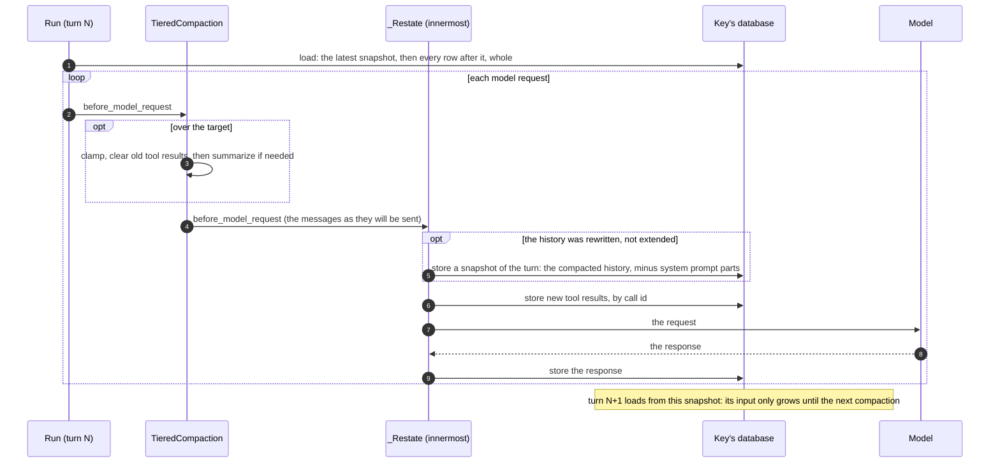
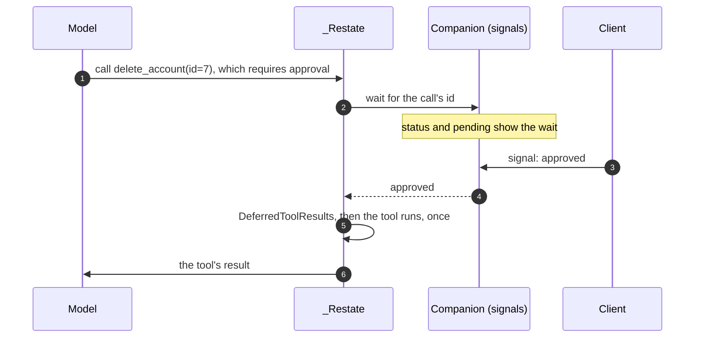
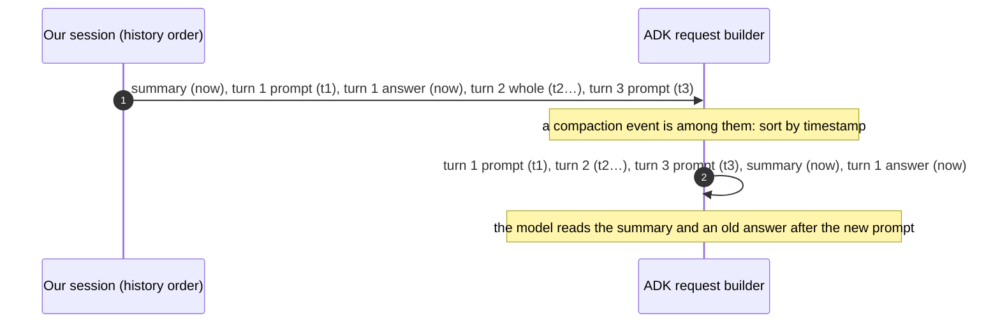

# The frameworks

How each framework plugs into the turn: what the framework itself expects (how
it stores a conversation, compacts it and deletes it), how `restate.agents`
maps onto it, and what we learned on the way. Each integration's module
docstring (`python/restate/agents/<framework>/_agent.py`) has the full list of
its behaviours; this page is the overview, and the why.

The research read the latest releases as of 8 November 2026, and only those
are supported (D4 in [What we learned](learnings.md#decisions)):

| Framework | Release | Package |
| --- | --- | --- |
| OpenAI Agents SDK | 0.24 | `restate.agents.openai` |
| Pydantic AI, with Pydantic AI Harness | 2.66, 0.66 | `restate.agents.pydantic_ai` |
| Google ADK | 2.14 | `restate.agents.adk` |
| LangGraph, with LangChain | 1.2.20, 1.4.9 | `restate.agents.langgraph` |

## What every integration does

An integration is a thin layer between its framework's agent loop and the
turn. It has five jobs, each of which fails in its own way:

| Job | Where | What goes wrong |
| --- | --- | --- |
| 1. Translate messages: framework message ↔ stored item, and what each holds (text, tool calls, tool results) | `_Items` in each `_agent.py` | a call is lost or misread after a reload |
| 2. Store each step as it happens, from the framework's hooks | OpenAI `_Hooks`, Pydantic AI `_Restate`, ADK `_Sessions`, LangGraph's nodes | a step is stored twice, or not at all, before a crash |
| 3. Resume: rebuild the framework's state, skip calls already made, don't ask again for a stored reply | OpenAI `_resume`, `_current`; ADK `_final`; `final_reply` | a tool runs twice, or the model is asked again |
| 4. Wrap tools: schema, argument validation, errors back to the model | `_function_tool`, `toolset`, `_AdkTool`, `_RestateTool` | a wrong schema, or bad arguments crash the turn |
| 5. Classify errors: refusal (424), retry, or terminal | `refusal_of`, `terminal_of`, each `_run`'s `except` | a bad key retried forever, or a blip fails the turn |

What the core gives an integration (`restate.agents.internal`):

- **`Items`**, the framework's items: `dump` and `load` (to store and read
  them), `prompt(text)`, `reply(text, agent)`, `results(calls)` (to make
  them), `read(item)` (what an item says, the tool calls it makes, the
  results it holds), and optionally `summary(text)` (the summary in the
  framework's own form) and `steered(text, steer_id)` (a message steered
  to a turn, as the framework tells it apart from a prompt; by default a
  prompt's item).
- **`answer_once(ctx, text, items, run, window, budget, check=)`**, which
  answers a prompt once. `run` gets the `Conversation`: `history()` is the
  model's input, and `conversation.turn` is the turn to write.
- **`Turn`**, the turn's writes: `append` (results), `append_reply(agent=)`,
  `carry(agent=, state=)`, `snapshot(items)`, `drop(reply)`,
  `ask_again(text)`; and its reads: `final_reply()`, `open_calls()`,
  `latest_ask()`, `stored(call_id)`.
- **Tools**: `tools_in(ctx)` and `current_call(call_id)`, so that a
  framework's tool call finds its context and idempotency key;
  `wait_for(ctx, call_id, signal, input, approval=)`, a durable wait for a
  framework's own tool call.
- **History from snapshots**: `chat(..., snapshots=True, compact_history=)`,
  and `Conversation.compact_after()`.

At a glance:

| | OpenAI | Pydantic AI | ADK | LangGraph agent | LangGraph `graph=` |
| --- | --- | --- | --- | --- | --- |
| The model's input | `history()` | the latest snapshot, then the rows after it | `history()`, as an ADK session | `history()` | the graph's own state |
| A turn carries | the agent (handoffs) | nothing | ADK's session state | nothing | nothing |
| Summaries | ours: one user message | the harness's compaction | ours: a user message, then "Understood." | ours: as ADK | none: the graph trims its own state |
| Steps are stored from | the run's hooks and input filter | the `_Restate` capability | `_Sessions.append_event` | the agent's nodes | a copy of the messages after the run's input |
| The framework's own approvals | not given: such a run fails its turn | durable: deferred tool calls wait | not integrated | not integrated | durable: `interrupt()` waits |
| Steered messages ([Steering a turn](turns.md#steering-a-turn)) | the input filter, at each step; spliced back into each later request | `_Steering`, innermost after `_Snapshots`: Pydantic AI's `enqueue('asap')` | `_Restate.before_model_callback`, as a request goes out, for an `LlmAgent` root: in the request and the session | the model node, kept in the run's state | none: each is a turn of its own |

In every framework, a tool can wait for a person: `wait_for_signal`.

## OpenAI Agents SDK

### What the SDK expects

- **Storage.** The `Session` protocol is a flat list of Responses items
  (`get_items`, `add_items`, `pop_item`, `clear_session`). `SQLiteSession`
  stores one row per item. The runner saves after each of its own "turns",
  which is one model call and its tools, not our turn.
  `AdvancedSQLiteSession` adds a turn number and branches per user message.
- **Compaction.** `OpenAIResponsesCompactionSession` rewrites the stored
  history. Server-side compaction (`ModelSettings.context_management`)
  returns a `compaction` item, stored like any other, before which items may
  be left out of later requests. `ToolOutputTrimmer` and
  `session_input_callback` change only the model's input.
- **Retention.** `pop_item` and `clear_session`; Redis sessions take a TTL.

### How `restate.agents` maps onto it

| OpenAI Agents | `restate.agents` |
| --- | --- |
| a session's items | a turn's items, plus the earlier turns as prompt and answer |
| `Session` | not used: `history()` is the run's input |
| the current agent, after handoffs | carried on the turn row (`turn.carry(agent=...)`) |
| server-side compaction | kept, within a turn: always on for the built-in agent on a Responses model; the input starts from the latest compaction item |
| the compaction session | not used: it rewrites stored items, which only turns write |
| `user_turn_number` | our turn |

### What we learned

- **Store a reply before its tools run** (`RunHooks.on_llm_end`), and the
  tools' results before the next request (`call_model_input_filter`): a crash
  while tools run then runs them again with the same call ids. The SDK's own
  session stores a step only once its tools have run.
- **Some replies can't be resumed:** a handoff, a hosted tool, or a function
  tool with guardrails, which a resumed call would bypass. Such a reply is
  dropped and its agent asked again.
- **The current agent must be carried.** A turn carries the agent its run
  starts with, then the agent of each handoff as it happens, even if the
  turn ends before that agent replies. A `Handoff` built by hand names no
  agent until it runs, so the next turn goes back to the agent you gave.
- **The summary is one user message,** `SUMMARY` and its text, with no
  made-up "Understood." after it, as Codex sends its own: the Responses API,
  and Chat Completions through the SDK's converter, accept the user message
  that follows.
- **Approvals aren't durable yet.** A run that stops for tool calls that
  need an approval (`needs_approval`) fails its turn: nothing would give the
  approval. A tool that waits for a person uses `wait_for_signal`.
- **A steered message must be put back in every request.** The input filter
  changes one request only: the SDK makes each request's input afresh, from
  the run's input and its own items. So the run keeps the messages it took,
  each with the item it came after (a tool call's id), and splices them back
  into each later request; where a handoff's `input_filter` took that item
  out, before the first item the run saw after the message, as if the filter
  had kept it. The run goes on in place: its input guardrails run once, and
  `max_turns`, tool choice and hooks carry on. A run also takes the messages
  waiting as it starts (a retried attempt's, say), into its input.
- **An agent used as a tool runs with the run's `run_config`** (the SDK
  passes it on to `Agent.as_tool`'s run), our input filter with it. A request
  made while one of the run's tool calls runs is that nested run's: it gets
  your own filter only. The turn stores none of its items (the call's output
  is what the turn keeps; an output without its call would break the next
  request) and puts none of the steered messages in it.
- **A handoff filter that drops the handoff's own output** (`input_filter=
  remove_all_tools`) leaves the handoff's call without an output in the
  turn: the run takes no steered message after it. Found with it, and not
  steering's: that output is never stored, so the next turns' requests carry
  a function call with no output, which OpenAI's APIs refuse (an open bug).

## Pydantic AI, on Pydantic AI Harness

Pydantic AI 2.x is built of *capabilities*: objects with hooks around a run's
parts (the run, each model request, tool execution, the output, deferred tool
calls). Pydantic AI Harness is a library of ready-made capabilities:
compaction, tool output limits, planning, memory, conversation search,
asking the user, and more. Our integration is a capability too, `_Restate`,
and it leans on the harness wherever a capability does what our code would
(D5).

### What Pydantic AI and the harness expect

- **Persistence is the app's.** "Pydantic AI is deliberately unopinionated
  about your database." The unit is a `Conversation`: messages, usage, a
  `conversation_id`. `run_id` is never inherited, and passing one that
  already appears in the message history raises `UserError`.
- **The harness's guidance is to store the head:** "a conversation head is
  separate from per-run checkpoints: it includes accepted prompts and
  between-run edits such as compaction". `ConversationStore` "only ever
  grows", so a history compacted by a capability isn't kept by it, and every
  later run past the target summarizes again.
- **`TieredCompaction` is the recommended default:** clamp oversized
  messages, clear old tool results, then summarize, cheapest first, before
  each model request once the history is over 80% of the model's window. Its
  edits persist into the run's messages. The summary is a request-side
  `CompactionPart`, which providers receive as user-voice text.
- **The durability layer assumes deterministic replay:** operations are told
  apart by their order, and the run id must stay the same across a replay.
  Turning it on disables harness features (background compaction, some
  sub-agent controls, `Permissions`' memory).
- **Deferred tool calls** (`requires_approval=True`, `ApprovalRequired`,
  `CallDeferred`, the harness's `AskUser` without an answerer) go through a
  capability hook, `handle_deferred_tool_calls`.
- **Stores are protocols** the app implements: `PlanStore` (`Planning`),
  `OverflowStore` (`ToolOutputLimits`), `HistorySource`
  (`ConversationSearch`), `MemoryStore` (`Memory`). Some harness keys are
  built on the run id: memory operation ids, spill keys.
- **The provider's prompt cache** holds when the input only grows:
  `WarnOnCacheBusts` flags a rewritten prefix.

### The design

**History from snapshots.** The harness's compaction replaces our window,
budget and summaries. When compaction rewrote the history, `_Restate`, which
runs innermost, stores the rewritten list as a snapshot of the turn before the
request goes out; the next turn starts from it, and its input only grows until
the next compaction. An `Agent` of your own with no compaction capability gets
the same default (Q3).

**Durable human-in-the-loop.** `_Restate.handle_deferred_tool_calls` opens a
companion wait per deferred call (`wait_for`): `approval` for an approval, or
a signal named after the tool for a result from outside. The run suspends
without holding a process; a client answers with `signal`; a retried attempt
joins the same wait; `stop` forgets the waits. An approval is marked as one
(`approval=True`), so a turn stopped after a denial doesn't report the call as
done.

**Stores.**

| Harness capability | Backed by | What it gives |
| --- | --- | --- |
| `Planning` (`plan_store()`) | a table in the key's database | the plan lasts across turns (by default each run gets a fresh one) |
| `ToolOutputLimits` (`overflow_store()`) | a table in the key's database | a large tool result spills, and the model reads the rest when it needs it |
| `ConversationSearch` (`history_source()`) | the turn rows and steps: one run per turn, its id the prompt id, its start `asked_at` | the model can search the exact earlier prompts, answers and tool calls that compaction summarized |
| `Memory` (`memory()`, `memory_store()`) | a session object, one key per namespace (a user) | memory across a user's conversations; `clear` leaves it |

**Identity.** Every run has the conversation id `<agent>/<key>`; its run id
is new in every attempt. Usage limits are per turn (Q1); a budget per
conversation would be the harness's `Spend`, later.

**Not adopted**, and why: the durability layer (our attempts resume from
committed steps, they don't replay; run ids change per attempt; session
handlers have no `ctx.run`; it disables harness features), `StepPersistence`
(our tables already make runs durable, and its head is our snapshot), and
`ConversationStore` (our tables are the store).

### What we learned

- **Run ids change with every attempt**, and Pydantic AI refuses one that is
  already in the history. Whatever the harness keys on the run id must be
  re-keyed on the tool call, which is stable: a spill is named by the tool
  call; a memory change is named by the invocation, the tool call and its
  fingerprint, so a call that runs again finds the receipt of the change it
  made (it would otherwise make it again, or fail to, as the text it
  replaces is gone).
- **A tool call that runs again must read what it read the first time.** The
  plan store journals a tool call's reads as well as its writes, by their
  order in the call. Replaying only the writes isn't enough: the call's
  earlier writes are committed, and reading them changes what it writes next
  (which steps a status change unblocks), so its writes no longer line up.
  A read's journal row is kept in memory and written with the call's next
  write: only a write makes it matter, so a call that only reads commits
  nothing. This is what the harness's own durable stores assume ("the store's
  recorded result keeps the original ids").
- **A snapshot is the history the model will get,** so: strip system prompt
  parts (or `ReinjectSystemPrompt` stops reinjecting it); drop the input
  usage of the responses in it (or the harness compacts again from the stale
  count); tell a rewrite from an extension by comparing with the previous
  request (the run's start rewrites the loaded history too, which is no
  compaction); store `RetryFeedbackPart` requests.
- **Compacting off the answer's path** (`compact_after()`) triggers at 70% of
  the window: `compact_now` at an 80% target does nothing below 80%.
- **Order matters.** `_Snapshots` runs innermost in `before_model_request`
  but for `_Steering`, which it wraps, so that it sees the messages as they
  will be sent; `_Restate`, which stores the tools' results, has no position
  of its own. Capabilities at the agent's own layer run before them, so one
  that edits the newest tool results could change them before they are
  stored (an open question).
- **A steered message goes in with Pydantic AI's own steering**,
  `RunContext.enqueue(..., priority='asap')` from `before_model_request`:
  it is delivered once every before-hook ran, into the request and the
  run's history, after what both hold, and the run goes on with its usage
  limits, retries and capabilities' state. `_Steering` stores the messages
  after any snapshot of the same request, so that the snapshot covers only
  what came before them. A request that resumes a paused response takes
  none.
- **Feedback is found by its parts.** A run merges the consecutive requests
  it is given, and resumes from the last one as a request of its own, so a
  stored `RetryFeedbackPart` request came back as a new request and was
  stored again (a retry, then every later turn): `_Restate` now knows each
  feedback part by its own JSON.
- **What other capabilities enqueue is not stored** (the harness's system
  reminders, loop detection, ...): it reaches the model, but a retried
  attempt and the next turns lack it. Planning records its plan again when
  it is missing; the others are lost (an open question).
- **The trade-offs of snapshots.** A turn reads everything since the latest
  compaction, up to the harness's target (80% of the model's window), where
  the turn projection reads up to its budget; and a snapshot repeats the
  tail it keeps. In return the provider's prompt cache holds between
  compactions. The harness takes a model's window from its profile, or from
  genai-prices (200,000 tokens if unknown): a wrong entry needs
  `context_window=`.
- **The harness moves fast.** It is at 0.x, released in step with Pydantic
  AI (0.66 with 2.66): pin what the tests cover.

## Google ADK

### What ADK expects

- **Storage.** `DatabaseSessionService` stores sessions (with their state)
  and events, one row per event; partial events aren't stored. A turn is an
  invocation: every event carries the `invocation_id` of its `run_async`.
  An integrator implements a session service; ours is `_Sessions`.
- **Compaction.** `EventsCompactionConfig` on the `App`: after a number of
  invocations, or past a token threshold, a summary event is appended
  (`author="user"`, `actions.compaction` with the range it covers). Raw
  events stay. Once a compaction event exists, building the request hides the
  compacted events and **re-sorts all events by timestamp**.
- **Retention.** `delete_session` only; rewind appends events that reverse
  the earlier state deltas.

### How `restate.agents` maps onto it

| ADK | `restate.agents` |
| --- | --- |
| a session | the conversation as `history()` gives it, rebuilt each turn |
| an event | an item |
| an invocation | a turn: one `run_async` |
| the session state | carried on the turn row (`turn.carry(state=...)`), with the state deltas of the loaded turns applied after it |
| a compaction event | not used: our summaries replace it |
| `delete_session` | `clear` |

### What we learned

- **ADK's compaction put our session out of order.** The events that
  `history()` makes on each load (the summary, and each earlier turn's
  answer) are stamped with the time they are made. Once a compaction event
  was loaded, ADK sorted by timestamp, and the summary and old answers came
  after the new prompt. A user `App`'s events compaction is now turned off,
  with a warning. (Stamping our events with their turn's time was rejected:
  it would leave two summaries covering overlapping turns.)

- **ADK 2 reports an agent's exception as an error event, then raises it.**
  The run lets the exception decide (retried, refused, or the limit of model
  calls); only an error event that ends the run fails the turn for good.
- **A stopped turn must end as ADK 2's runner expects.** The runner cancels
  the agent's task and waits for it, so a tool whose own task is cancelled as
  the turn stops ends cancelled, rather than raising the stop's reason
  (`Tool.run`); the runner hung otherwise.
- **An `App`'s root may be a `Workflow`.** A workflow retried after its last
  node answered answers with that node's stored response.
- **The state across turns** starts from the state the latest turn ADK
  answered carried (not one that another invocation ended, whose state is a
  guess), then applies the state deltas of the loaded turns after it.
- **The summary keeps the default form**, a user event then "Understood.":
  the tests run on scripted models, which can't tell what Gemini accepts.
- **A steered message is taken as a model request goes out**
  (`_Restate.before_model_callback`), not as the tools' results are stored:
  after some tools ADK asks the model nothing more (a tool's
  `skip_summarization`, an output schema's `set_model_response`), and a
  message taken there would go unread. It is added to the request and to the
  session, which ADK builds every later request from, so the run goes on
  with it. The agent's own `before_model_callback` runs after the plugin's,
  on the request with the message: a response it gives in place of the
  model's answers the message too.
- **A steered message starts an invocation of its own**, as a prompt does:
  after a crash ADK resumes the prompt's invocation from its events, and its
  classic runner (a workflow root's) fails on a user message last among
  them, on every retry. Only an `LlmAgent` root takes steered messages; with
  a workflow root, each is a turn of its own. With
  `include_contents='none'`, the requests after the one that takes a message
  start at it, without the prompt and the tools' results before it.

## LangGraph and LangChain

### What LangGraph expects

- **Checkpointers save snapshots of the state, not a transcript:** one
  checkpoint per super-step, plus one for the input, each holding (or
  pointing to) the whole state, the message list included. There is no turn:
  a thread is a chain of checkpoints. Messages have ids, and
  `RemoveMessage(id)` (or `REMOVE_ALL_MESSAGES`) removes them.
- **`DeltaChannel`** (a beta) stores a channel's writes, and its whole value
  only now and then (a snapshot); its value is rebuilt from the latest
  snapshot and the writes after it.
- **Compaction is the state's.** LangChain's `SummarizationMiddleware`
  rewrites the state (remove all, a summary, the kept messages);
  `trim_messages`, `ContextEditingMiddleware` and a `pre_model_hook` that
  returns `llm_input_messages` change only the model's input.
- **Retention.** `delete_thread`; `prune` (keep the latest, or delete) only
  on Postgres, which refuses threads with a `DeltaChannel`.

### How `restate.agents` maps onto it

| | The built-in agent: `langgraph.agent(model=...)` | Your graph: `langgraph.agent(graph=...)` |
| --- | --- | --- |
| The model's input | `history()` | the graph's own state |
| Checkpoints | none | `SqlCheckpointSaver`, in the key's database, pruned after each run to what the latest checkpoint of each namespace needs |
| Our items | the run's messages | a copy of the messages after the run's input, matched by id |
| The window | the agent's | at least 1: the graph reads what closed the previous turn |
| Summaries | ours | none: its model reads its own state |
| Steered messages | taken by the model node at each step, kept in the run's state | none: each is answered as a turn of its own |

### What we learned

- **The graph's state is the graph's to trim.** The latest checkpoint holds
  every message the state keeps, so what grows is the state. A graph trims it
  with `SummarizationMiddleware` or `RemoveMessage`; the turn's prune then
  deletes the channel values that held the removed messages, and the
  conversation, as a log, keeps them.
- **The prune must keep what a `DeltaChannel` is rebuilt from:** the latest
  checkpoint's ancestors back to each delta channel's snapshot, read from the
  checkpoint metadata's `counters_since_delta_snapshot`. Only channels the
  checkpoint holds count: LangGraph counts every delta channel at every step,
  written or not, and a channel nothing writes would otherwise keep every
  checkpoint of the thread.
- **Many kept checkpoints mean many versions,** which the database refuses as
  one `OR` per pair past 100 terms: a `DeltaChannel` graph failed every turn
  from about its eleventh. Pairs are matched as a list of rows.
- **Each interrupt has an id of its own,** and its wait id is `<invocation
  id>:interrupt:<interrupt id>`; a run resumes with the signals that answer
  its pending interrupts.
- **The graph's message ids are ours where it matters:** the prompt is
  `prompt:<turn>`, and a message that asks again is
  `prompt:<turn>:again:<position>`, which no prompt's id can be. A graph is
  given a previous turn's closing record only if that turn was closed, never
  an answer the conversation stored.
- **A structured response is the answer only of the run that wrote it:** the
  turn compares the channel's version before and after its run.
- **A steered message joins the run in place.** The model node takes it
  (`take_steers`) before its request, sends it after the tool results, and
  returns it with the reply, so the state keeps it for the rounds after:
  running the graph again with it would reset the recursion limit. Its id is
  `steer:<id>`, as `_Items.steered` makes and stores it, so the history of
  a retried attempt and of the next turns has it too; a trimmed request
  never starts at one, which would leave out the turn's prompt and its tool
  results.
- **Subgraph checkpoints pile up:** the latest checkpoint of each subgraph
  namespace stays, one per turn that ran a subgraph (an open question).
