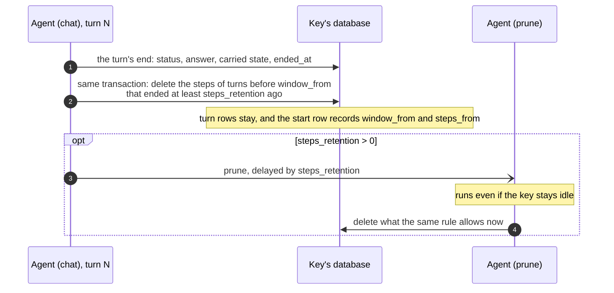

# Future work: steps retention

Designed, not built. Kept here to be picked up later.

## Why

A turn's steps (its model replies, tool calls and tool results) are kept until
`clear`, although no model reads them again once the turn leaves the window:
earlier turns reach the model from their rows only (`history()`), and
summaries are written from the rows too (`compact`). With history from
snapshots, no model reads the steps before the latest snapshot either.

## The rule

A turn's steps are deleted once both of these hold:

- no turn's model reads them any more: the turn is before the window the next
  turn loads (`window_from`);
- the turn ended at least `steps_retention` ago.

The turn's row stays until `clear`, so nothing changes for the model, for
summaries, or for the summary view.

- **The default** would be `steps_retention = timedelta(0)`. With `window=1`,
  the end of turn N would delete turn N−1's steps.
- **A UI that shows past tool calls** would set a longer retention.
- **With `window="all"`** nothing would be deleted.

## Who deletes

- the end of every turn, answered or closed, in the transaction that stores
  the turn's end;
- a private `prune` handler, when `steps_retention` is above zero. Each turn's
  end would schedule it with a Restate delayed send, so that an idle key still
  loses its old steps on time.

## The core design

- **Schema.** Three new columns (appended migrations, as this would come
  after a release):
  - `restate_agent_turns.ended_at`, in Unix milliseconds;
  - `window_from` on the start row: the window's first position, as the
    latest turn's end computed it;
  - `steps_from` on the start row: no steps are stored before it.
- **The option.** `steps_retention: timedelta` in `AgentOptions`,
  `AgentObject` and `AgentInfo`, validated like `budget`.
- **The rule.** A pure `steps_cut(turns, window_from, retention, now_ms)` that
  returns the position before which steps may go. It stops at the first turn
  that must stay, so the delete is always one range delete. `window_from`
  comes from the window rule on the transcript as the next turn will load it
  (what `Conversation._upcoming()` computes), with the window `answer_once`
  was given, so a framework that widens it (LangGraph's `graph=`) is
  honoured.
- **At a turn's end.** `Turn.answered` turns its `UPDATE` into one
  transaction: the `UPDATE` with `ended_at`; then `window_from`; then the
  range delete, if the cut moved; then the start row. The ownership rule
  ([The turn model](turns.md#the-turn-model)) gets a second exception: a
  turn's end may delete earlier turns' steps, never their rows.
- **`prune`.** A private handler, its name reserved with `settle` and
  `compact`. It reads the start row and the `ended_at` of the turns before
  `window_from`, then deletes what the rule allows. It is idempotent. Each
  turn's end sends it with `delay=steps_retention` and the idempotency key
  `<prompt id>:prune`, closed turns included.
- **The full view.** For a turn before `steps_from`, `_messages.py` renders
  the answer from the turn row, under `answered_at`, as the summary view
  already does. Cursors need no change, since deleting writes no `seq`.
- **With snapshots** (Pydantic AI), the cut would be the latest snapshot.
  `ConversationSearch` reads those steps, though, so deleting them would
  trade away search over old tool details.

## Tests, when it is built

- the rule, as a table over windows, statuses and retentions;
- deletion at a turn's end, for answered and closed turns;
- ended turns staying in view;
- `history()` unchanged with and without deletion;
- `prune` on an idle key, against a server;
- the full view's fallback;
- mutants in `scripts/resurrect.py`.

Per framework:

- **OpenAI:** handoffs at window 0, and compaction items inside deleted
  steps; the same requests with and without deletion.
- **Pydantic AI:** the same requests with and without deletion, and provider
  compaction items inside deleted steps.
- **ADK:** the state across turns at windows 0 and 1, and a killed turn:
  `_Sessions.session` takes the base state from the latest turn that wasn't
  ended, then applies the state deltas of the loaded turns, so deleted steps
  must change nothing.
- **LangGraph:** the widened window is honoured. A graph's own state is out
  of retention's reach: the graph trims it itself, with
  `SummarizationMiddleware` or `RemoveMessage`.

## Questions for then

- the default retention;
- whether apps may call `prune`;
- whether to add a LangGraph opt-in that trims the graph's state.

**Out of scope even then:** copies outside the key's tables, which are each
turn's Restate journal (kept for `journal_retention`) and freed database pages
in sdk-shared-core.

**Precedent.** None of the coding agents deletes the steps its model stops
seeing ([What we learned](learnings.md#the-research)). LangChain's
`SummarizationMiddleware` and the OpenAI Agents compaction session replace
stored history when they compact.
