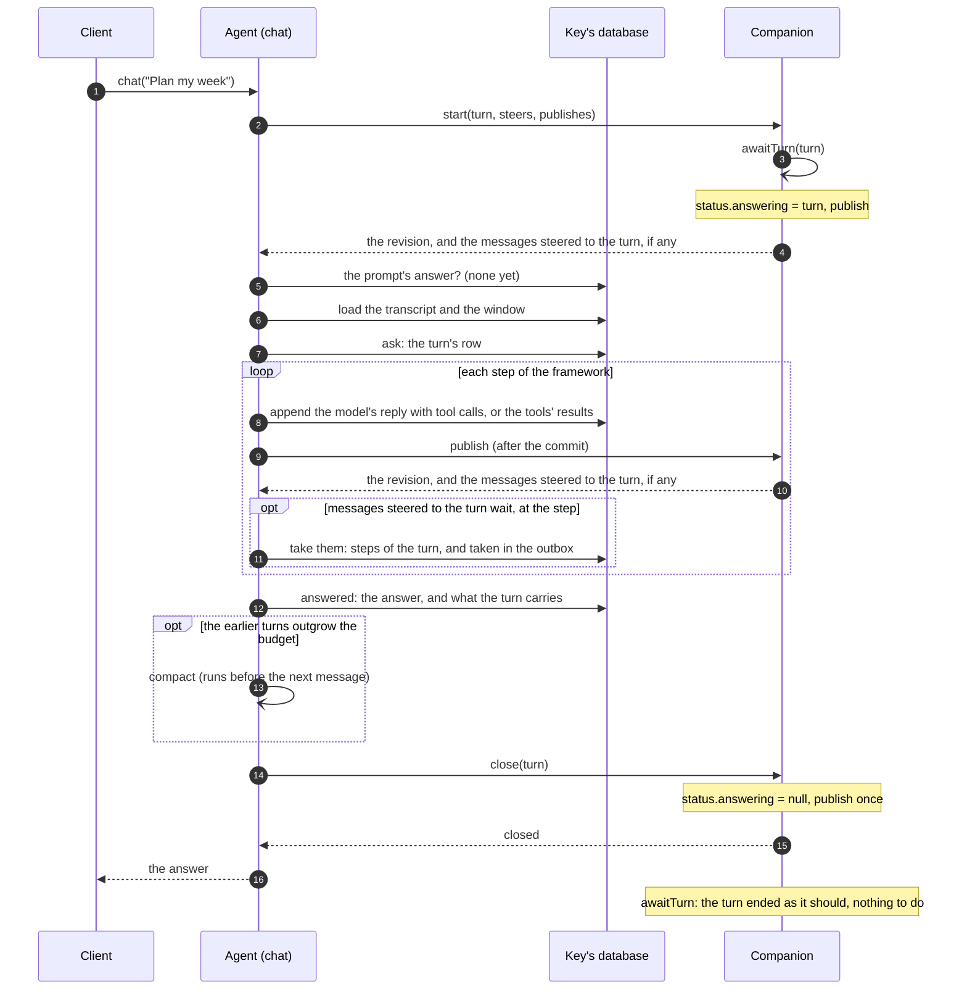
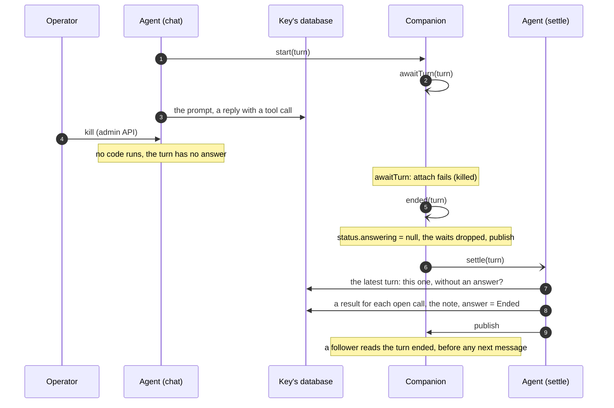
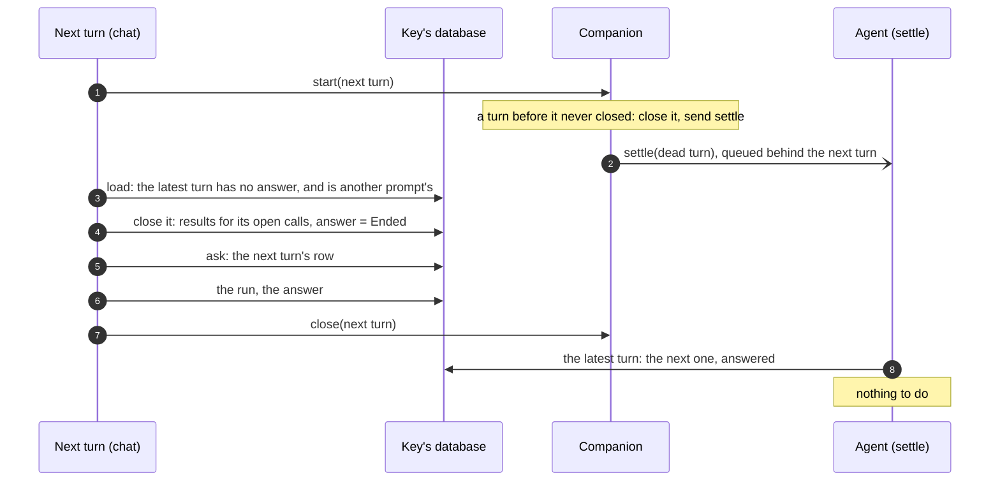
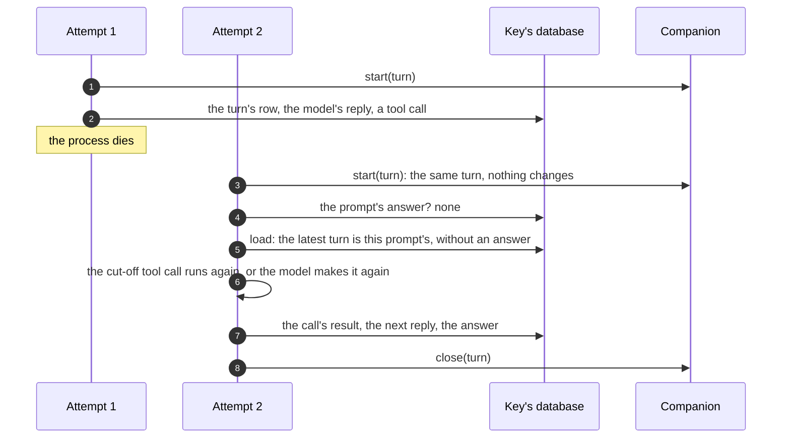
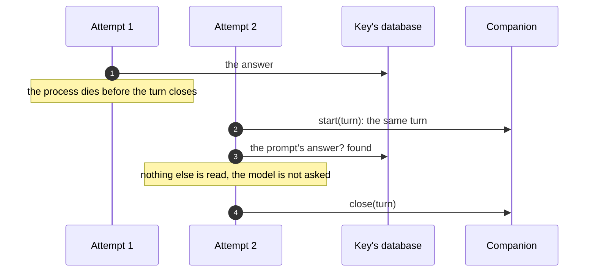
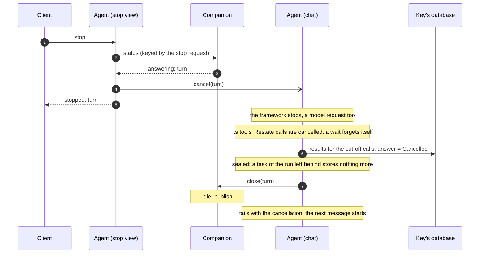
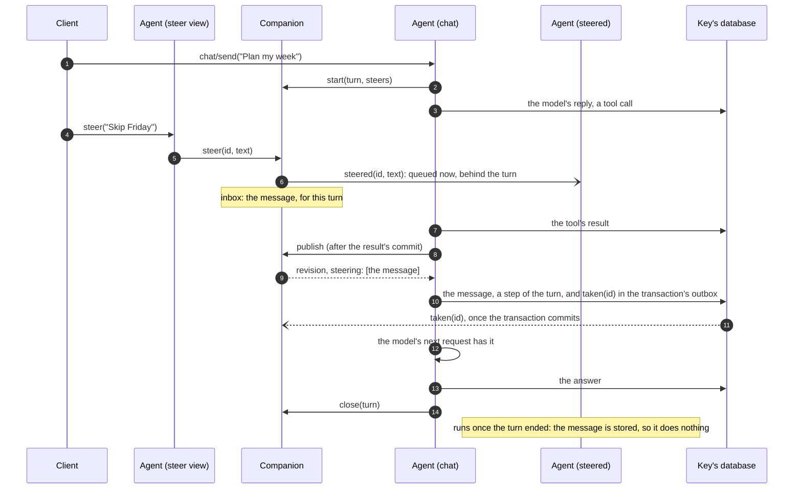
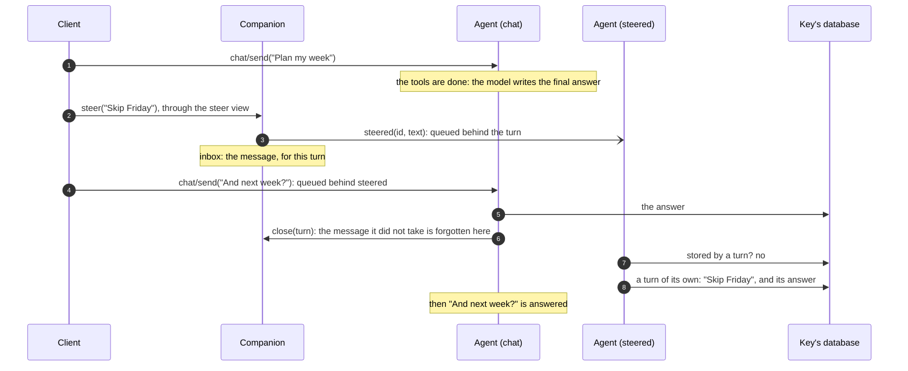
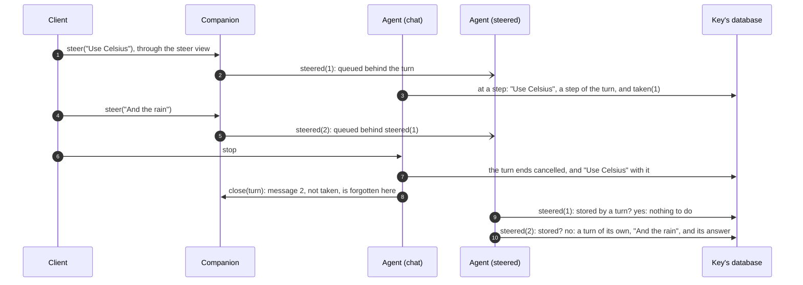

# Turn semantics

How an agent of `restate.agents` answers its messages: what a turn is, how it
starts and ends, what happens when it is retried, stopped or killed, and what
`status`, `messages` and a follower see along the way. What a turn stores and
what the model gets are in [The conversation](conversation.md); how each
framework plugs in, in [The frameworks](frameworks.md).

The code lives in:

- [`_turn.py`](../../python/restate/agents/_turn.py): `chat_turn`, the turn;
- [`_conversation.py`](../../python/restate/agents/_conversation.py): the
  conversation, and `answer_once`, which answers a prompt;
- [`_signals.py`](../../python/restate/agents/_signals.py): the companion, one per
  agent (`make_companion`);
- [`_steering.py`](../../python/restate/agents/_steering.py): the messages
  steered to a turn, which it takes at its steps;
- [`_object.py`](../../python/restate/agents/_object.py): the views (`status`,
  `stop`, `steer`, `clear`, `sync`, `watch`) and the private handlers
  (`settle`, `compact`, `erase`, `steered`);
- [`_messages.py`](../../python/restate/agents/_messages.py): the conversation as
  clients read it;
- [`_calls.py`](../../python/restate/agents/_calls.py): the Restate calls of a
  turn's tools.

The TypeScript SDK's agents follow the same turn and companion
(`sdk-sessions/packages/agents/TURN-SEMANTICS.md`). How the conversation is
stored and loaded, the `settle` and `compact` handlers, and each agent
having a companion of its own, are this SDK's (see
[The companion is the agent's own](#the-companion-is-the-agents-own), and
[Porting to sdk-sessions](porting.md)).

## Words

- **Agent, key.** A session object of `restate.agents`, such as `assistant`,
  and one of its keys, such as `alice`: one conversation, in its own SQL
  database.
- **Message.** What a client sends the agent: a call of its `chat` handler,
  one Restate invocation whose id (`inv_1f…`) is also the message's id; or a
  call of its `steer` view, whose request's id is the message's id.
- **Turn.** One prompt, the messages steered to it that it took, and what
  answers them: the unit of the conversation
  ([The turn model](#the-turn-model)). Its id is the prompt's: the
  invocation's id, or `<id>:2`, `<id>:3` for later prompts of a handler that
  prompts more than once. A `chat` message is one turn; a steered message
  joins the turn being answered, or is a turn of its own.
- **Invocation.** The invocation answering a message (`chat`'s, or
  `steered`'s for a steered message answered as a turn of its own), from its
  start to its end, across its attempts: what the companion follows
  (`status` calls it the turn being answered, `answering`) and what `stop`
  cancels. An invocation of a handler of your own can hold several turns.
- **Attempt.** One run of a turn's invocation. A crash, a lost connection or
  a suspension ends an attempt; Restate starts another, which runs the
  handler again from its first line and resumes from what the database has.
- **Companion.** The agent's own virtual object, named
  `<agent>.agentprebuilt.restate` and keyed as the agent: key `alice` of
  `assistant` has the companion `assistant.agentprebuilt.restate`, key
  `alice`. Whatever makes the agent makes it, and the agent serves it
  alongside itself. It is ingress-private: clients reach it through the
  agent's views. It is a journaled virtual object, so it can wait
  (awakeables, timers) and be written while the turn runs. It keeps the
  running turn, the waits of its tools, and the conversation's revision.
  Nothing in it is needed to complete a turn: it is the control plane.
- **Revision.** A number the companion increases at every change a client
  could see (`publish`). `watch` and `sync` wait for a newer one.
- **Transcript.** Per turn: the prompt and the turn's answer.
- **Trajectory.** Per turn: everything else it stored, the model's replies,
  the tool calls and their results, compaction items.
- **Carried state.** What a turn hands to the turns after it that is no
  message: the agent the conversation is with (after a handoff), and the
  framework's own state (ADK's session state).
- **Window.** The turns the model sees whole, with their trajectories
  ([Which turns a turn loads](conversation.md#which-turns-a-turn-loads)).
- **Step.** The point in a turn after the model's reply has a result for
  each of its tool calls, before the model's next request.
- **Steered message.** A message sent to the agent's `steer` view: the turn
  being answered takes it at its next step, or else it is answered as a turn
  of its own ([Steering a turn](#steering-a-turn)).

## One turn at a time

A key answers one turn at a time, in the order its messages came. `chat` is
an exclusive handler, and it keeps the key while it waits (suspended on a
signal, say): a message sent while the agent answers another waits in
Restate's queue for the key, and its turn starts when the one before it
ended.

A message sent to `steer` takes its place in the same queue as it is sent,
and is answered there, as a turn of its own, unless the turn being answered
takes it first, at its next step, and answers it together with its own
message. A message sent to `chat` never joins the turn being answered
([Steering a turn](#steering-a-turn)).

So **turns never overlap.** At most one turn of a conversation has no
answer, and it is the latest. A turn that finds an earlier one without an
answer knows that turn's invocation is gone (killed, say): a live one would
still hold the key.

- **Answer now, or later.** `chat` answers with the answer. `chat/send`
  answers with the invocation's id at once, and
  `/restate/invocation/<id>/attach` waits for the answer, as often as you
  like.
- **Once.** A message sent with an idempotency key is one invocation,
  answered once, however often it is sent. A webhook's delivery (`deliver`)
  is a message of this kind, keyed by the delivery.
- **To change course,** send the turn a message with `steer`, which it
  takes at its next step; or stop the turn (`stop`) and send the message
  that replaces it: it is answered once the stopped turn ended, after any
  messages already waiting.

## A turn's life



1. **Start.** The turn calls the companion's `start(turn)`: from here,
   `status` says the agent answers it (`answering: {invocationId, since}`).
   It also says whether the turn takes steered messages (`steers`), and
   whether `start` publishes it (`publishes`: a followed turn, not a
   background agent's). A retried attempt calls `start` again with the same invocation, which
   changes nothing (it keeps when the turn started). `start` sends
   `awaitTurn(turn)`, the turn's watch. It also publishes, as the turn's
   first revision, and returns what `publish` returns: the turn makes no
   publish of its own to start. A background agent's turn is not published
   at its start, and `start` returns nothing.
2. **The prompt.** `answer_once` reads the prompt's answer by its id, one
   indexed read: a retried attempt of an answered turn returns it, and reads
   nothing more; one of a turn that was closed (cancelled, failed, refused, or
   ended by another invocation) fails as the prompt did, the note never
   taken for an answer. Otherwise it loads the conversation
   ([Which turns a turn loads](conversation.md#which-turns-a-turn-loads)), closes a turn
   left without an answer, and stores the prompt as the turn's row.
3. **Steps.** The framework answers: model calls and tool calls. Each step
   is stored as it comes: a reply with tool calls in one transaction, before
   its tools run; the tools' results before the model is asked again. A
   final reply, which no tool waits for, is held and commits with the
   answer. After each write that commits, the turn publishes once, and
   waits for it: so a follower sees the calls as their tools start, and
   their results before the model's next request returns. The companion
   answers each `publish` with the messages steered to the turn that wait:
   at its next step, the turn takes them, and the model's next request has
   them ([Steering a turn](#steering-a-turn)).
4. **Answer.** The answer is stored on the turn's row, with what the turn
   carries. If the turns before the next turn's window outgrow the agent's
   budget, the agent sends itself `compact`
   ([Summaries](conversation.md#summaries)).
5. **End.** The turn calls the companion's `close(turn)` and waits for it.
   `close` clears the turn and publishes: one revision for the turn's end,
   after its last write. Then the handler returns the answer, or raises the
   turn's error.

A **background** agent (`background=True`, a subagent say) publishes its
turn's end only: no step, nor its start, wakes a follower (its `start` says
it does not publish). Its turns take no steered messages.

## How a turn ends

| How | The handler | In the conversation, the turn's answer | Who closes the turn in the companion | Then |
| --- | --- | --- | --- | --- |
| **Answered** | returns the answer | the answer | the turn | idle; the next message starts |
| **Refused** (a wrong API key, an unknown model) | fails with HTTP 424, for good | `Unanswered: …` | the turn | idle; the next message is answered on its own |
| **Failed for good** (a terminal error) | fails with it | `Error: <message>` | the turn | idle |
| **Stopped** (`stop`, `clear`, or Restate's cancel) | fails with the cancellation (409) | `Cancelled: …` | the turn | idle; its tools' calls are cancelled, their waits forgotten |
| **Crashed** (a process died, a retryable error) | none yet: Restate runs it again | none yet: the turn goes on | nobody: the turn is not over | still answering; the next attempt goes on with it |
| **Killed** (Restate's admin API) | runs no code | `Ended: …`, by `settle` or the next message | its watch (`awaitTurn`), at once | idle; its tools' waits dropped |
| **Out of retries** (100 000 attempts, about 11 days) | runs no code | `Ended: …`, as killed | its watch, if Restate fails it | idle; a turn Restate pauses instead stays answered until an operator acts |

A turn that closes itself (answered, refused, failed, stopped) closes its
run in the conversation first: each tool call without a result gets one (the
error its Restate call returned, a note that it did happen if it returned,
or else the note that ends the turn), then the note is the turn's last
reply, and its answer. So the next turn's model never sees a tool call
without a result, and knows how the turn ended.

**The messages steered to a turn go as the turn goes.** Those it took are
its own, as its prompt is: its answer answers them, and a turn that ends
otherwise (refused, failed, stopped, ended) ends them too, and they are not
answered again. Those it did not take were queued as turns of their own as
they were sent, and are answered after it, in order.

Whoever closes a turn in the companion, a close does the same: it clears the
turn (if the agent still answers it), drops the waits of the turn's tools
(rejecting their awakeables, so a `wait` still parked ends), forgets the
messages steered to the turn, and publishes once if any of these changed
something. A second close of the same turn changes nothing, and publishes
nothing.

## Dead turns

A turn closes itself only if its code runs to the end. A killed turn runs
none, so its turn has no answer, and must not be finished: it is over. Two
things close it, whichever comes first.

### The companion notices: `settle`

The companion watches each turn it starts: `awaitTurn(turn)`, a shared
handler, waits on the turn's invocation (`attach`), holding no process. If
the invocation failed without closing its turn, the companion closes it,
and sends the agent `settle(turn)`, a private handler that closes the turn
in the conversation.



- **The calls' outcomes.** A tool call whose Restate call returned before
  the kill gets "done, but its result was not recorded" rather than the
  note: the model would take it for undone, and do it again. `settle` reads
  the outcomes the dead invocation stored, while they are still there (the
  next invocation of the key replaces them).
- **Idempotent.** `settle` closes the latest turn only if it is the dead
  invocation's and has no answer. A turn the next message closed first is
  left as it is.
- **An hour at most.** The watch races `attach` against an hour's sleep. A
  turn still answered then gets a new watch, and this one ends: no watch
  waits for weeks (a turn waiting for an approval, say) on the deployment it
  started on.
- **A cancelled watch** (an operator's) closes nothing: the turn may still
  run.

### The next message comes first

A message queued behind the killed turn may start before the watch closed
it. Its `start` closes the turn before it in the companion (and sends
`settle`, which waits behind it for the key), and its `answer_once` finds
the turn without an answer, and closes it the same way, before its own
prompt.



### Which closes it, a table

| The dead turn is closed by | When | Its calls' outcomes |
| --- | --- | --- |
| `settle`, from the companion's `awaitTurn` | as soon as Restate fails the invocation | read, if still stored |
| `settle`, from the next turn's `start` | after the next turn, which closed it first | (the next turn did) |
| the next turn's `answer_once` | before its prompt | read, if still stored (the next turn stored none yet) |

## Attempts: crashes and retries

A crash (a process that dies, a lost connection, a retryable error) ends an
attempt, not the turn. Restate runs the handler again from its first line,
and the turn goes on from what the database has:



And a crash after the answer was stored:



- **The prompt, once.** Every attempt asks for the same prompt id, which
  finds the turn stored, answered or unfinished, rather than asking the
  model again. A run that stored its final reply but not its answer answers
  with that reply.
- **Tool calls, once.** A tool call has an idempotency key of the
  invocation and its call id, `<invocation>:<call id>`. Restate's own tools
  (`call`, `send`, `workflow`, `subagent`, `wait_for_signal`) make their call
  once however often the tool call runs: a framework that gives a cut-off
  call a new id gets the earlier call's id back
  ([`_calls.py`](../../python/restate/agents/_calls.py)).
- **Steered messages, once.** A message the turn stored is a step of the
  turn for every later attempt: in the model's history, and never taken
  again (by its id). The `taken` that tells the companion is sent from the
  storing transaction's outbox, again with the same key after a crash.
- **Waits survive.** A tool waiting for a signal waits in the companion
  (`wait`), by that key: the next attempt rejoins the same wait, and the
  turn is still answered meanwhile. A framework's own tool call that waits
  for something outside (Pydantic AI's deferred tool calls, say) waits the
  same way, through `wait_for(ctx, call_id, signal, input)` in
  `restate.agents.internal`. Such a wait is its tool call's alone: the
  framework stored the call before it waits, so a new call with the same
  input (the model asking again after the first's answer) waits anew, and
  never gets an earlier call's approval. An approval (`approval=True`) is
  not the call: a turn stopped before the call's result is stored reports
  the call as not done, whatever its approval returned.
- **A dead attempt stops.** An attempt that ends while its process lives on
  (Restate suspended it, gave up on it, or lost its connection) stops its
  work, a model's request included: it can store nothing more, and the next
  attempt goes on. This is not a cancellation: the turn goes on.

## Stopping a turn

`stop` cancels the invocation of the message being answered: Restate's
cancellation, as its admin API's `PATCH /invocations/<id>/cancel`.



- The view asks `status` with an idempotency key of its request: a `stop`
  that Restate runs again gets the same turn, and cancels it again (which
  does nothing), never the message that started after it.
- The turn ends cancelled whenever the cancellation comes, and the next
  message starts afresh: the cancelled prompt is over.
- A cancellation that comes once the turn answered changes nothing: the
  answer stands.
- A tool cut short by the stop raises the stop's reason, so the model never
  carries on with it. If the framework cancelled the tool's own task, the
  tool ends cancelled instead: a framework that cancels a task and waits for
  it (ADK 2's runner) expects nothing else. The turn ends cancelled either
  way.
- A message steered to the turn ends with it if the turn took it, as the
  turn's prompt does; one it had not taken is answered as a turn of its own
  after it. A turn that stops while it waits to store messages takes none.
- `clear` stops the turn the same way, then forgets the conversation (the
  key's database, the companion's waits, kept signals and steered
  messages). A message sent before `clear` is answered first (unless the
  stopped turn took it), then forgotten too; one sent after it is answered
  in the cleared conversation. Message ids and cursors carry on.

## Steering a turn

A message sent to the agent's `steer` view, rather than to `chat`, adds to
the turn being answered. The turn takes it at its next **step**: once the
model's reply has a result for each of its tool calls, before the model's
next request. That request has the message, after those results, and the
turn's answer answers the turn's messages so far. If the turn reaches no
step before it ends, the message is answered as a turn of its own, right
after it. Either way, it is answered once.

| The message is sent | It is answered |
| --- | --- |
| while the turn has a step ahead (a tool call runs, say) | by the turn being answered, which takes it at that step |
| while the model writes the turn's final answer | as the next turn, before the messages sent after it: no step follows |
| with no turn being answered | as a turn of its own, which it starts, as `chat/send` does |
| to a turn that takes none (see the limits), or past its 16 | as a turn of its own, once the turn being answered ended |
| to a turn that then stops, fails, is refused or killed | not at all if the turn took it (it ends with the turn); otherwise as a turn of its own after it |

The view answers `{id, turn}`: the message's id (the request's: send it
with an idempotency key, so that a retried request is the same message),
and the turn that holds it for its next step, or `null` if it is answered as
a turn of its own.

### Taken at the next step



### Too late: the next turn

The model writes the turn's final answer, so no step follows: the turn ends
without taking the message, which its own turn answers next, before a
message sent after it.



### The turn ends otherwise

A message the turn took is its own, as its prompt is: stopped with it here.
One it had not taken is answered as a turn of its own after it.



### How it holds

- **Where it waits.** The companion's `steer` sends the agent's private
  `steered` handler the message at once, so it takes its place in the key's
  queue as it is sent; and, if the turn being answered takes steered
  messages (its `start` says so, `Started.steers`), it holds the message for
  that turn (`inbox`), 16 at most (`STEERS`).
- **How the turn learns of it.** From `publish`, which the turn makes
  anyway as it starts (its `start`) and after each write of steps that
  commits (a reply with tool calls, the tools' results): the companion
  answers it with the messages waiting for the turn. The turn waits for the
  publish after the results, and its next step then takes what it returned.
  A turn that nobody steers makes no call more.
- **Taken once.** At a step, the framework's integration calls
  `take_steers`: the turn stores each waiting message by its id, once, as a
  message of the user that is a step of the turn, and the integration puts it
  in the request that is about to go out, in place: the framework's run goes
  on, with its limits, guardrails and state. The transaction that stores the
  messages sends the companion `taken` from its outbox, once, with the
  commit; the companion marks them taken, and counts them among the turn's
  16 until it ends. A turn that stops while it waits to store messages
  takes none.
- **Answered once.** Once the turn ended, `steered` runs, for each message:
  it does nothing if a turn stored the message, and otherwise answers it as
  a turn of its own. So each message is answered once, in the order it was
  sent with the messages after it.
- **A taken message is its turn's.** It goes as the turn goes
  ([How a turn ends](#how-a-turn-ends)): answered by the turn's answer, or
  stopped, refused, failed or ended with it, and never answered again. A
  reply dropped to ask the model again drops the messages taken after it,
  which `steered` then answers.
- **What the model sees.** In the window, the message is where it was taken.
  Later, an earlier turn is its message, the messages steered to it, and its
  answer; budgets and summaries count them. `latest_ask` skips them: the
  turn goes on from its prompt (an ADK invocation, a graph's run).
- **Limits.** A step comes once a reply's tool calls all have results: a
  tool that waits a day for an approval holds the message until it
  returns (stop the turn to change course sooner). A turn takes at most 16
  messages in all; past them, each is a turn of its own. A message is taken
  only as a model request goes out: one that no request follows (ADK asks
  the model nothing more after some tools) is a turn of its own. A LangGraph
  graph (`graph=`), an ADK agent whose root is a workflow, and a background
  agent take none; an OpenAI run takes none after a handoff whose
  `input_filter` drops the handoff's own output
  ([The frameworks](frameworks.md)).

## The turn model

A turn is the unit of the conversation, in storage, in code and in views.
Turns are composed into one flat list in one place only: what the model gets.

- **Identity.** A turn's id is its prompt's id. Every row of the
  conversation belongs to one turn: the turn's row, or one of its items.
- **Ownership.** Only the latest turn, while it has no answer, is written,
  and only by its own run. The one exception is closing a turn whose
  invocation is gone (`ended`): `settle`, or the next turn, writes its
  closing record (a result for each open call, the note, the answer), and
  nothing else.
- **Scope.** A turn's run reads and writes its own turn: its open calls, its
  replies, its final reply, its drops. Earlier turns are read-only context.
- **Messages.** A turn's messages of the user are its prompt, then the
  messages steered to it that it took, each a step at the place it was
  taken, and a message that asked again (`ask_again`). Its answer answers
  them all.
- **Lifecycle.** A turn is being answered (no status), then ends once, with a
  status: `answered` by its run, or closed as `cancelled`, `failed`,
  `refused` or `ended`. The status, the answer, the answer's message and
  what the turn carries are stored in one update of its row. The messages
  steered to it that it took end with it.
- **Two projections.** The transcript (each turn's message, the messages
  steered to it, and its answer) and a turn's detail (its steps), read
  separately: the `messages` view's `summary` and `full` views.
- **One composition.** `Conversation.history()` composes the turns into what
  the model gets: the summary, the earlier turns' messages (with the
  messages steered to them) and answers, the window's turns whole. Nothing
  else flattens turns.

In code ([`_conversation.py`](../../python/restate/agents/_conversation.py)):

```
Conversation                      the key's conversation, loaded for a turn
  transcript                      every loaded turn's row: prompt, status, answer, carried
  turns                           the window's turns, whole
  turn                            the latest turn: the one a run answers
  history()                       what the model gets: the one place turns are composed
  knows_result(), new_results()   what the model was given, across turns (to tell new results)
  ask(prompt_id, text) -> Turn    start the next turn: refused while another has no answer

Turn                              one prompt, the messages steered to it, and what answers them
  id, n, status, answer, prompt   its row
  entries, items                  its prompt and steps
  open_calls(), replies(), last_reply(), final_reply(), stored()   its own state, never another turn's
  latest_ask(), steered()                                           its latest ask; the messages steered to it
  append(), append_reply(), drop(), carry(), ask_again(text)        its run's writes
  steer(messages, taken, going)                                     take steered messages, at a step (take_steers)
  answered(answer), close(ctx, status, note)                        its end: once
```

A turn always ends with a message of the assistant: its last reply (with no
tool calls, and no call or result after it), the note that closed it, or
else its answer, stored as its reply, from the agent the turn is with (a
turn that ended with a tool's output that is the answer, say). That message
is the answer's in the summary, under the same id. Only an empty answer gets
no message. A LangGraph graph, which keeps its own messages, is given only a
closed turn's closing record, never an answer the conversation stored.

**Asking again within a turn.** A turn can ask the model again before it
answers, once: `answer_once`'s `check` reads the run's answer, and if it
returns a message, the turn stores that message as a step of its own (a
message of the user, `Turn.ask_again`) and runs again. The turn's answer is
the reply to it. `output=` asks so for an answer that does not validate
("Reply again, with JSON only: ..."). It is not a turn: the summary shows
the person's message and the answer, and the full view shows the ask as a
step of the turn. A framework that runs from a message of its own (ADK's
invocation, a LangGraph graph's input) runs from the turn's latest message of
the user (`latest_ask`). A retried attempt that finds the ask stored does
not ask again. The check reads the reply to the ask too (`last`): a
`TerminalError` it raises fails the turn, which is closed `failed` with it,
as `output=` does for a reply that still does not validate. A steered
message is a message of the user that is a step of the turn too, but no
ask: the turn goes on from its latest ask, which skips it.

**Names.** A turn is the conversation's (`restate.agents.internal.Turn`).
What `status` reports, `answering`, is the invocation being answered
(`restate.agents.Answering`: its wire format, `invocationId` and `since`, is
shared with Restate's other SDKs).

## Several prompts in one handler

A handler of your own may prompt more than once (`openai.prompt(ctx, …)`
twice, say): each prompt is a turn of the conversation, `<id>`, then
`<id>:2`. A retried attempt makes them in the same order, so each finds its
own answer, and the companion's turn is the invocation, all of them.

## What a client sees

| View | What it gives |
| --- | --- |
| `status` | `answering`: the turn from its `start` to its close, or null; `waiting`: its tools' waits; `steering`: the messages steered to the turn that it has not taken yet (absent if none) |
| `pending` | the waits, oldest first, each with its id (`<turn>:<call>`) for `signal` |
| `messages` | the conversation as stored. `view: "full"` (the default): every turn, with its tool calls and their outputs, the messages steered to it where it took them, and how a closed turn ended. `view: "summary"`: each turn's message, the messages steered to it, and its answer, under the same ids |
| `notifications`, `watch` | the revision; `watch` waits (up to a minute) for a newer one |
| `sync` | the revision, `status`, and the messages since a cursor, at once: what a follower reads |

The revision increases at:

- a turn's start (its `start`), and each write of its steps that commits:
  a reply with tool calls, the tools' results (not in the background);
- a turn's close: its own, its watch's, or the next turn's `start` closing
  it;
- `settle`, once it closed a dead turn in the conversation;
- a wait that starts, is resolved by a `signal`, or is forgotten (a
  cancelled turn's);
- a message steered to the turn, and the turn taking it (`taken`);
- `clear`.

So a follower that reads each new revision sees every turn begin, its tool
calls as their tools start, their results before the model's next request
returns, its end, and a killed turn end. A final reply, held until the
answer, shows with the turn's end.

## The companion is the agent's own

Each agent has a companion of its own: the virtual object
`<agent>.agentprebuilt.restate`, with the agent's name as it is (Restate
refuses names that start with `restate`, so the suffix ends the name
instead). It is keyed as the agent, and it knows its agent: it sends
`settle` and `steered` to the agent it was made for, at its own key. An
agent and its companion are always the same code in the same deployment, so
the companion sends `settle` for every dead turn, and `start` always returns
what it published for a turn that `publishes`.

A turn still says whether it takes steered messages (`Started.steers`: a
framework that cannot take them, or a background agent, does not), and
whether `start` publishes it (`Started.publishes`: a background agent's turn
is not published). The handlers' names (`awaitTurn` among them) and payloads
are those of the TypeScript SDK's companion, but nothing is shared with it
any more: the TypeScript SDK's agents keep their `signals` object, which this
SDK's agents no longer serve or call.

**Upgrading** from a version whose agents shared the `signals` object
(keyed `<agent>:<key>`): the new companions start empty, and nothing in
`signals` carries over. Turns in flight, pending waits, steered messages
held for a turn, and the revision are left behind. A turn in flight as you
deploy runs on with the deployment it started on, and with `signals`: the
new `status` and `stop` do not see it, and the new `signal` cannot resolve
its tools' waits (while the old deployment is registered, its `signals`
still takes `resolve` at `/signals/<agent>:<key>/resolve`). The revision
starts again, so a follower should start over with a `sync` without one.
Let the agents' turns end before you deploy, and remove the old deployment
once nothing runs on it.

## Guarantees and limits

- **One turn at a time per key**, in the order messages came. A turn is
  joined only by a message sent to `steer`, at a step.
- **A steered message is answered once**: by the turn that took it, or as a
  turn of its own, in the order it was sent with the messages after it. One
  that a turn took goes as the turn goes: stopped, refused, failed or ended
  with it, it is not answered again.
- **A turn takes at most 16 steered messages**, and only as a model request
  goes out, once each of the model's tool calls has a result.
- **A turn is completed from its own rows**, and reads a bounded part of the
  conversation: the transcript the budget holds, and the window.
- **`status` says the turn being answered** from its start to its close,
  however it ends: answered, refused, stopped, killed, or out of retries
  (if Restate fails it). A crashed turn is still being answered: it is.
- **A dead turn is closed, never finished**, by `settle` or the next
  message, with a result for each of its open calls.
- **A turn's waits end with it**: a cancelled turn's forget themselves; a
  killed turn's are dropped when it closes.
- **A turn's work is done once** across attempts: its prompt by its id,
  Restate's calls by their idempotency keys. A tool of your own does
  something once if it uses the idempotency key it is given.
- **Limits:**
  - A LangGraph graph that trims its run's prompt away has the messages it
    keeps copied by id: those of the loaded turns are not copied again.
  - An agent without a summary trims its earliest turns one at a time, so
    the start of the model's input changes at each turn, and a provider's
    prompt cache misses.
  - A crash right after an answer is stored leaves the turn's finished
    Restate calls recorded until the key's next invocation replaces them.
  - A summary that keeps failing is tried again after each turn.
  - Waits started by a handler other than `chat` (your own handler that
    prompts a framework with a `wait_for_signal` tool) are not turns: if
    that handler is killed, its waits stay in `pending` until a `signal`
    resolves them or `clear` forgets them.
