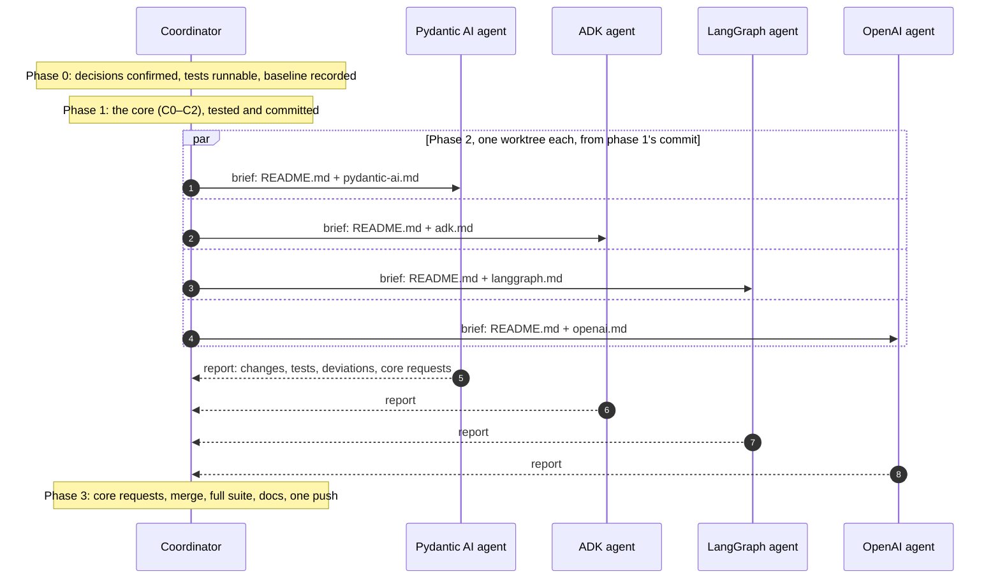
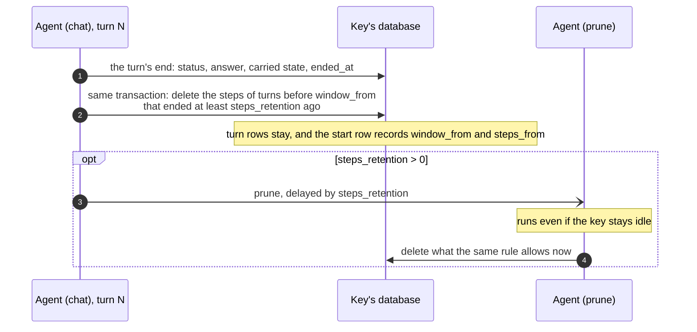

# Conversation storage and the frameworks

> **Status:** a plan. Nothing in this folder is implemented yet. It was written on
> 2026-11-08 against PR restatedev/sdk-python#296 at commit `670445c`, and its line
> numbers refer to that commit. It was revised the same day:
> - D1 was clarified, and D4 and D5 were added;
> - steps retention moved to [future work](#future-work-steps-retention);
> - the scope narrowed to sessions and agents.

**Scope:** `restate.sessions` and `restate.agents` only. That means
`python/restate/sessions/` and `python/restate/agents/`, with their tests and
docs. `restate.ext.*`, sdk-shared-core and the TypeScript SDK are out of scope.

This folder holds the research behind these changes, and the plan for making
them:

1. **Framework alignment.** Each supported framework needs certain things from a
   turn: state carried from one turn to the next, and a way for the summary to
   reach its model. The research found gaps in our integrations, and this plan
   closes them. For Pydantic AI, the integration leans on Pydantic AI Harness
   (D5).
2. **One bug found along the way.** When a user's ADK app has events compaction
   on, ADK re-sorts the session we build, and the events come out of order.
3. **Two clean-ups decided along the way:**
   - no `DROP TABLE` (D1);
   - only the latest framework releases (D4).

**Future work, designed but not planned now:** steps retention, which would
delete a turn's steps once no model reads them any more
([below](#future-work-steps-retention)).

| File | What it holds | Who implements it |
| --- | --- | --- |
| `README.md` (this file) | the research summary, the decisions, the shared core work, how the parts connect, and the future work | the coordinator (phases 0, 1 and 3) |
| [`pydantic-ai.md`](pydantic-ai.md) | Pydantic AI and Pydantic AI Harness | one agent (phase 2) |
| [`adk.md`](adk.md) | Google ADK | one agent (phase 2) |
| [`langgraph.md`](langgraph.md) | LangGraph and LangChain: the built-in agent, and `graph=` | one agent (phase 2) |
| [`openai.md`](openai.md) | the OpenAI Agents SDK | one agent (phase 2) |

## How to use this plan

The work runs in four phases. Only the coordinator touches shared files, in
phases 1 and 3. That lets the four framework agents of phase 2 run in parallel
without editing the same files.

## Where we are

PR #296 made the turn the unit of the conversation. The design is in
[`TURN-SEMANTICS.md`](../../TURN-SEMANTICS.md). Each key's database stores:

- `restate_agent_turns`: one row per turn, holding its prompt, its status, its
  answer, and what it carries to later turns (the agent after a handoff, ADK's
  session state);
- `restate_agent_items`: every other item of a turn (its *steps*), each tagged
  with its turn;
- a start row: the first position, the last `seq`, and the summary of the
  earliest turns.

Each turn, the model gets three things:

- the summary;
- the earlier turns, as their prompts and answers, as many as `budget` holds;
- the last `window` turns whole.

Nothing is deleted except by `clear`.

## The research

The work covered three open-source coding agents and the four frameworks we
integrate with:

- **Coding agents** (each one cloned and read at its latest commit):
  - Codex (`openai/codex`);
  - opencode (`anomalyco/opencode`, formerly `sst/opencode`, v2.2.5, plus v1.19.5
    for its old prune);
  - pi (`earendil-works/pi`, formerly `badlogic/pi-mono`).
- **Frameworks** (read from their latest wheels and docs):
  - Pydantic AI 2.66 and Pydantic AI Harness 0.66;
  - Google ADK 2.14;
  - LangGraph 1.2.20 and LangChain 1.4.9;
  - OpenAI Agents 0.24.0.

The framework details are in each framework's file.

### The coding agents

| | Codex | opencode v2 | pi |
| --- | --- | --- | --- |
| Storage | JSONL rollout per thread, projected into SQLite: `thread_turns`, `thread_items` | SQLite: an event log, projected into message and part rows | JSONL per session: a tree of entries (`id`, `parentId`) |
| A turn | a row: status, error, times, first user item, final answer item | none: an `idle` message ends it | none stored |
| Earlier turns, to the model | as stored, since the last compaction; tool output capped when recorded (10k tokens) | as stored, since the last compaction; tool output capped when produced (2,000 lines or 50 KiB) | as stored, from the compaction's first kept entry |
| Compaction | at 90% of the window: user messages (≤20k tokens) plus a summary, as a user message with a fixed prefix | at the window minus max(15%, 16k): a summary row, plus the last ~15k tokens as text | at the window minus 16k: an entry with the summary and the first entry kept (~20k tokens) |
| Old tool output | not cleared | v1 cleared it, opt-in; v2 removed that | not cleared; an appended `context_edit` can hide an entry from the model |
| Retention | rollouts kept; `history.max_bytes` trims only the prompt log | sessions kept; spilled tool-output files deleted after 7 days | sessions kept |
| A client sees | turns with `itemsView: full` or `summary` (first user message plus final answer) | every row, and a divider at a compaction | the compacted view; the raw entries over RPC |

What this tells us:

- **Codex's layout is ours.** Its `thread_turns` table holds status, error,
  times, and the ids of the first user item and the final answer. Its
  `thread_items` table holds each item's JSON, tagged with its turn and ordered.
  Its client protocol's `itemsView: summary` is our `view: "summary"`. Sources:
  `codex-rs/state/thread_history_migrations/0001_thread_history.sql` and
  `codex-rs/app-server-protocol/src/protocol/turn_items_view.rs`.
- **Each of the three:**
  - keeps an append-only log;
  - sends the model the history since the last compaction, unchanged, which
    suits the provider's prompt cache;
  - records a compaction by appending a marker;
  - deletes only whole sessions, when asked.
- **Each sends its summary as a user message, with no assistant reply after
  it.** Pydantic AI does the same with a summary an app writes (see
  [`pydantic-ai.md`](pydantic-ai.md)).

### The frameworks

| | Its unit | A turn | Compaction | Deletes stored history | Should it dictate our layout? |
| --- | --- | --- | --- | --- | --- |
| Pydantic AI | a run's messages; a `Conversation` | none: a run | capabilities: the provider's, or the harness's | no: its store "only ever grows" | no: it is "deliberately unopinionated about your database" |
| ADK | events | `invocation_id` | an appended event; raw events kept | only whole sessions | no |
| LangGraph / LangChain | checkpoints (state snapshots) | none | `SummarizationMiddleware` rewrites the state | when that rewrites it; whole threads | no |
| OpenAI Agents | Responses items | a turn number (advanced session only) | the compaction session rewrites rows | when that rewrites them | no |

### What we take from it

1. **Keep the layout.** Turns are the record and items are the detail, which is
   Codex's choice too, and every framework's unit maps onto it.
2. **Frameworks dictate two things: the item format and what a turn carries.** We
   already store each framework's own items. What a turn must carry for the
   framework to continue differs per framework:
   - OpenAI Agents: the current agent;
   - ADK: the session state;
   - Pydantic AI: the on-demand capabilities that were loaded, which we don't
     carry yet.

   That work belongs to each framework's file.
3. **A framework's own features come first.** Where a framework already does
   what our code does, the integration uses the framework's feature, and
   `restate.agents` supplies what it needs. This is D5 for Pydantic AI Harness,
   and the same spirit applies to the others.

## Decisions

**Taken:**

- **D1. Assume no existing databases** (decided 2026-11-08). The schema is
  written as if every key's database were new:
  - no `DROP TABLE`;
  - no migrations;
  - no compatibility code.

  A schema change edits the `CREATE` statements directly. Phase 1 starts by
  removing the two `DROP TABLE IF EXISTS` statements at the top of `SCHEMA`
  (`_conversation.py:125-127`), which #296 added for databases from before it.
- **D2. Keep the layout.** Turn rows are the record, and items are the detail.
- **D3. Frameworks plug in through the hooks that already exist:**
  - `Items.summary(text)`, which is optional (`_conversation.py:233-278`);
  - `Turn.carry(agent=..., state=...)` (`_conversation.py:571-583`).

  A framework that needs more from the core asks for it (phase 2, rule 3).
- **D4. No version floor** (decided 2026-11-08). `restate.agents` is a new
  integration, not announced yet, so it supports only the latest release of each
  framework:
  - Each extra's lower bound moves to the release that is latest when the work
    starts. As of 2026-11-08 those are:
    - `pydantic-ai-slim` 2.66, plus `pydantic-ai-harness` 0.66, which becomes a
      dependency;
    - `google-adk` 2.14;
    - `langgraph` 1.2.20 and `langchain` 1.4.9;
    - `openai-agents` 0.24.0.
  - Code uses the newest APIs directly: no feature detection, and no guards kept
    only for older versions. Each framework agent removes the guards it finds.
  - CI's jobs for the oldest versions (`.github/workflows/test.yml:36-91`)
    install the extras' lowest versions, which are then the latest. Keep them or
    remove them; the coordinator decides.
- **D5. Pydantic AI leans on Pydantic AI Harness** (decided 2026-11-08). Where a
  harness capability does what our code does, the Pydantic AI integration uses
  the capability, and `restate.agents` supplies what the capability needs
  (storage, durability). See [`pydantic-ai.md`](pydantic-ai.md).

**Open.** These should be answered before phase 1; if one isn't, its
recommendation applies.

| | Question | Recommendation |
| --- | --- | --- |
| Q1 | Pydantic AI's usage limits: per turn (today) or per conversation (what Pydantic AI does when it carries a `Conversation`)? | Per turn. See [`pydantic-ai.md`](pydantic-ai.md). |
| Q2 | Land this in #296, or in a follow-up PR on top of it? | Your call. #296 is already large, and approved by the review bot. |

## Phase 0: preparation (coordinator)

1. Confirm Q1 and Q2.
2. Make the server tests runnable. They use Docker: `restate.harness` starts
   `ghcr.io/restatedev/restate:1.8.1` (`tests/support.py:7`). Without Docker:
   - install restate-server 1.8.1 from npm (`@restatedev/restate-server`);
   - run the tests with a pytest plugin that starts the harness's server as a
     local process instead of a container. #296 was tested with such a plugin,
     `restate_npx.py`, which lived in that session's scratch directory. Recreate
     it if it's gone; it takes `RESTATE_SERVER_BIN`.
   - Give every agent the plugin's directory and the binary's path.
3. Record the baseline: the pass count of
   `uv run --no-sync -m pytest tests/agents_*.py tests/examples_agents.py`. At
   `670445c` it was 490 passed and 1 skipped.

## Phase 1: the core (coordinator)

### C0. Dependencies

Per D4:

- Raise the lower bounds of the extras in `pyproject.toml` (lines 30-35) to the
  latest releases, and add `pydantic-ai-harness` to the `pydantic_ai` extra.
- Run `uv lock` and `uv sync --all-extras --all-packages`.
- Record the baseline again: it is the baseline the framework agents compare
  against. Fix whatever the new versions break in the core. Breakage inside a
  framework's package goes into that framework's brief.

### C1. Schema

Per D1:

- Remove the two `DROP TABLE IF EXISTS` statements (`_conversation.py:125-127`),
  and the comment above them. `SCHEMA` then holds only `CREATE` statements.
- Check the other schemas of `restate.sessions` and `restate.agents` for the same
  pattern, for example the LangGraph checkpointer's (`langgraph/_checkpointer.py`).
  Remove any statement that exists only for databases from before.

### C2. What the frameworks need from the core

These come from the framework files, and are made before phase 2 so that no
framework agent edits shared files:

- **Pydantic AI:** the core work its harness plan needs, listed in
  [`pydantic-ai.md`](pydantic-ai.md) under "What the core provides". If that list
  is empty, there is nothing to do here.
- **ADK, LangGraph and OpenAI:** nothing.

### Docs

- TURN-SEMANTICS.md: whatever C2 changes.
- The module docstrings are each framework agent's job.

## The core contract

Phase 2's agents may rely on the following:

- **Earlier turns reach the model only from their rows.** `history()` gives them
  as `turn.item` (the stored prompt) followed by `items.reply(answer, agent)`. A
  framework must never depend on an earlier turn's steps outside its window.
- **`Items.summary(text) -> list[Item]`, optional, renders the summary in the
  framework's own form.** By default, the summary is a user message with
  `SUMMARY` and the text, followed by an "Understood." reply
  (`_conversation.py:269-278`).
- **`Turn.carry(state=...)` is one text slot per turn that the framework owns.**
  A turn that doesn't set it inherits the previous turn's (`_conversation.py:571-583`
  and `_conversation.py:631`). ADK uses it, and Pydantic AI may (see
  [`pydantic-ai.md`](pydantic-ai.md)).
- **Whatever C2 adds**, as `pydantic-ai.md` describes it.

## Phase 2: the framework agents

**Rules:**

1. **Where to start.** Start from phase 1's commit, and work in your own git
   worktree (the Agent tool's `isolation: "worktree"`).
2. **What you may touch.** Only:
   - `python/restate/agents/<framework>/`;
   - your framework's tests, as your file lists them;
   - the "Status" line of your file.

   Never edit shared files: `python/restate/agents/_*.py`,
   `python/restate/sessions/`, `TURN-SEMANTICS.md`, `TESTING-AGENTS.md`, or this
   README.
3. **When you need a core change**, don't make it. Describe it in your report:
   what it is, why, and which test needs it.
4. **Every fix comes with a test** that fails without it. Run:
   - your framework's tests;
   - `uv run ruff format --check`, `uv run ruff check`, pyright and mypy, on what
     you changed, per directory, as the `Justfile` does.
5. **Versions.** Only the latest release is supported (D4), and phase 1 has
   already moved the floor to it.
   - Use the newest APIs directly.
   - Remove any guard in your package that exists only for older versions. List
     each one in your report.
6. **Commits.** Commit in your worktree with clear messages, and don't push.
7. **Your report covers:**
   - the files you changed;
   - the tests you added, each confirmed to fail without its fix;
   - the results of the runs;
   - where you deviated from your file, and why;
   - the core changes you need;
   - open questions.

**The brief for each agent:**

> Implement `docs/conversation-storage/<framework>.md` in restatedev/sdk-python.
> Read `docs/conversation-storage/README.md` first: the core contract, the rules
> for framework agents, and how to run the tests. For server tests, use the
> plugin in `<plugin dir>` with `RESTATE_SERVER_BIN=<binary>`. Phase 1 is at
> `<commit>`. Do work items `<list>`; the decisions taken are `<Q1, Q2 answers>`.
> Report as the rules say.

## Phase 3: connecting the dots (coordinator)

1. **Core requests.** Read the four reports, and make any core changes they ask
   for on the core branch first.
2. **Merge.** Merge the worktrees one at a time, smallest first: OpenAI, ADK,
   LangGraph, Pydantic AI. There should be no conflicts outside docs. If there
   are any, the rules settle them: a framework owns its package.
3. **Checks across the frameworks:**
   - the full suite against a server: `uv run --no-sync -m pytest tests/*`;
   - `uv run ruff format --check`, `uv run ruff check`, pyright and mypy, per
     directory (`Justfile:15-37`);
   - `scripts/resurrect.py`: every mutant still applies, and is caught;
   - framework against framework: one script (three turns, one tool call each,
     window 1) gives the same `messages` full view in all four, apart from
     documented differences;
   - CI's jobs for the oldest versions: keep them green, or remove them (D4).
4. **Docs:**
   - TURN-SEMANTICS.md: C2, plus each framework's notes;
   - TESTING-AGENTS.md: new rows in "The contract, per framework", if the work
     adds behaviour to the contract;
   - the "Status" lines in this folder.
5. **Publish.** Push the commits to the branch in one push, and update the PR
   description, or open a new PR (see Q2).

## Running the tests

- **Without a server:** `uv run --no-sync -m pytest tests/<module>.py -m "not server"`.
- **With a server:** Docker is the default. Without Docker:
  `PYTHONPATH=<plugin dir> RESTATE_SERVER_BIN=<restate-server> uv run --no-sync -m pytest -p restate_npx -q tests/<module>.py`.
- **Lint and types:** `uv run ruff format --check && uv run ruff check`. Run
  pyright and mypy per directory, as the `Justfile` does; mypy only works that
  way.

## Acceptance criteria

- **The schema.** `SCHEMA` holds no `DROP TABLE`, and no agent schema keeps
  statements for databases from before (C1).
- **The versions.** The extras' floors are the latest releases, and no guard for
  an older version is left in `restate.agents` (C0, rule 5).
- **The framework files.** Each framework file's acceptance criteria hold.
- **The checks.** The full suite, lint, types and `scripts/resurrect.py` all
  pass, on the latest framework releases.

## Risks

- **Breakage from the version bump.** Most of the frameworks moved several minor
  versions since #296 was tested. C0 measures the damage first.
- **The harness changes fast.** It is at 0.x, and released in step with Pydantic
  AI (0.66 with 2.66). A dependency on its capabilities follows that pace, so pin
  what the tests cover.

## Future work: steps retention

This is designed, but not planned now. It is kept here so it can be picked up
later.

**Why.** A turn's steps (its model replies, tool calls and tool results) are
kept until `clear`, although the model never reads them again once the turn
leaves the window. Earlier turns reach the model from their rows only
(`_conversation.py:955-970`), and summaries are written from the rows too
(`_conversation.py:1194-1200`).

**The rule.** A turn's steps are deleted once both of these hold:

- no turn's model reads them any more: the turn is before the window the next
  turn loads (`window_from`);
- the turn ended at least `steps_retention` ago.

The turn's row stays until `clear`, so nothing changes for the model, for
summaries, or for the summary view.

- **The default** would be `steps_retention = timedelta(0)`. With `window=1`, the
  end of turn N would delete turn N−1's steps.
- **A UI that shows past tool calls** would set a longer retention.
- **With `window="all"`** nothing would be deleted.

**Who deletes:**

- the end of every turn, answered or closed, in the transaction that stores the
  turn's end;
- a private `prune` handler, when `steps_retention` is above zero. Each turn's end
  would schedule it with a Restate delayed send, so that an idle key still loses
  its old steps on time.

### The core design, when it is picked up

- **Schema.** Three new columns:
  - `restate_agent_turns.ended_at`, in Unix milliseconds;
  - `window_from` on the start row: the window's first position, as the latest
    turn's end computed it;
  - `steps_from` on the start row: no steps are stored before it.
- **The option.** `steps_retention: timedelta` in `AgentOptions`, `AgentObject`
  and `AgentInfo`, validated like `budget`.
- **The rule.** A pure `steps_cut(turns, window_from, retention, now_ms)` that
  returns the position before which steps may go. It stops at the first turn
  that must stay, so the delete is always one range delete. `window_from` comes
  from `window_start` on the transcript as the next turn will load it, which is
  what `Conversation._upcoming()` computes. It uses the window `answer_once` was
  given, so a framework that widens it (LangGraph's `graph=`) is honoured.
- **At a turn's end.** `Turn.answered` turns its `UPDATE` into one transaction:
  the `UPDATE` with `ended_at`; then `window_from`; then the range delete, if the
  cut moved; then the start row. The ownership rule in TURN-SEMANTICS.md gets a
  second exception: a turn's end may delete earlier turns' steps, never their
  rows.
- **`prune`.** A private handler, its name reserved in `BUILT_IN`. It reads the
  start row and the `ended_at` of the turns before `window_from`, then deletes
  what the rule allows. It is idempotent. Each turn's end sends it with
  `delay=steps_retention` and the idempotency key `<prompt id>:prune`, closed
  turns included.
- **The full view.** For a turn before `steps_from`, `_messages.py` renders the
  answer from the turn row, under `answered_at`, as the summary view already
  does. Cursors need no change, since deleting writes no `seq`.
- **Tests:**
  - the rule, as a table over windows, statuses and retentions;
  - deletion at a turn's end, for answered and closed turns;
  - ended turns staying in view;
  - `history()` unchanged with and without deletion;
  - `prune` on an idle key, against a server;
  - the full view's fallback;
  - mutants in `scripts/resurrect.py`.
- **Checks per framework:**
  - Pydantic AI: the same requests with and without deletion, and provider
    compaction items inside deleted steps.
  - ADK: the state across turns, and a killed turn.
  - LangGraph: the widened window is honoured. A graph's own state is out of
    retention's reach, and the graph has to trim it itself, with
    `SummarizationMiddleware` or `RemoveMessage`.
  - OpenAI: handoffs at window 0, and compaction items inside deleted steps.
- **Questions for then:**
  - the default retention;
  - whether apps may call `prune`;
  - whether to add a LangGraph opt-in that trims the graph's state.
- **Out of scope even then:** copies outside the key's tables. Those are each
  turn's Restate journal (kept for `journal_retention`) and freed database pages
  in shared-core. Neither is part of sessions or agents.
- **Precedent.** None of the coding agents deletes the steps its model stops
  seeing. The only precedent was opencode v1's opt-in prune, which v2 removed:
  - it left the last two user turns alone;
  - it kept the newest 40,000 tokens of tool output;
  - it hid older outputs from the model, but kept them stored.

  Among the frameworks, LangChain's `SummarizationMiddleware` and the OpenAI
  Agents compaction session replace stored history when they compact.
