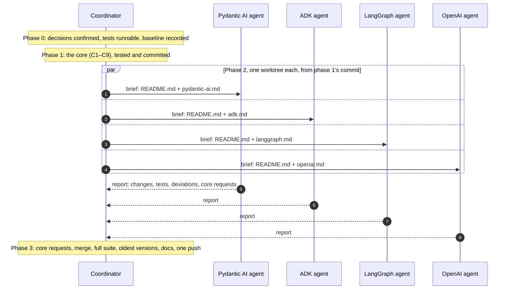
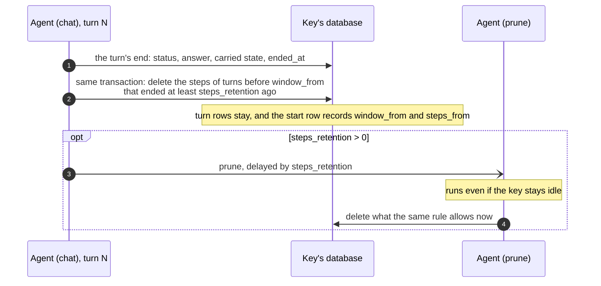

# Conversation storage: what we keep, for how long, and what each framework needs

> **Status:** a plan. Nothing in this folder is implemented yet. It was written on
> 2026-11-08 against PR restatedev/sdk-python#296 at commit `670445c`, and its line
> numbers refer to that commit.

This folder holds the research behind three changes to `restate.agents`, and the
plan for making them:

1. **Steps retention.** A turn's steps are its model replies, tool calls and tool
   results. Today they are kept until `clear`; with this change they are deleted
   once no model reads them any more. The transcript (each turn's prompt and
   answer) stays.
2. **Framework alignment.** Each supported framework needs certain state carried
   from one turn to the next. The research found gaps in our integrations, and
   this plan closes them.
3. **One bug found along the way.** When a user's ADK app has events compaction
   on, ADK re-sorts the session we build, and the events come out of order.

| File | What it holds | Who implements it |
| --- | --- | --- |
| `README.md` (this file) | the research summary, the idea, the shared core work, and how the parts connect | the coordinator (phases 0, 1 and 3) |
| [`pydantic-ai.md`](pydantic-ai.md) | Pydantic AI and Pydantic AI Harness | one agent (phase 2) |
| [`adk.md`](adk.md) | Google ADK | one agent (phase 2) |
| [`langgraph.md`](langgraph.md) | LangGraph and LangChain: the built-in agent, and `graph=` | one agent (phase 2) |
| [`openai.md`](openai.md) | the OpenAI Agents SDK | one agent (phase 2) |

## How to use this plan

The work runs in four phases. Only the coordinator touches shared files, in
phases 1 and 3. That lets the four framework agents of phase 2 run in parallel
without editing the same files.



## Where we are

PR #296 made the turn the unit of the conversation. The design is in
[`TURN-SEMANTICS.md`](../../TURN-SEMANTICS.md). Each key's database stores:

- `restate_agent_turns`: one row per turn, holding its prompt, its status, its
  answer, and what it carries to later turns (the agent after a handoff, ADK's
  session state);
- `restate_agent_items`: every other item of a turn (its *steps*), each tagged
  with its turn;
- a start row: the first position, the last `seq`, and the summary of the
  earliest turns.

Each turn, the model gets three things:

- the summary;
- the earlier turns, as their prompts and answers, as many as `budget` holds;
- the last `window` turns whole.

Today nothing is deleted except by `clear`, so the steps of every turn stay
stored, although the model never reads them again once the turn leaves the
window.

## The research

The work covered three open-source coding agents and the four frameworks we
integrate with:

- **Coding agents** (each one cloned and read at its latest commit):
  - Codex (`openai/codex`);
  - opencode (`anomalyco/opencode`, formerly `sst/opencode`, v2.2.5, plus v1.19.5
    for its old prune);
  - pi (`earendil-works/pi`, formerly `badlogic/pi-mono`).
- **Frameworks** (read from their latest wheels and docs):
  - Pydantic AI 2.66 and Pydantic AI Harness 0.66;
  - Google ADK 2.14;
  - LangGraph 1.2.20 and LangChain 1.4.9;
  - OpenAI Agents 0.24.0.

The framework details are in each framework's file.

### The coding agents

| | Codex | opencode v2 | pi |
| --- | --- | --- | --- |
| Storage | JSONL rollout per thread, projected into SQLite: `thread_turns`, `thread_items` | SQLite: an event log, projected into message and part rows | JSONL per session: a tree of entries (`id`, `parentId`) |
| A turn | a row: status, error, times, first user item, final answer item | none: an `idle` message ends it | none stored |
| Earlier turns, to the model | as stored, since the last compaction; tool output capped when recorded (10k tokens) | as stored, since the last compaction; tool output capped when produced (2,000 lines or 50 KiB) | as stored, from the compaction's first kept entry |
| Compaction | at 90% of the window: user messages (≤20k tokens) plus a summary, as a user message with a fixed prefix | at the window minus max(15%, 16k): a summary row, plus the last ~15k tokens as text | at the window minus 16k: an entry with the summary and the first entry kept (~20k tokens) |
| Old tool output | not cleared | v1 cleared it, opt-in (below); v2 removed that | not cleared; an appended `context_edit` can hide an entry from the model |
| Retention | rollouts kept; `history.max_bytes` trims only the prompt log | sessions kept; spilled tool-output files deleted after 7 days | sessions kept |
| A client sees | turns with `itemsView: full` or `summary` (first user message plus final answer) | every row, and a divider at a compaction | the compacted view; the raw entries over RPC |

What this tells us:

- **Codex's layout is ours.** Its `thread_turns` table holds status, error,
  times, and the ids of the first user item and the final answer. Its
  `thread_items` table holds each item's JSON, tagged with its turn and ordered.
  Its client protocol's `itemsView: summary` is our `view: "summary"`. Sources:
  `codex-rs/state/thread_history_migrations/0001_thread_history.sql` and
  `codex-rs/app-server-protocol/src/protocol/turn_items_view.rs`.
- **None of the three deletes the steps the model stops seeing.** Each keeps an
  append-only log, sends the model the history since the last compaction
  unchanged (which suits the provider's prompt cache), records a compaction by
  appending a marker, and deletes only whole sessions, when asked. Size limits
  apply only to side files, and to tool output as it is recorded.
- **The one precedent for clearing old tool output was opt-in, and is gone.** In
  opencode v1:
  - It left the last two user turns alone.
  - It kept the newest 40,000 tokens of tool output, and acted only if more than
    20,000 tokens could be cleared.
  - It marked older outputs as compacted but kept them stored, and the model saw
    "[Old tool result content cleared]".

  opencode v2 dropped it: `compaction.prune` is now an unsupported setting. pi's
  `context_edit` is an append-only way to hide an entry from the model, which its
  extensions can use.

### The frameworks

| | Its unit | A turn | Compaction | Deletes stored history | Should it dictate our layout? |
| --- | --- | --- | --- | --- | --- |
| Pydantic AI | a run's messages; a `Conversation` | none: a run | capabilities: the provider's, or the harness's | no: its store "only ever grows" | no: it is "deliberately unopinionated about your database" |
| ADK | events | `invocation_id` | an appended event; raw events kept | only whole sessions | no |
| LangGraph / LangChain | checkpoints (state snapshots) | none | `SummarizationMiddleware` rewrites the state | when that rewrites it; whole threads | no |
| OpenAI Agents | Responses items | a turn number (advanced session only) | the compaction session rewrites rows | when that rewrites them | no |

### What we take from it

1. **Keep the layout.** Turns are the record and items are the detail, which is
   Codex's choice too, and every framework's unit maps onto it.
2. **Frameworks dictate two things: the item format and what a turn carries.** We
   already store each framework's own items. What a turn must carry for the
   framework to continue differs per framework:
   - OpenAI Agents: the current agent;
   - ADK: the session state;
   - Pydantic AI: the on-demand capabilities that were loaded, which we don't
     carry yet.

   That work belongs to each framework's file.
3. **Deleting steps the model no longer reads is new ground for coding agents.**
   Frameworks that rewrite stored history do it when they compact. We delete when
   a turn leaves the window, because that is when our model stops reading its
   steps.

## The idea

**The rule.** A turn's steps are deleted once both of these hold:

- no turn's model reads them any more: the turn is before the window the next
  turn loads (`window_from`);
- the turn ended at least `steps_retention` ago.

The turn's row stays until `clear`: its prompt, status and answer, and what it
carries. Deleting steps therefore changes nothing for the model, which reads
earlier turns from their rows (`_conversation.py:955-970`). It changes nothing
for summaries either, which are written from the rows
(`_conversation.py:1194-1200`), nor for the summary view.

**The default.** `steps_retention = timedelta(0)`: steps go as soon as the turn
leaves the window. With `window=1`, the end of turn N deletes turn N−1's steps.
A UI that shows past tool calls sets a longer retention, such as
`timedelta(days=7)`. With `window="all"` nothing is deleted, because the model
reads everything.

**Who deletes.**

- **The end of every turn**, whether answered or closed, deletes what the rule
  allows. It does so in the transaction that stores the turn's end.
- **A private `prune` handler**, when `steps_retention` is more than zero. Each
  turn's end schedules it with a Restate delayed send. Without it, an idle key
  would keep its old steps past their retention; `prune` deletes them on time,
  and no process stays running while it waits.



**What clients see.**

- The full view shows a turn whose steps were deleted as its prompt and its
  answer, under the same ids as before. That is how the summary view already
  shows every turn.
- A follower keeps whatever it has already read.

**What retention does not reach.** These are documented, not solved here:

- **A LangGraph graph's own state.** The graph's latest checkpoint holds every
  message its state keeps (see [`langgraph.md`](langgraph.md)).
- **Each turn's Restate journal.** It keeps the turn's call results and database
  writes until `journal_retention` runs out.
- **Freed database pages** (C9).

## Decisions

**Taken:**

- **D1. No backwards compatibility and no migrations** (decided 2026-11-08).
  While #296 is unreleased, schema changes edit its `CREATE` statements. Once a
  version has been released, schema changes have to be new migrations appended
  after the existing ones, per the rule of `restate.sessions`
  (`python/restate/sessions/_schema.py`).
- **D2. Turns are the record; steps expire.** This is the rule above.
- **D3. Frameworks plug in through the hooks that already exist:**
  - `Items.summary(text)`, which is optional (`_conversation.py:233-278`);
  - `Turn.carry(agent=..., state=...)` (`_conversation.py:571-583`).

  Phase 1 adds no framework-facing API beyond the core contract below.

**Open.** These should be answered before phase 1; if one isn't, its
recommendation applies.

| | Question | Recommendation |
| --- | --- | --- |
| O1 | The default `steps_retention` | `timedelta(0)` |
| O2 | Should `chat`'s `journal_retention` default to at most `steps_retention`, so the journal's copy goes too? | No: document it. It is Restate's setting, and users opt in. |
| O3 | Expose `prune` to apps ("delete steps now")? | No: it stays private, like `compact`. |
| O4 | Pydantic AI's usage limits: per turn (today) or per conversation (what Pydantic AI does with `conversation=`)? | Per turn. See [`pydantic-ai.md`](pydantic-ai.md), P1. |
| O5 | A LangGraph graph's own state: document how to trim it, or add an opt-in helper that trims it? | Document now; a helper later, if asked. |
| O6 | Land this in #296, or in a follow-up PR on top of it? | Your call. #296 is already large, and approved by the review bot. |
| O7 | Should the TypeScript SDK (sdk-sessions) follow? | Out of scope here; decide after this lands. |

## Phase 0: preparation (coordinator)

1. Confirm O1 to O6.
2. Make the server tests runnable. They use Docker: `restate.harness` starts
   `ghcr.io/restatedev/restate:1.8.1` (`tests/support.py:7`). Without Docker:
   - install restate-server 1.8.1 from npm (`@restatedev/restate-server`);
   - run the tests with a pytest plugin that starts the harness's server as a
     local process instead of a container. #296 was tested with such a plugin,
     `restate_npx.py`, which lived in that session's scratch directory. Recreate
     it if it's gone; it takes `RESTATE_SERVER_BIN`.
   - Give every agent the plugin's directory and the binary's path.
3. Record the baseline: the pass count of
   `uv run --no-sync -m pytest tests/agents_*.py tests/examples_agents.py`. At
   `670445c` it was 490 passed and 1 skipped.

## Phase 1: the core (coordinator)

### C1. Schema

Changes to `SCHEMA` (`_conversation.py:122-160`), made in its `CREATE`
statements, per D1:

- **`restate_agent_turns.ended_at INTEGER`**: when the turn ended, in Unix
  milliseconds. `Turn.answered` writes it along with the status.
- **`restate_agent_conversation_start.window_from INTEGER`**: the first position
  of the window the next turn loads, as the latest turn's end computed it.
- **`restate_agent_conversation_start.steps_from INTEGER`**: steps before this
  position are deleted. It is NULL while none are.

The code around them:

- `Start` (`_conversation.py:282-290`) gets `window_from` and `steps_from`.
- `start_of` and `restart` read and write them.
- `next_start`, which `clear` uses through `erase`, resets both to NULL.

### C2. The option

- Add `STEPS_RETENTION = timedelta(0)` to `_common.py`, next to `WINDOW` and
  `BUDGET`.
- Add `steps_retention: timedelta` to `AgentOptions` (`_object.py:67-104`), with
  a docstring in the style of `window` and `budget`: "How long a turn's steps
  (the model's replies, tool calls and results) are kept once no turn's model
  reads them: once the turn is before the window. Defaults to 0. The turn's
  prompt and answer are kept until `clear`."
- `AgentObject.__init__` (`_object.py:236-261`) takes the option and rejects
  anything but a non-negative `timedelta`, as it checks `budget`
  (`_object.py:258-260`). It stores the value in `AgentInfo` (`_turn.py:123-132`).
- Every framework's `agent()` passes `AgentOptions` through, so the frameworks
  need no change for this. Phase 3 checks that.

### C3. The rule

This is a pure function in `_conversation.py`, next to `window_start`:

```python
def steps_cut(turns: Sequence[Entry], window_from: int, retention: timedelta, now_ms: int) -> int:
    """Return the position before which steps may be deleted.

    That is the position of the first turn, oldest first, that is at or after
    ``window_from``, has not ended, or ended less than ``retention`` before
    ``now_ms``. Deleting stops there, so what is deleted is always a prefix:
    one range delete.
    """
```

- `window_from` is computed from the transcript as the next turn will load it:
  `window_start(transcript, window)`, once the latest turn's status is set. That
  is what `Conversation._upcoming()` computes (`_conversation.py:923-934`), so
  share the code.
- Test it with a table: windows 0, 1, 2 and `"all"`; the statuses answered,
  cancelled, failed, refused, ended and running; retention 0 and 1 hour, with
  `ended_at` on both sides of it.

### C4. Deleting at a turn's end

`Turn.answered` (`_conversation.py:615-641`) is the one place every turn ends:

- answered;
- closed by `close`: cancelled, failed or refused;
- closed as ended: by `settle`, or by the next turn's `answer_once`.

Turn its single `UPDATE` into one transaction that does the following, in order:

1. Run the `UPDATE`, now also setting `ended_at`.
2. Compute `window_from` from the transcript, with this turn's status already set.
   - Use the window the conversation was loaded with. `_Ledger` gets `window` and
     `retention` fields, which `Conversation.load` sets.
   - That window is the one `answer_once` was given, so when a framework widens
     it, the widened window counts. LangGraph's `graph=` does this, through the
     per-call `whole`.
3. Compute `cut = steps_cut(...)`. If `cut` is past `start.steps_from`, run
   `DELETE FROM restate_agent_items WHERE n < ?` and set the start row's
   `steps_from = cut`.
4. Store the start row's `window_from`.

Keep `_Ledger.start` in step. Then add a second exception to the ownership rule
in TURN-SEMANTICS.md ("The turn model"): a turn's end may delete the steps of
earlier turns that retention allows. It never writes their rows.

### C5. The `prune` handler

All in `_object.py`:

- Add `"prune"` to `BUILT_IN` (`_object.py:150-166`) and to the docstring's list
  of reserved names (`_object.py:196-200`).
- Register it next to `compact` (`_object.py:544-545`):
  `agent.handler(ingress_private=True)(prune)`.

What it does, as `async def prune(ctx: SessionContext, _: Nothing = None) -> bool`:

1. Ensure the schema.
2. Read the start row.
3. Read `n` and `ended_at` of the turns from `steps_from` (or the first position)
   up to `window_from`.
4. Apply `steps_cut`, delete, and update `steps_from`.
5. Return whether it deleted anything.

It is idempotent, and it reads neither items nor the window size.

**Scheduling.** When `steps_retention` is more than zero, each turn's end sends
`prune` to the key:

- with `delay=steps_retention`, which `ctx.generic_send` takes
  (`python/restate/sessions/_api.py:217-224`);
- with the idempotency key `f"{prompt_id}:prune"`;
- next to the `compact` send (`_conversation.py:1123-1127`);
- also when the turn was closed, on the `TerminalError` paths of `_answer`
  (`_conversation.py:1157-1172`), so that every turn's end schedules one.

Like `compact`, it runs before the key's next queued message, and no process
stays running while it waits.

### C6. Loading

No change: steps inside the window are never deleted. The tests assert two
things:

- loading a pruned conversation reads no step before `steps_from`;
- `history()` is the same with and without pruning.

### C7. The full view

In `_messages.py`:

- **The answer of a pruned turn.** Today the full view renders a turn's answer
  from its step row (`_rows`, `_messages.py:112-116`). For a turn before
  `steps_from`, render it from the turn row instead, under `answered_at`, with
  `answered_seq`. The summary view already does that (`_summarized`,
  `_messages.py:168-183`), so share that code.
- **Cursors.** Deleting writes no `seq`, so `_since` (`_messages.py:119-133`)
  needs no change, and a follower keeps what it already read. Test two things:
  - a read from a cursor after pruning returns nothing new;
  - a fresh read shows pruned turns as their prompt and answer, with the same ids
    as before.
- **Optional, to decide in phase 1:** a `stepsFrom` field on `messages` pages,
  telling a client where the stored steps start. It would be an addition to the
  wire format, so nothing existing breaks.

### C8. Docs

TURN-SEMANTICS.md:

- "Words": steps retention.
- "What a turn stores": the new columns.
- "The turn model": the ownership exception.
- A new "Retention" section, with the diagram above.
- "What a client sees": pruned turns.
- "Guarantees and limits": what retention doesn't reach.

Elsewhere:

- The `AgentOptions` docstring.
- TESTING-AGENTS.md: a retention row in "The contract, per framework", filled in
  during phase 3.

### C9. Deletion beyond the tables

This work is independent of the rest, so it can run alongside phase 2.

- **The journal.** Each turn's Restate journal holds its call results and its
  database writes, until `journal_retention` runs out. Document that a deletion
  guarantee needs `journal_retention` no longer than `steps_retention` (see O2).
- **Freed pages.** Before storing a b-tree page, shared-core zeroes the space in
  it that no cell uses (`sdk-shared-core/src/sql/io.rs:101-107`). Whole pages
  added to the freelist have not been checked. Deleting a large tool output frees
  its overflow pages this way.
  - Write a test with a store implemented in Python (no VM): store a large unique
    value, delete it, checkpoint, then search every stored value for its bytes.
  - If they are found, open an issue on restatedev/sdk-shared-core (zero the freed
    pages, or support `secure_delete`), and note it in "Guarantees and limits".
  - Fixing it is not part of this plan.

### Core tests

Most of these run through the made-up framework whose items are plain dicts
(`agents_conversation.ITEMS`).

| Test | Module | What it checks |
| --- | --- | --- |
| The rule | `tests/agents_conversation.py` | the `steps_cut` table (C3) |
| A turn's end deletes | `tests/agents_conversation.py` | at window 1, turn 3's end deletes the steps of turns 1 and 2 and keeps every row; `steps_from` and `window_from` are set; the same holds when the turn is closed |
| Ended turns stay in view | `tests/agents_conversation.py` | turns a, then ended, then c: c's end keeps the ended turn's steps until an answered turn follows it |
| The model's input is unchanged | `tests/agents_conversation.py` | `history()` is the same with and without pruning, turn after turn (an oracle, as the crash sweeps use) |
| Retention | `tests/agents_conversation.py` | at 1 hour, a turn's end keeps the steps of turns that ended less than an hour ago |
| `prune` | `tests/agents_object.py` (server) | with `steps_retention=timedelta(seconds=1)`, steps before the window remain after the turn, and are gone a few seconds later with the key idle |
| Reserved name | `tests/agents_object.py` | registering a handler called `prune` raises `ValueError` |
| Full view | `tests/agents_messages.py` | pruned turns show as prompt and answer, with the same ids; cursors neither go back nor repeat; `clear` resets `steps_from` |
| Mutants | `scripts/resurrect.py` | each of these is caught: (1) the cut ignores `window_from`; (2) the delete removes turn rows; (3) `prune` ignores retention; (4) the full view loses its fallback |

## The core contract

Phase 2's agents may rely on the following:

- **Retention is automatic.** Frameworks call nothing. A framework's steps are
  deleted once their turn is before the window and older than `steps_retention`.
- **The window a framework passes to `answer_once` is the one retention
  honours**, because `window_from` is computed with it.
- **Earlier turns reach the model only from their rows.** `history()` gives them
  as `turn.item` (the stored prompt) followed by `items.reply(answer, agent)`. A
  framework must never depend on an earlier turn's steps outside its window.
- **`Items.summary(text) -> list[Item]`, optional, renders the summary in the
  framework's own form.** By default, the summary is a user message with
  `SUMMARY` and the text, followed by an "Understood." reply
  (`_conversation.py:269-278`).
- **`Turn.carry(state=...)` is one text slot per turn that the framework owns.**
  A turn that doesn't set it inherits the previous turn's (`_conversation.py:571-583`
  and `_conversation.py:631`). ADK uses it, and Pydantic AI may (see
  [`pydantic-ai.md`](pydantic-ai.md), P3).
- **"Without pruning", in the oracle tests,** means a `steps_retention` long
  enough that nothing is deleted, such as `timedelta(days=3650)`. There is no
  setting that turns retention off.
- **Tests can read the setting** through `AgentInfo.steps_retention` and
  `settings_of(ctx)`.

## Phase 2: the framework agents

**Rules:**

1. **Where to start.** Start from phase 1's commit, and work in your own git
   worktree (the Agent tool's `isolation: "worktree"`).
2. **What you may touch.** Only:
   - `python/restate/agents/<framework>/`;
   - your framework's tests, as your file lists them;
   - the "Status" line of your file.

   Never edit shared files: `python/restate/agents/_*.py`, `TURN-SEMANTICS.md`,
   `TESTING-AGENTS.md`, or this README.
3. **When you need a core change**, don't make it. Describe it in your report:
   what it is, why, and which test needs it.
4. **Every fix comes with a test** that fails without it. Run:
   - your framework's tests;
   - `uv run ruff format --check`, `uv run ruff check`, pyright and mypy, on what
     you changed, per directory, as the `Justfile` does.
5. **Versions.** The oldest version your extra allows must still pass. CI tests
   the oldest Pydantic AI and LangGraph (`.github/workflows/test.yml:36-91`).
   Detect newer APIs at run time instead of requiring them.
6. **Commits.** Commit in your worktree with clear messages, and don't push.
7. **Your report covers:**
   - the files you changed;
   - the tests you added, each confirmed to fail without its fix;
   - the results of the runs;
   - where you deviated from your file, and why;
   - the core changes you need;
   - open questions.

**The brief for each agent:**

> Implement `docs/conversation-storage/<framework>.md` in restatedev/sdk-python.
> Read `docs/conversation-storage/README.md` first: the core contract, the rules
> for framework agents, and how to run the tests. For server tests, use the
> plugin in `<plugin dir>` with `RESTATE_SERVER_BIN=<binary>`. Phase 1 is at
> `<commit>`. Do work items `<list>`; the decisions taken are `<O1–O6 answers>`.
> Report as the rules say.

## Phase 3: connecting the dots (coordinator)

1. **Core requests.** Read the four reports, and make any core changes they ask
   for on the core branch first.
2. **Merge.** Merge the worktrees one at a time, smallest first: OpenAI, ADK,
   LangGraph, Pydantic AI. There should be no conflicts outside docs. If there
   are any, the rules settle them: a framework owns its package.
3. **Checks across the frameworks:**
   - the full suite against a server: `uv run --no-sync -m pytest tests/*`;
   - the oldest Pydantic AI and LangGraph, installed as CI installs them
     (`uv pip install --resolution lowest-direct ...`,
     `.github/workflows/test.yml:51-91`);
   - `uv run ruff format --check`, `uv run ruff check`, pyright and mypy, per
     directory (`Justfile:15-37`);
   - `scripts/resurrect.py`: every mutant applies, and the new ones are caught;
   - framework against framework: one script (three turns, one tool call each,
     window 1, retention 0) gives the same `messages` full view in all four,
     apart from documented differences.
4. **Docs:**
   - TURN-SEMANTICS.md: C8, plus each framework's notes;
   - TESTING-AGENTS.md: the retention row;
   - the "Status" lines in this folder.

   Each framework's module docstring is its agent's job.
5. **Publish.** Push the commits to the branch in one push, and update the PR
   description, or open a new PR (see O6).

## Running the tests

- **Without a server:** `uv run --no-sync -m pytest tests/<module>.py -m "not server"`.
- **With a server:** Docker is the default. Without Docker:
  `PYTHONPATH=<plugin dir> RESTATE_SERVER_BIN=<restate-server> uv run --no-sync -m pytest -p restate_npx -q tests/<module>.py`.
- **Lint and types:** `uv run ruff format --check && uv run ruff check`. Run
  pyright and mypy per directory, as the `Justfile` does; mypy only works that
  way.

## Acceptance criteria

- **What is stored.** With the default settings and window 1, after turn N ends,
  the database holds steps only for:
  - turn N;
  - any turn being answered, or ended, after it.

  Every turn row stays.
- **The model's input** is the same with and without retention, for every
  framework. Oracle tests check this.
- **The views.** The full view shows pruned turns as prompt and answer, under
  unchanged ids. The summary view is unchanged, and cursors keep moving forward.
- **Idle keys.** With `steps_retention` above zero, an idle key's steps are gone
  within the retention plus the delay of the scheduled call.
- **The framework files.** Each framework file's acceptance criteria hold.
- **The checks.** The full suite, the oldest-version runs, lint, types and
  `scripts/resurrect.py` all pass.

## Risks

- **A framework that reads an earlier turn's steps outside its window.** None was
  found, and the oracle tests guard against one.
- **Clocks.** `ended_at` comes from the process's wall clock. Skew only shifts
  deletion by the amount of the skew.
- **One large delete.** The first turn end after retention is enabled on a long
  conversation deletes everything before the window at once. That is one range
  delete on the primary key; measure it on a conversation of 10,000 steps.
- **Expectations of a full history.** Clients that expect the full view to keep
  every tool call will see older ones go. The default makes this visible at once,
  and the docs must say so.
