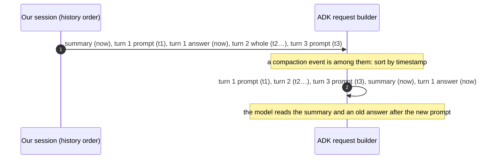

# Google ADK

> **Status:** not started. This plan is for one agent. Read
> [`README.md`](README.md) first: the core contract, the rules for framework
> agents, and how to run the tests.

## Scope

- **Package:** `python/restate/agents/adk/` (`_agent.py`).
- **Tests:** `tests/agents_adk.py`.
- **Versions:** the extra requires `google-adk>=1.20.0` (`pyproject.toml:30`).
  The venv has 1.20 installed, and the latest is 2.14. Where the two differ, say
  so in your report.

## What ADK expects

### Storage

- **`DatabaseSessionService`** (2.14, schema v1) has these tables
  (`google/adk/sessions/schemas/v1.py`):
  - `sessions`: app, user, id, state (JSON), and times;
  - `events`: id, app, user, session, `invocation_id`, timestamp, and
    `event_data` (JSON);
  - `app_states`, `user_states` and `adk_internal_metadata`.
- **One row per event.** Partial events, which stream, are not stored.
  `SqliteSessionService` has the same shape. In 1.20 each field of an event had a
  column of its own, and `actions` was pickled.
- **A turn is an invocation.** Every event carries the `invocation_id` of the
  `run_async` call that made it (`events/event.py`, `runners.py`). There is no
  turn row, status or answer.
- **What an integrator implements:** `create_session`, `get_session`,
  `list_sessions` and `delete_session`, and an override of `append_event`
  (`sessions/base_session_service.py`). Our `_Sessions` class does this
  (`adk/_agent.py:161-221`).

### Compaction

- **`EventsCompactionConfig`** on the `App` (`apps/_configs.py`) has two triggers:
  - a sliding window: after `compaction_interval` new invocations, it summarizes
    from `overlap_size` invocations back;
  - a token threshold, `token_threshold` with `event_retention_size`, which is
    new since 1.20.
- **The summary is a new event.** It has `author="user"`, and its
  `actions.compaction` holds the start and end timestamps of the range it covers.
  It is appended through the session service (`apps/llm_event_summarizer.py`,
  `apps/compaction.py`, `runners.py`).
- **Raw events stay.** In the runner's words, "Raw events remain persisted".
- **Building the request:**
  - it hides the events inside compacted ranges;
  - once any compaction event exists, it re-sorts all events by timestamp
    (`flows/llm_flows/context/_compaction.py`, `_process_compaction_events`; and
    `_contents.py`).
- **Context caching** reuses a Gemini cache of the prompt's prefix.
  `ContextFilterPlugin` trims only the request.

### Retention

- **`delete_session` is the only deletion.** Vertex sessions also take a TTL.
- **Rewind deletes nothing.** It appends events, with state deltas that reverse
  the earlier ones.
- **No API prunes events.**

## How `restate.agents` maps onto it

| ADK | `restate.agents` |
| --- | --- |
| a session | the conversation as `history()` gives it, rebuilt each turn (`_Sessions.session`, `adk/_agent.py:165-186`) |
| an event | an item |
| an invocation | a turn: one `run_async` |
| the session state | carried on the turn row (`turn.carry(state=json)`, `adk/_agent.py:188-192`), with the state deltas of the loaded turns applied after it |
| a compaction event | the built-in agent doesn't use one; our summary, kept in the start row, replaces it |
| `delete_session` | `clear` |

## Work items

### A1. A user's `events_compaction_config` puts the session out of order (bug)

**The cause:**

1. `_app` keeps the settings of a user's App (`adk/_agent.py:327-337`),
   `events_compaction_config` included.
2. ADK then appends compaction events, which our turn stores as items.
3. Once one of them is loaded, ADK re-sorts the session's events by timestamp.
4. Some events are made by `history()` on each load, and are stamped with the
   time they are made: the summary (`summary_items`), and each earlier turn's
   answer. That answer is `_Items.reply`'s `Event`, at `adk/_agent.py:133-135`.
5. After the sort, those events come after the turns they belong before.

**Reproduce it first.**
- **Setup:** an App with `EventsCompactionConfig(compaction_interval=1,
  overlap_size=0)` and a stub summarizer.
- **Run:** three turns.
- **Assert:** the contents ADK sends in turn 3 follow `history()`'s order.

This should fail today.

**The fix (recommended).**
- In `_app`, drop `events_compaction_config` from the App:
  `model_copy(update={..., "events_compaction_config": None})`.
- Log a warning the first time.
- Document that our summaries and window replace ADK's compaction, as they
  already do for the built-in agent.
- Check whether ADK 2.14's token-threshold compaction can run in the middle of an
  invocation. If it can, a user loses compaction within a long turn; say so in
  the docstring.

**The alternative, rejected:** stamping the events we make with their turn's
time. That keeps ADK's compaction, but leaves two summaries covering overlapping
turns: ADK's and ours.

**Tests:**
- the reproduction passes;
- the warning is logged once per process;
- the built-in agent is unchanged.

### A2. Retention

- **The state across turns.** At retention 0, the existing tests of "ADK state
  across turns" pass unchanged, at window 0 and at window 1.
- **A killed turn.** A turn is killed and closed as ended, the next turn answers,
  and the steps are pruned. The next turn's state is what it would have been
  without pruning. `_Sessions.session` takes the base state from the latest turn
  ADK answered, then applies the state deltas of the loaded turns.
- **The same requests.** Every model request is the same at retention 0 as with a
  retention long enough that nothing is deleted.
- **The full view.** Pruned turns show as prompt and answer, with ADK's events.

### A3. The summary's form

- **Keep the default:** a user event, then a model event saying "Understood."
- **Check whether Gemini needs it.** Gemini may expect alternating roles. Check on
  the oldest and the latest supported versions. If both accept consecutive user
  contents, consider a single user event, as the coding agents send their
  summaries, and explain the choice in your report.

### A4. Docs

Update the module docstring of `adk/_agent.py`:

- a user App's events compaction is turned off, and why;
- what retention means for ADK: state is carried on the turn row, and the steps
  of earlier turns go.

## Acceptance

- A1's reproduction fails before the fix and passes after it, on 1.20 and on the
  latest version.
- A2's tests pass.
- Nothing outside this file's scope changed.

## Out of scope

- Using ADK's session services (`DatabaseSessionService`, Vertex) for storage.
- Rewind.
- Context caching.
