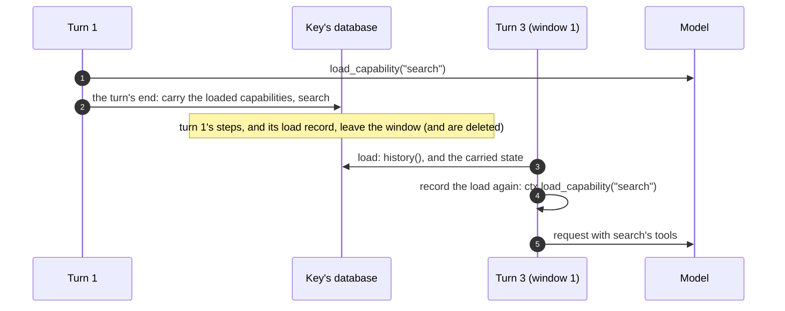

# Pydantic AI

> **Status:** not started. Being rewritten to lean on Pydantic AI Harness (README, D5). This plan is for one agent. Read
> [`README.md`](README.md) first: the core contract, the rules for framework
> agents, and how to run the tests.

## Scope

- **Package:** `python/restate/agents/pydantic_ai/` (`_agent.py`, `__init__.py`).
- **Tests:** `tests/agents_pydantic_ai.py`, plus the Pydantic AI cases in
  `tests/agents_output.py`.
- **Versions:**
  - The extra requires `pydantic-ai-slim>=2.0,<3` (`pyproject.toml:32`). CI tests
    the oldest version it allows (`.github/workflows/test.yml:70-91`).
  - The venv has 2.15 installed. The latest is 2.66.
  - Pydantic AI Harness (`pydantic-ai-harness`, 0.66) is not a dependency. Use it
    only in tests that skip when it isn't installed.

## What Pydantic AI expects

### Persistence

**Pydantic AI leaves the schema to the app.** Its persistence guide
(`docs/persistence.md`, v2.66) says:

> Pydantic AI is deliberately unopinionated about your database. It gives you a
> full-fidelity serialization boundary and leaves the schema to you … which
> table the history hangs off, which tenant column it needs, how long you keep
> it.

It also keeps storage and durability apart: "Reaching for a durable engine
because you wanted to store a chat thread is the common mistake".

**The unit is a `Conversation`** (`pydantic_ai/conversation.py`, 2.66).
- **What it holds:**
  - the messages;
  - the running `usage`;
  - the `conversation_id`;
  - the deferred tool requests a paused run is waiting on;
  - a `revision`, and a `new_message_index`.
- **How runs use it:** every run takes `conversation=` and returns
  `result.conversation`.
- **What `message_history=` loses:** it "still works, but carries only the
  messages". Without the rest, "every turn's UsageLimits budget starts over from
  zero", and the deferred requests "can't be recovered from the messages".

**Writes stay proportional to the turn.** For that, the guide recommends
appending each run's `new_messages()` (through `ModelMessagesTypeAdapter`), and
keeping `usage`, the id and the deferred requests beside them.

**`ConversationStore`** (`pydantic_ai/conversation_store.py`) does this for
you.
- **What it stores:** a log with one `ConversationEntry` per message, each linked
  to the one before it by `parent_id`. A `ConversationRecord` holds the head, the
  usage, the deferred requests, the scope, the branches and the revision.
- **How it saves:** `save` appends only the messages the store doesn't have. If
  compaction rewrote the history instead of extending it, the new messages branch
  off the last message both histories share. "The stored conversation only ever
  grows."
- **A SQL backend** implements five primitives: `read_record`, `read_records`,
  `write_record`, `delete_record` and `read_entry`.

**The harness's `StepPersistence`** checkpoints runs, not conversations. It saves
a snapshot at each settled tool boundary, so a run can be continued or forked.
Nothing resumes a step that crashed. Restate already gives us that.

**Nothing deletes a live conversation's messages.** `ConversationStore.delete`
removes a whole conversation.

### Compaction

**Provider compaction**, in the core:
- `AnthropicCompaction` (`pydantic_ai.models.anthropic`) and `OpenAICompaction`
  (`pydantic_ai.models.openai`).
- The provider's `CompactionPart` stays in the `ModelResponse` it arrived in. The
  adapters leave out what precedes it, when sending only.
- The docs warn: "Don't trim the stored history around compaction boundaries
  yourself".

**Compaction for any model**, in the core: `ProcessHistory` wraps a history
processor as a capability.

**Compaction strategies**, in the harness:
- Strategies: `ClampOversizedMessages`, `SlidingWindowCompaction`,
  `ClearToolResults`, `DeduplicateFileReads`, `SummarizingCompaction`,
  `RelevanceCompaction`, `TieredCompaction`, `FallbackCompaction`,
  `CompactOnRequest`.
- Helpers: `WarnNearLimits`, `ReportContextUsage`, `compact_now`, and pinning.
- Their edits "persist into the run's message history" (`ctx.messages[:] = …`).
- They count messages, tokens or tool-call pairs, never turns.

**A summary the app writes itself** goes in a request-side `CompactionPart`:
"put it in a `CompactionPart` with only `content` set, in a `ModelRequest` that
takes the place of the messages it summarizes". Every provider then receives it
as user-voice text inside `<conversation_summary>`, which is "how Claude Code,
Codex and OpenCode send their own summaries".

### On-demand capabilities

**A capability counts as loaded while its load record is in the history.**
"Pydantic AI counts an on-demand capability as loaded while the record of its
load is in the history after the latest compaction". The record is either the
model's `load_capability` exchange, or the `CapabilityLoadDeltaPart` that a load
from code (`RunContext.load_capability`) leaves. Any compaction part hides the
loads and tool discoveries before it.

**The harness records loads again after compacting.** After each summary it
appends a `CapabilityLoadDeltaPart`, then a `ToolAvailabilityDeltaPart`, so the
capability stays loaded (harness `compaction/README.md`, "On-demand capabilities
across compaction").

### Versions

Find the exact version that introduced each of these by bisecting the wheels on
PyPI.

| | 2.15 (installed) | 2.66 (latest) |
| --- | --- | --- |
| `agent.run(usage=...)` | yes (`agent/abstract.py:315`) | yes |
| `Conversation`, `ConversationStore`, `conversation=` | no (no `pydantic_ai/conversation.py`) | yes |
| `CompactionPart` | yes, for provider compaction | also request-side, for a summary the app writes |
| On-demand capabilities (the `load_capability` tool) | yes (`_deferred_capabilities.py`) | yes |
| `RunContext.load_capability`, `CapabilityLoadDeltaPart`, `ToolAvailabilityDeltaPart` | not found | yes (`_run_context.py:1041`, `messages.py:3537,3578`) |

## Pydantic AI's recipe for production, without Restate

Built from the persistence guide and the harness's compaction docs:

```python
from pydantic_ai import Agent, Conversation
from pydantic_ai.conversation_store import ConversationStore
from pydantic_ai_harness import ClearToolResults, SummarizingCompaction, TieredCompaction

agent = Agent("anthropic:claude-sonnet-5-5", capabilities=[
    # Or the provider's own compaction: AnthropicCompaction() / OpenAICompaction().
    TieredCompaction(tiers=[ClearToolResults(max_tokens=1, keep_pairs=3),
                            SummarizingCompaction(max_messages=1, keep_messages=20)],
                     target_fraction=0.8),
])

class SqlStore(ConversationStore):
    ...  # read_record, read_records, write_record, delete_record, read_entry

async def chat(store: SqlStore, conversation_id: str, prompt: str) -> str:
    conversation = await store.load(conversation_id) or Conversation(conversation_id=conversation_id)
    result = await agent.run(prompt, conversation=conversation)  # messages, usage, pending approvals
    await store.save(result)  # appends this run's messages; the store only ever grows
    return result.output
```

## How `restate.agents` maps onto it

| Pydantic AI | `restate.agents` |
| --- | --- |
| `ConversationStore`, or a table of messages | the key's database: a turn row per run and an item per message, written as each step comes |
| `store.load`, then `conversation=` | `Conversation.load`, then `message_history=conversation.history()` (`_agent.py:390-400`) |
| `store.save(result)` | our `_Restate` capability stores each response as it arrives, and each tool result by its call id (`_agent.py:221-265`). At the end it stores what `result.all_messages()` adds (`_agent.py:428`). |
| provider compaction | the built-in agent gets it (`_capabilities`, `_agent.py:349-361`), within a turn |
| harness compaction | an `Agent` of your own keeps its capabilities. We store the original messages, matching them by call id, and its summaries aren't stored. |
| a summary across runs | the summary from our `compact` handler, kept in the start row and rendered by `summary_items` |
| `StepPersistence` | Restate: each attempt resumes the turn from its stored steps |
| deferred tool requests | not carried: a run that stops for them fails its turn (`_agent.py:36-40`); use `wait_for_signal` instead |
| `usage` across runs | not carried (P1) |
| loaded on-demand capabilities | lost once the turn leaves the window (P3) |

## Work items

### P1. Usage across turns (decision Q1)

- **Today** `usage_limits` limits a single turn (`_run`'s docstring,
  `_agent.py:373-376`).
- **What carrying usage would change.** With `conversation=` or `usage=`,
  Pydantic AI's limits would cover the whole conversation. A `request_limit`
  would then eventually fail every turn of a long conversation.
- **Recommendation:** keep limits per turn, and change nothing now.
- **If Q1 says per conversation:**
  - carry the cumulative `RunUsage` in the turn's state, in P3's JSON;
  - pass it as `usage=`, which works on every supported version;
  - say so in the docstring.
  - Note that a retried attempt doesn't count the requests of the attempts before
    it.
- **Acceptance, if done:** with `request_limit=3`, two turns of two requests each
  fail on the second turn.

### P2. The summary as a request-side `CompactionPart`

- **Implement `summary(self, text)` on `_Items`** (`_agent.py:174`). Return
  `[ModelRequest(parts=[CompactionPart(content=text)])]` where request-side
  compaction parts are supported. Elsewhere, keep the default (a user message and
  "Understood.").
- **Find the version.** Look for the first Pydantic AI version that sends a
  request-side `CompactionPart` as `<conversation_summary>` text, by bisecting
  the wheels. Detect it by version, and document the version.
- **Check the adapters.** Every adapter our tests use should receive the summary
  as described: OpenAI Responses and Chat, Anthropic, Google, `FunctionModel` and
  `TestModel`. Per the docs, `FunctionModel` receives the part itself.
- **It interacts with P3.** A compaction part hides the capability loads recorded
  before it, so loads carried from earlier turns must be recorded after the
  summary.
- **Tests:**
  - the request after a summary starts with the summary, in the right form;
  - the views are unaffected, since they don't show summaries;
  - the oldest allowed version uses the default form.

### P3. Loaded on-demand capabilities across the window

- **The problem.** Pydantic AI counts a capability as loaded while its load
  record is in the history. Our window drops the steps of earlier turns, and with
  them their load records. A capability loaded two turns ago therefore unloads
  silently, and its tools leave the request.
- **Carry the loads.** At the turn's end, collect the names of the on-demand
  capabilities that are loaded, from the run's messages: `load_capability`
  returns and `CapabilityLoadDeltaPart`s. Store them as JSON in
  `turn.carry(state=...)`, as `{"capabilities": [...]}`, together with `usage` if
  P1 is done. Pydantic AI agents own this slot; only ADK uses it otherwise.
- **Restore them.** At the start of each run, record the carried loads after the
  earlier turns:
  - On 2.66, call `ctx.load_capability(name)` from our `_Restate` capability's
    first hook, before the first model request. Do it for each carried name that
    isn't loaded in the history already.
  - On older versions, either create the model's `load_capability` exchange
    yourself (a `ToolCallPart` and `ToolReturnPart` pair, typed in
    `_deferred_capabilities.py`), or leave this unsupported and document it.
    Choose after reading both versions.
- **The restored records must not be stored.** They carry no new tool-result
  ids, so `_Restate.store` should skip them (`_agent.py:237-247`); confirm it.
  That keeps them out of the views, and stops them piling up turn after turn.
- **Tests:**
  - an agent with an on-demand capability loaded in turn 1, at window 1: turn 3's
    model request still lists its tools;
  - the same after a summary, with P2;
  - on the oldest version, the behaviour you documented.



### P4. Working with the harness (verification only)

- **Test an `Agent` of your own:**
  - one that trims with `ProcessHistory`, which needs no new dependency;
  - one with `SummarizingCompaction`, if the harness is installed.
- **For both, check:**
  - the stored turn keeps every tool result, matched by call id;
  - compaction within a turn works;
  - across turns, the next run gets our `history()`.
- **Document:**
  - Don't add `StepPersistence`: Restate already makes runs durable.
  - `ConversationSearch` would need a `HistorySource` over our tables. That is a
    follow-up, out of scope here.

### P6. Docs

- Update the bullet list at the top of `pydantic_ai/_agent.py` (`_agent.py:36-62`):
  - the summary's form;
  - the carried capabilities;
  - the usage decision.
- Put any notes for TURN-SEMANTICS.md in your report. The coordinator writes that
  file.

## Acceptance

- P2 and P3 pass on the latest release.
- P4's checks pass.
- If Q1 chose conversation limits, P1's test passes.
- Nothing outside this file's scope changed.

## Out of scope

- Storing our conversation in `ConversationStore`, or carrying a `Conversation`
  as our state.
- Carrying deferred tool requests across turns: we keep failing the turn and
  pointing to `wait_for_signal`.
- `ConversationSearch` and `Memory`.
