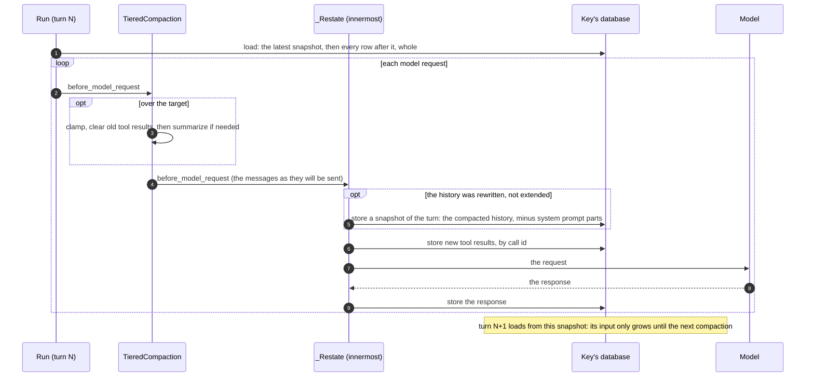
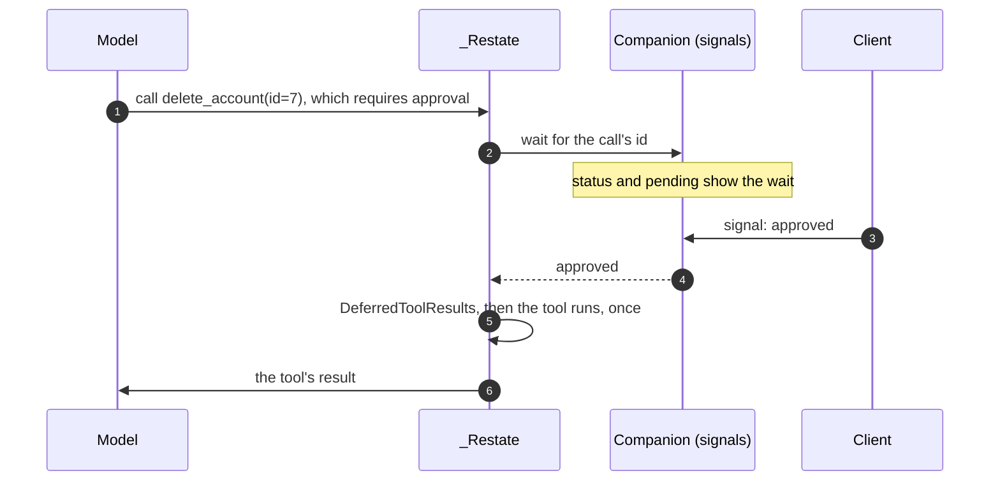

# Pydantic AI, on Pydantic AI Harness

> **Status:** done in phase 2, on branch `phase2-pydantic-ai` (from `88b3614`):
> P0 to P9, each with its tests. Deviations and core notes are in the agent's
> report. Read [`README.md`](README.md) first: the core contract, the rules for
> framework agents, and how to run the tests.

## Scope

- **Package:** `python/restate/agents/pydantic_ai/` (`_agent.py`, `__init__.py`).
- **Tests:** `tests/agents_pydantic_ai.py`, plus the Pydantic AI cases in
  `tests/agents_output.py`.
- **Versions:** only the latest releases (README, D4). Phase 1 moves the floor to
  `pydantic-ai-slim` 2.66, and adds `pydantic-ai-harness` 0.66 to the
  `pydantic_ai` extra.
- **Direction (README, D5):** where a harness capability does what our code does,
  use the capability, and have `restate.agents` supply what it needs.

## What Pydantic AI Harness is

`pydantic-ai-harness` describes itself as "the official capability library and
harness for Pydantic AI". Its releases come out with Pydantic AI's: 0.66 shipped
alongside 2.66.

- **What a capability is.** A capability is the plug-in unit of Pydantic AI 2.x:
  `Agent(capabilities=[...])`, or `agent.run(capabilities=[...])`. It is an
  object with hooks around a run's parts:
  - the run itself;
  - each model request;
  - tool validation and execution;
  - the output;
  - events;
  - deferred tool calls.

  Our integration is already one: `_Restate` (`_agent.py:221`) stores each
  response and tool result as it comes.
- **What the harness is.** A library of ready-made capabilities:
  - **Context:** compaction strategies, limits on tool output, warnings when the
    prompt cache breaks, and reports of how much context is used.
  - **Persistence and memory:** step persistence, conversation search, memory and
    planning.
  - **People and control:** asking the user, an approval reviewer, permissions,
    guardrails, loop detection and spend limits.
  - **Execution:** shell, filesystem, code mode, and sandboxes (Docker, E2B,
    Modal, and others).
  - **Integrations:** GitHub, Linear, Slack, Notion, web search and fetch, and a
    browser.
  - **Durable execution backends** (AWS Lambda, Azure Durable Task, and others),
    built on core's layer of durable operations.
- **How it plugs in.** A capability declares what it needs through a small
  protocol, such as a store or a history source. The app implements that
  protocol on its own storage.

There are two ways the harness can fit us:

1. **Capabilities that replace our code.** Compaction replaces our window, our
   budget, our `compact` summarizer, and the provider compaction the built-in
   agent gets.
2. **Capabilities that need what `restate.agents` already has:**
   - durable waits, for deferred tool calls;
   - the key's database, for plans and spilled tool outputs;
   - our turn tables, for conversation search;
   - session objects, for memory.

One part doesn't fit: the harness's durability layer (see "Not adopted").

## The research

Everything here was read in Pydantic AI 2.66 and Pydantic AI Harness 0.66, both
the source and the docs.

### Persistence

- **The schema is left to the app.** "Pydantic AI is deliberately unopinionated
  about your database … which table the history hangs off, which tenant column it
  needs, how long you keep it" (`docs/persistence.md`).
- **The unit is a `Conversation`.** It holds the messages, the running `usage`,
  the `conversation_id`, and the deferred tool requests a paused run waits on. A
  run takes `conversation=`, and `message_history=` "carries only the messages"
  (`pydantic_ai/conversation.py`).
- **Ids:**
  - When `conversation_id` is left out, a run takes the one on its message
    history, or else a fresh UUID7 (`agent/abstract.py:588-596`).
  - `run_id` is never inherited. Passing one that already appears on the message
    history raises `UserError`.
- **Compacted histories aren't stored by `ConversationStore`.** It "only ever
  grows" (`conversation_store.py:160-163`). A summary a capability writes carries
  no run id, so `new_messages()` leaves it out, and a store that appends run by
  run never keeps the summary. Each later run past the target therefore
  summarizes again (inferred from `_agent_graph.py`).
- **The harness's guidance is to store the head.** "A conversation head is
  separate from per-run checkpoints: it includes accepted prompts and between-run
  edits such as compaction. Do not reconstruct it by concatenating overlapping run
  snapshots" (`step_persistence/README.md:816-822`).

### Compaction

- **`TieredCompaction` is the recommended default**
  (`.agents/skills/pydantic-ai-harness/references/CONTEXT-MANAGEMENT.md:64-103`):

  ```python
  TieredCompaction(
      tiers=[
          ClampOversizedMessages(max_part_tokens=50_000),
          DeduplicateFileReads(file_key=file_key),  # for agents that read files
          ClearToolResults(max_tokens=1, keep_pairs=3),
          SummarizingCompaction(max_messages=1, keep_messages=20),
      ],
      target_fraction=0.8,
  )
  ```

  - Before each model request, if the estimated history is over its target, it
    runs the tiers in order, cheapest first, and stops once the history fits.
  - A tier's own trigger is ignored inside it, but must still be valid.
- **Edits persist.** They "persist into the run's message history"
  (`compaction/README.md:4-6`), as `ctx.messages[:] = compacted`. So
  `result.all_messages()` returns the compacted history (`run.py:1040-1055`).
- **The summary's form.** `SummarizingCompaction` writes its summary as a
  request-side `CompactionPart`, which every provider receives as user-voice
  `<conversation_summary>` text.
- **Loads survive summaries.** Summaries that remove the record of an on-demand
  capability's load record it again after the summary, so the capability stays
  loaded (`compaction/README.md:854-881`).
- **The context window:**
  - A `target_fraction` needs the model's context window: from the model's
    profile, else from genai-prices, else `context_window=`.
  - An unknown window falls back to 200,000 tokens (`compaction/_context_window.py`,
    `compaction/README.md:108-172`).
  - The harness estimates tokens itself, and doesn't read
    `ctx.context_window_used`.
- **Compacting between runs.** `compact_now(strategy, history, model=...)` runs a
  strategy outside a run (`compaction/README.md:241-277`).
- **A warning.** Don't stack provider compaction with harness summaries. A
  provider's `CompactionPart` is trimmed by its own adapter when sending, and
  other providers need the history before it (`docs/capabilities/compaction.md`).

### The durability layer

- **The protocol:**
  - A durable engine subclasses `BaseDurabilityCapability`
    (`durable_exec/_base.py:302`), with an `engine_spec`, `in_durable_context`, and
    a backend.
  - The backend implements either `CallableOperationBackend.execute(...)` or
    `RegisteredOperationBackend.register(...)` (`durable_exec/_operation_backend.py`).
  - Model requests, tool calls, MCP and events all go through it, as do
    capability methods marked `@durable_operation`.
- **It assumes a retry runs every operation again from the start, deterministically.**
  - Operations are told apart by the order they happen in, and the run id must stay
    the same across a replay (`docs/durable_execution/backends.md`).
  - Our attempts don't replay. They start from the steps already committed
    (TURN-SEMANTICS.md, "Attempts").
  - A stable run id raises `UserError` once the turn's stored messages carry it
    (`_agent_graph.py:430-443`).
  - Session handlers have no `ctx.run` (`python/restate/sessions/_api.py`).
- **Turning a durable context on disables harness features:**
  - background compaction raises;
  - `TrajectoryJudge` raises;
  - `SubAgents`' task control raises;
  - `Permissions` stops remembering approvals.

### Deferred tool calls

Core gives every capability a hook, `handle_deferred_tool_calls(ctx, *,
requests) -> DeferredToolResults | None` (`capabilities/abstract.py:1595-1619`).
It is called when a tool raises `ApprovalRequired` or `CallDeferred`, or when the
model calls a tool registered with `requires_approval=True`.

The harness builds on it:

- `AskUser` defers the call when it has no answerer;
- `ApprovalReviewer` passes on whatever it doesn't approve;
- `Permissions` uses it too.

### Stores and sources

| Capability | Protocol | Source |
| --- | --- | --- |
| `ConversationSearch` | `HistorySource`: `list_runs() -> list[RunRecord]`, sorted by `started_at`; `run_history(*, run_id) -> list[ModelMessage]`, the originals, without summaries | `conversation_search/_source.py:61-81`; `RunRecord` in `step_persistence/_types.py:131-149` |
| `Planning` | `PlanStore`: `get_items`, `set_items`, `get_item`, `add_item`, `update_item`, `remove_item` | `planning/_store.py:44-104` |
| `ToolOutputLimits` | `OverflowStore`: `write(key, data) -> handle`, `read(handle)` | `tool_output_limits/_store.py:37-58` |
| `Memory` | `MemoryStore`: `read`, `get_operation`, `write(..., expected_version, operation)`, `delete`, `list_paths`. The compare-and-swap, and its receipt, are atomic. | `memory/_store.py:209-246` |

More about each:

- **`ConversationSearch`** gives the model `search_conversation_history(query,
  run_id=None)`, ranked by BM25. Its default scope, `conversation`, needs the
  conversation id.
- **`Planning`** defaults to a fresh in-memory plan per run, which for us means
  per turn.
- **`ToolOutputLimits`** reduces a large result once. By default it spills the
  result to the store, leaving a handle and a preview, and the model reads the
  rest with `read_tool_result`.
- **What is keyed on the run id.** Some harness keys use the run id: memory
  operation ids, and spill keys. Our run ids change on every attempt.

### Prompt caching

- **`WarnOnCacheBusts`** warns when the cached prefix shrinks unexpectedly
  (`warn_on_cache_busts/README.md`). It would flag what we do today. These all
  rewrite a cached prefix without a `CompactionPart`:
  - dropping turn N−2's steps once turn N−1 leaves the window;
  - trimming the oldest turn to fit `budget`;
  - a new text summary.

  TURN-SEMANTICS.md already admits the cache misses this causes.
- **With history taken from the latest snapshot, the cache holds.** The input
  only grows between compactions.

### Turns

- **The harness has no notion of turns.** Its unit is the run, which is our turn.
- **Some state lives in the messages:**
  - capability loads, Skills' included;
  - tool-search discoveries;
  - pins;
  - lasting system reminders.

  With history from the latest snapshot, all of it stays until a compaction, and
  the harness records it again after one.

## The design

### History from the latest snapshot

**This replaces the window, the budget and `compact` for Pydantic AI.** A
snapshot is the history as the harness compacted it, stored in the turn by C2a.

- **What a run gets:** the conversation since the latest snapshot, whole, plus
  the new prompt. Before the first snapshot, that's the whole conversation.
- **Who compacts:** the harness's `TieredCompaction`, as recommended, in
  `before_model_request`.
- **Storing the snapshot.** When compaction has rewritten the history, `_Restate`
  stores the rewritten list as a snapshot of the turn, before the request goes
  out. The next run starts from it.
- **What clients see doesn't change:**
  - `messages` and `sync` show the original steps;
  - snapshots are for the model only, and never shown;
  - the summary view is unchanged.



**What changes for the earlier work items:**

- **The summary's form is done by the harness.** `SummarizingCompaction` writes a
  request-side `CompactionPart`.
- **Carrying capability loads is no longer needed.** Loads stay in the history
  until a compaction, and the harness records them again after it. Tool-search
  discoveries and pins behave the same way.
- **The provider cache holds between compactions**, and `WarnOnCacheBusts` should
  only fire at a compaction. Add a test that it stays quiet.

**What is removed for Pydantic AI agents:**

- `window` and `budget`. They don't apply to a Pydantic AI agent. Phase 1
  decided: they're ignored with `snapshots=True`, not rejected. Document it.
- The `compact` summarizer (`summarize=_summarizer(model)`, `_agent.py:684-695`).
- The provider compaction the built-in agent gets by default (`_capabilities`
  and `_compaction`, `_agent.py:327-362`).

**What is added:**

- **The default.** The built-in agent gets `TieredCompaction` as above, without
  `DeduplicateFileReads`, since it has no file tools.
- **An `Agent` of your own** (Q3, decided): if it has no compaction capability, it gets
  the same default, so its history stays bounded. If it has one, it runs as
  configured.
- **A `context_window` option** on the Pydantic AI `agent()` and `prompt()`,
  passed to `TieredCompaction`, for models whose window the registry doesn't
  know.
- **Optional: compacting off the answer's path.** After a turn's answer, if the
  history is near the target, the agent sends itself `compact`. That runs the same
  strategy through `compact_now`, and stores a snapshot. The next turn then starts
  already compacted, without waiting for a summary.

**Points to take care of:**

- **Order.** `_Restate` must run last in `before_model_request`, so that it sees
  the compacted messages. Use Pydantic AI's capability ordering.
- **Telling a rewrite from an extension.** Compare against the previous request.
  The start of a run rewrites the loaded history too, and that is not a
  compaction.
- **System prompts.** Strip `SystemPromptPart`s from snapshots, or
  `ReinjectSystemPrompt` stops reinjecting the system prompt.
- **Known results.** After loading a snapshot, the tool-result ids inside it are
  known (C2a). Otherwise `_Restate.store` stores them again.
- **Where to cut.** Only at our snapshots, never at a provider's
  `CompactionPart`.
- **Crashes.** A crash before the snapshot is stored means the history is
  summarized again. That costs a model call, nothing more.

### Durable human-in-the-loop: deferred tool calls

- **Implement `handle_deferred_tool_calls` on `_Restate`.**
  - For each deferred call (an approval, or a result from outside), open a
    companion wait with the id `<invocation>:<call id>`, as `wait_for_signal` does
    (C2c).
  - Suspend until a client resolves it with `signal`.
  - Map the value to `DeferredToolResults`: an approval, a denial with its
    reason, or the call's result.
- **What it makes work:**
  - tools registered with `requires_approval=True`;
  - `ApprovalRequired` and `CallDeferred`;
  - the harness's `AskUser` with no answerer;
  - `ApprovalReviewer`, for what it passes on;
  - `Permissions`.
- **What it replaces.** Today a run that stops for deferred calls fails its turn
  (`_agent.py:36-40`, `_agent.py:152-156`, `_agent.py:429-432`).
- **How it waits:**
  - No process is held while waiting.
  - A retried attempt joins the same wait.
  - `stop` forgets the waits, as it does for `wait_for_signal`.



### Stores that `restate.agents` provides

| Harness capability | Backed by | Effort | Value |
| --- | --- | --- | --- |
| `Planning` (`PlanStore`) | a table in the key's database, in this package's own `Schema` | S | the plan survives across turns, where today each run starts a fresh one |
| `ToolOutputLimits` (`OverflowStore`) | a table in the key's database, each row tagged with its turn | S | large outputs spill, and the model reads the rest when it needs it |
| `ConversationSearch` (`HistorySource`) | our turn rows and steps, one run per turn: `run_id` is the prompt id, and `started_at` is the turn's time (C2b) | M | the model can search the exact earlier prompts, answers and tool calls that compaction summarized |
| `Memory` (`MemoryStore`) | a session object per memory namespace, such as one per user, whose exclusive handler makes the compare-and-swap atomic | M | memory across a user's conversations, kept in `restate.sessions` |

- **Exactly once.** Harness keys built on the run id change on every attempt. Our
  stores therefore deduplicate on the id of the tool call that writes, taken from
  a context variable that `_Restate.before_tool_execute` sets. A retried attempt
  doesn't write twice.
- **`clear`** drops every table of the key, so plans and spills reset with the
  conversation. Memory lives on its own object, and outlives a conversation's
  `clear`; that is the point of it.

### Identity

- **Pass `conversation_id=f"{agent}/{key}"` to every run.** Today we pass none, so
  a turn may get a fresh UUID7. The conversation id is used by:
  - `ConversationSearch`'s scope;
  - `WarnOnCacheBusts`;
  - code mode's REPL store.
- **Keep a fresh `run_id` per attempt.** A stable one raises `UserError` once the
  turn's stored messages carry it.

### Not adopted, and why

- **The durability layer** (a Restate `BaseDurabilityCapability` and backend):
  - it assumes deterministic replay, while our attempts resume from committed
    state;
  - our run ids change on every attempt;
  - session handlers have no `ctx.run`;
  - turning it on disables harness features.

  Durability stays with `_Restate` committing each step.
- **`StepPersistence`.** Restate and our tables already make runs durable, and
  its conversation head is our snapshot.
- **`ConversationStore`.** Our tables are the store.
- **For later:**
  - `BackgroundTools`, and `SubAgents`' task control, need the process to stay
    alive. Our `subagent` tool already covers foreground subagents durably.
  - A `Spend` store, which would give a budget per conversation (Q1). Code mode's
    REPL store, and media.

### Usage limits (Q1, decided: per turn)

Keep `usage_limits` per turn. The harness's `Spend` capability, with a window per
conversation, is the way to budgets per conversation, later.

## Work items

| | Item | Effort | Needs |
| --- | --- | --- | --- |
| P1 | Identity: a stable `conversation_id` | S | — |
| P2 | History from the latest snapshot; `TieredCompaction` by default; `context_window` | L | C2a |
| P3 | Deferred tool calls become durable waits | M | C2c |
| P4 | A `PlanStore` over the key's database | S | — |
| P5 | An `OverflowStore` over the key's database | S | — |
| P6 | A `HistorySource` for `ConversationSearch` | M | C2b, P1 |
| P7 | Memory on a session object | M | — |
| P8 | Guards for older versions (D4) | S | — |
| P9 | Docs | S | — |

Do P1 first, then P2 and P3. P4 to P7 are independent of each other.

### P0. What the new releases broke (first)

Phase 1 moved the floor to the latest release, and 3 of this framework's
tests fail there, before any other change. The README's "Phase 1: what was
built" lists them, with the type errors. Fix them first, in this package (or
in its tests, where a test relied on how an older release behaved), and
report each cause. A cause in the core is a core request (rule 3).

### Tests

**P2, history from the latest snapshot:**
- A long conversation crosses the target. One snapshot is stored, and the next
  turn's first request starts with the summary and the kept tail.
- Between compactions, each turn's request starts with the previous turn's
  request: the cache oracle. `WarnOnCacheBusts` stays quiet.
- A crash after the snapshot is stored: the retry doesn't summarize again. A
  crash before: it summarizes once more.
- The views are unchanged: the full view shows the original steps, and no
  snapshot is rendered.
- An `Agent` of your own without compaction gets the default (Q3).
- A capability loaded in turn 1 is still loaded in turn 5, both before and after
  a compaction.
- No system prompt is stored in a snapshot, and `ReinjectSystemPrompt` still
  works.
- Tool results inside a snapshot are not stored again.

**P3, deferred tool calls:**
- A tool with `requires_approval=True`:
  - the turn waits, and `status` and `pending` show the wait;
  - `signal` with an approval runs the tool once;
  - a denial reaches the model;
  - a crash while waiting joins the same wait;
  - `stop` forgets it, and cancels the turn.
- `AskUser` without an answerer waits, then gets the answer.

**P4 to P7, the stores:**
- **P4:** a plan written in turn 1 is read in turn 2, and `clear` resets it.
- **P5:** a large output spills. `read_tool_result` reads it in the same turn and
  in a later one. A retried attempt writes it once.
- **P6:** search finds an exact tool result that a compaction summarized, and the
  runs are listed in order.
- **P7:** two conversations of the same user share memory. A conflicting write is
  refused. A retried write is applied once.

### P8. Guards for older versions (D4)

Remove the version detection that #296 needed, and any code kept only for older
Pydantic AI versions. List each removal in your report.

### P9. Docs

- Update the bullet list at the top of `pydantic_ai/_agent.py` (`_agent.py:36-62`):
  - history from the latest snapshot, and compaction by the harness;
  - deferred tool calls as durable waits;
  - the stores;
  - the conversation id.
- Put notes for TURN-SEMANTICS.md in your report: how a Pydantic AI agent's model
  input differs from the turn projection the other frameworks use.

## Acceptance

- P1 to P9 are done, and their tests pass on the latest releases.
- P2's cache oracle holds across three turns between compactions.
- Nothing outside this file's scope changed. Core needs go through C2.

## Later, with steps retention

- **Where the cut would be.** With history from the latest snapshot, retention's
  cut would be that snapshot, since no model reads the steps before it.
- **What deleting them would cost.** `ConversationSearch` reads those steps, so
  deleting them would lose the old tool details it can search. Decide that then.

## Out of scope

- `restate.ext.pydantic` (`RestateAgent`), which is outside sessions and agents.
- Storing our conversation in `ConversationStore` or `StepPersistence`.
- Carrying deferred tool requests across turns. P3 resolves them within the turn.
